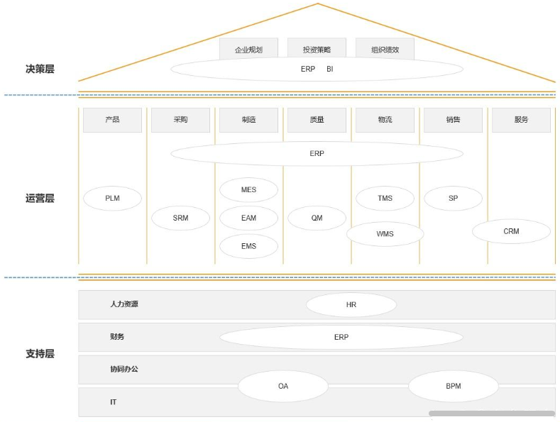

相关链接：

https://www.bilibili.com/video/BV1Ya4y1D7et/

http://tongtaisec.com/index.php?m=home&c=View&a=index&aid=72

https://baijiahao.baidu.com/s?id=1749617177819285326&wfr=spider&for=pc

https://baijiahao.baidu.com/s?id=1784676260883044933&wfr=spider&for=pc

https://blog.csdn.net/logic1001/article/details/146185272

# 总览

- 各种系统，主要根据服务对象的不同进行划分。

1、‌A端系统‌。

通常指开发者端（Developer端）或管理员端，是为程序员、开发人员或系统管理员提供的工具和平台。

这类系统主要用于软件开发、调试、部署和运维管理，如代码托管平台、服务器管理控制台、API开发工具等。‌

2、B端系统‌。

B端，即to business，这类平台、工具或软件专为企业或商家打造，旨在提升其运营效率。B端是为企业或商家设计的平台，通过提升效率、降低成本和风险来创造价值。它们通常依托于电脑软件，通过浏览器进行操作。

B端产品涵盖众多领域，如企业办公软件、HR及财务系统、物流供应链管理工具等。这些产品的共同目标是助力企业提升效率、节约成本并降低风险，协同工作是它们的显著特点。

3、C端系统‌。

指面向个人消费者（Consumer）的系统，是普通用户日常接触最多的互联网产品类型。其设计核心在于提升用户体验、强调感性和便捷性，如在线购物App、社交媒体平台、流媒体服务、移动支付工具等。‌

‌4、G端系统‌。

即政务端（Government端），专为政府机构和公共管理部门设计，用于提升政务服务效率和治理能力，如电子政务平台、智慧城市管理系统、税务申报系统等。‌

- 系统从技术架构角度进行分类。

1、OLTP系统‌（在线事务处理系统）。

用于实时处理日常业务交易，如订单录入、库存更新等，B端和C端的多数核心业务系统都属于此类。‌

2‌、OLAP系统‌（在线分析处理系统）。

用于对历史数据进行分析、挖掘和可视化，以支持决策，典型代表是BI系统（商业智能系统）。‌

- 系统在特定场景下的其它细分类型。

1、S端‌（服务端）。

在技术层面指服务器端，但在业务语境中有时模糊指代服务提供方（如平台商家端），其本质仍属于B端。‌

2‌、D端‌（开发者工具端）。

为开发者提供SDK、API、测试环境等工具的平台。‌

## B端系统

### ERP系统

- ERP系统（企业资源计划系统、Enterprise Resource Planning）。

ERP系统是一种用于管理企业各类资源的软件系统，包括生产管理、采购管理、库存管理、财务管理等功能模块，帮助企业实现资源的优化配置和管理。

核心模块：采购、销售、仓库、财务。

### BI系统

- BI系统（商业智能系统、Business Intelligence System）。

BI系统是一种用于数据分析和决策支持的软件系统，可以帮助企业从海量数据中提取有价值的信息，并进行分析、展示和预测，为企业决策提供支持和指导。

### DSS

- DSS（决策支持系统、Decision Support System）。

DSS是一种基于计算机技术和数据分析的决策支持工具，可以帮助企业进行决策分析和决策制定，提高企业的决策效率和决策质量。

DSS系统的主要功能包括数据收集、数据分析、决策模型和决策支持等。

### PLM系统

- PLM（Product Lifecycle Management、产品生命周期管理）是一种支持产品全生命周期信息创建、管理、分发和应用的应用解决方案。

根据CIMDATA定义，其覆盖范围包括企业内部及协作企业间的集成管理，涉及人力资源、流程、应用系统和信息资源的整合。

- PLM系统。

PLM系统通过统一数据模型实现产品设计、工艺路线、质量检测等数据的全生命周期管理，支持BOM结构管理、工程变更管理、文档管理等功能模块。系统集成主流CAD软件及ERP、MES等管理系统，形成设计到生产的全流程数据闭环，并通过数字主线技术实现跨部门协同与数据追溯。在实施层面，PLM采用关系型数据库与NoSQL混合架构，内置可视化工作流引擎，支持云端与本地双轨部署。

核心模块：产品构型、产品研发管理、文档管理。

PLM概念起源于制造业信息化需求，早期应用集中于工程数据管理领域。随着云计算、人工智能等技术发展，国产化PLM系统逐渐融合大数据、工业互联网等技术，形成覆盖需求-设计-工艺-制造-服务的全生命周期解决方案。国际厂商主导的高端市场与国内厂商深耕的行业应用共同推动PLM向平台化、生态化方向演进。

### SRM系统

- 供应商关系管理（SRM）是用来改善与供应链上游供应商的关系的，它是一种致力于实现与供应商建立和维持长久、紧密伙伴关系的管理思想和软件技术的解决方案，它旨在改善企业与供应商之间关系的新型管理机制，实施于围绕企业采购业务相关的领域，目标是通过与供应商建立长期、紧密的业务关系，并通过对双方资源和竞争优势的整合来共同开拓市场，扩大市场需求和份额，降低产品前期的高额成本，实现双赢的企业管理模式。

- SRM系统（供应商关系管理系统、Supplier Relationship Management）。

SRM系统是面向供应链前端，用来改善主机厂与其供应链上游供应商关系的系统，旨在改变主机厂传统的供应商管理模式，建立双方合作共赢的战略伙伴关系，并通过信息手段控制优化双方之间的信息流、物流和资金流，降低主机厂采购成本和服务成本，增加客户的价值以及提高公司的利润率。

核心模块：供应商、采购订单。

### SCM系统

- SCM系统（供应链管理系统、Supply Chain Management）。

SCM系统是一种用于管理供应链的软件系统，包括采购管理、供应商管理、物流管理、库存管理等功能模块，帮助企业实现供应链的协同和优化。

### SCRM系统

- SCRM系统（社交客户关系管理系统、Social Customer Relationship Management System）。

SCRM系统是一种基于社交媒体的客户关系管理工具，可以帮助企业通过社交媒体与客户进行互动和交流，提高客户满意度和忠诚度。

SCRM系统的主要功能包括社交媒体监测、社交媒体管理、客户服务和客户分析等。

### MES

- MES（生产执行系统、制造执行系统、Manufacturing Execution System）

MES是一种用于管理制造过程的软件系统，包括生产计划管理、生产调度管理、工艺管理、质量管理等功能模块，帮助企业提高生产效率和质量水平。

MES是企业信息化系统的重要组成部分。MES定义为“位于上层的计划经济管理进行系统与底层的工业企业控制环境之间的面向车间层的管理会计信息技术系统”，它为操作工作人员或管理研究人员可以提供计划的执行、跟踪以及所有资源（人、设备、物料、客户服务需求等）的当前状态。目的是解决工厂生产活动过程的黑匣子问题，实现公司生产经营过程的可视化、可控化。

MES系统是数字化车间的核心。MES通过数字化生产活动过程可以控制，借助自动化和智能化技术教学手段，实现车间制造成本控制智能化、生产经营过程透明化、制造装备数控化和生产产品信息集成化。车间MES主要内容包括车间管理会计系统、质量风险管理研究系统、资源环境管理操作系统及数据采集和分析软件系统等，由技术创新平台层、网络层以及相关设备层实现。

MES就像是制造企业的大脑，通过对工厂资源的全面控制和优化配置，使企业生产过程更加高效、透明化。

核心模块：工厂建模、设备管理、生产管理、质量管理、物料管理。

- MES系统由车间资源管理、生产任务管理、车间计划与调度管理、生产过程管理、质量过程管理、物料跟踪管理、车间监控管理、统计分析等部分组成，涵盖了生产现场管理。

1、MES 是一个可定制的制造管理系统，可以现场定义不同企业的工艺流程和管理要求。

2、系统从底层数据采集开始，到过程监测和在线管理，一直到成本相关数据管理，构成了完整的生产信息化体系。系统各功能模块提供了由底层接近于自动化系统的监控过程逐渐过渡到成本管理的经营层，可以满足企业在信息化生产管理领域不同规划阶段的要求，在继承的基础上实现信息化过程的平稳过渡、逐步提高。

- MES主要负责与生产过程连接，是实现企业综合自动化的关键环节的企业信息系统。MES通过控制包括物料、设备、人员、流程指令和设施在内的所有工厂资源，MES提高了制造竞争力，确保整个生产行为的特最别优是。

1、在化工、冶金等流程工业中，将各种不同的自控系统联网，自动采集生产过程的数据实现企业的生产信息集成，建立全厂范围的实时和历史数据库，是企业实现MES生产管理系统应用最关键、最核心、也是最基础的任务。

2、在功能上，MES不仅提供了工艺管理、计划管理、生产管理等核心功能，MES更在生产执行过程中提供了实时反馈和预警，使企业的生产过程更加透明化。通过数据采集、手工报工等多种方式，MES能够实时反馈出车间订单的生产进度，管理者坐在办公室就能看到某个订单的生产情况。同时，在生产过程中出现的质量问题，MES也能进行记录并形成数据报表，进行分析和预警，确保不良品不能离开车间进入销售环节。

- 在发达国家，MES已经得到了广泛的应用和作推为广介。于ERP（企业资源计划系统）和自控系统（如DCS、PLC等）之间的系统，MES发挥着管控一体化的桥梁作用。

### MOM系统

- MOM系统（制造执行系统、Manufacturing Operations Management System），也称为MES，是一种用于管理和监控制造过程的信息系统。

MOM系统主要用于实时监控和控制生产过程，以提高生产效率、质量和可靠性。它与企业资源计划（ERP）系统和自动化控制系统（ACS）相互衔接，实现生产计划的执行和生产数据的采集与分析。

- MOM系统的主要功能包括：

1. **计划与调度**：根据订单和生产计划，制定生产任务和生产调度计划，并进行资源分配和排程。
2. **生产过程控制**：通过监控和控制设备、工艺参数等，确保生产过程的稳定性和一致性。
3. **数据采集与分析**：实时采集和记录生产数据，包括设备状态、产量、质量等，用于分析生产效率和质量问题，并进行持续改进。
4. **质量管理**：跟踪和记录生产过程中的质量数据，进行质量检验和控制，确保产品符合质量标准和客户需求。
5. **追溯与溯源**：追踪和记录产品的生产过程和原材料的来源，以实现产品的追溯和质量追溯。
6. **工艺管理**：管理和维护产品的工艺路线和工艺参数，确保生产过程的一致性和可控性。
7. **资源管理**：管理生产所需的人力、设备、物料等资源，进行资源调度和优化，提高资源利用率和生产效率。
8. **报表与分析**：生成各种生产报表和分析报告，帮助管理层进行决策和优化生产过程。

总之，MOM系统通过集成和优化生产过程的各个环节，实现生产过程的实时监控、数据采集与分析、质量管理等功能，提高生产效率和质量，降低生产成本，提升企业的竞争力和可持续发展能力。

- MOM系统在生产过程中的作用：

1. **生产计划与调度：**MOM系统可以根据订单和生产计划，制定生产任务和生产调度计划，并进行资源分配和排程。它可以帮助企业有效地安排生产资源，提高生产效率和交货准时率。
2. **生产过程控制**：MOM系统通过监控和控制设备、工艺参数等，确保生产过程的稳定性和一致性。它可以实时监测生产设备的状态和运行情况，及时发现并处理异常情况，避免生产事故和质量问题的发生。
3. **数据采集与分析：**MOM系统可以实时采集和记录生产数据，包括设备状态、产量、质量等。它可以对生产数据进行分析和统计，帮助企业了解生产过程的效率和质量情况，发现潜在问题并进行持续改进。
4. **质量管理：**MOM系统可以跟踪和记录生产过程中的质量数据，进行质量检验和控制。它可以帮助企业实施质量管理措施，确保产品符合质量标准和客户需求，提高产品质量和客户满意度。
5. **追溯与溯源：**MOM系统可以追踪和记录产品的生产过程和原材料的来源，实现产品的追溯和质量追溯。它可以帮助企业追溯产品的生产批次和工艺参数，快速定位和处理质量问题，提高产品质量和安全性。
6. **工艺管理**：MOM系统可以管理和维护产品的工艺路线和工艺参数，确保生产过程的一致性和可控性。它可以帮助企业优化生产工艺，提高生产效率和产品质量。
7. **资源管理：**MOM系统可以管理生产所需的人力、设备、物料等资源，进行资源调度和优化。它可以帮助企业合理安排资源使用，提高资源利用率和生产效率。

- MOM系统与可视化大屏有密切关联，可以通过可视化大屏展示MOM系统中的实时数据和生产情况，以及进行生产过程的监控和管理。

### TMS

- TMS（运输管理系统、Transportation Management System）。

TMS是一种用于运输管理的软件系统，可以帮助企业实现运输计划制定、运输调度、运输跟踪、运输成本控制等方面的业务流程自动化，提高运输管理效率和质量。

核心模块：汽车管理、货物追踪、运输派遣。

### WMS

- WMS（仓库管理系统、Warehouse Management System）。

WMS系统是一种用于管理仓库的软件系统，包括入库管理、出库管理、库存管理、配送管理等功能模块，帮助企业提高仓库管理效率和准确性。

核心模块：出库、入库、库存、盘存。

### CRM系统

- CRM系统（客户关系管理系统、Customer Relationship Management）。

CRM系统是一种用于管理客户关系的软件系统，包括客户信息管理、销售管理、客户服务管理等功能模块，帮助企业提高客户满意度和市场竞争力。

核心模块：客户、销售订单。

### OMS

- OMS（订单管理系统、Order Management System）。

OMS是一种电子商务系统，主要用于管理订单、库存、物流和客户服务等方面的业务流程。

核心模块：订单。

OMS系统可以帮助企业实现订单的自动化处理、库存管理、物流跟踪和客户服务等功能，提高订单处理效率和准确度，降低企业的运营成本，提高客户满意度。

### APS系统

- APS（高级计划与排程、Advanced Planning and Scheduling）是解决生产排程和生产调度问题的技术，常被称为排序问题或资源分配问题。其主要目标是对供应链中某一指标（如设备资产回报率ROA）进行总优化，核心是久经磨练的数学算法或解决方案。

APS分为供应链级和工厂级两类。

- APS系统（高级生产计划与排产系统、高级计划系统）。

高级计划系统（企业管理运营系统、Advanced Planning System）是基于供应链管理与约束理论的企业管理运营系统，通过数学模型与智能优化算法整合企业内外部资源约束，生成涵盖战略、战术及操作层面的供应链计划，并为客户提供精确交货承诺。

该系统以供应链网络为规划范畴，集成物料、生产能力等多维度约束条件，实现多源信息共享与有限产能计划优化。

APS系统介于ERP系统与MES系统之间，接受ERP系统下达的订单后，在有限产能与工艺约束条件下完成生产作业排。其功能覆盖需求预测、动态调度、资源配置优化，并通过集成高级算法、人工智能（AI）、机器学习（ML）、物联网（IoT）等技术实现实时监控与智能决策支持。

核心模块：生产计划。

- 趋势与展望。

1、20世纪50年代起数学方法开始应用于生产计划优化。

60年代中期，IBM开发了基于产品结构分解的MRP系统。

80年代初，轮胎制造商Kelly Springfield和烟草公司Philip Morris开始应用计划和排程系统。80年代，MRPⅡ形成生产计划与资源管理集成框架。

90年代ERP系统局限性推动APS系统诞生，约束理论与线性规划技术突破催生基于内存运算的APS引擎，使数学解析计划方法进入实用阶段。

2、APS的发展已走过四代算法，最新第四代是智能算法融合人工智能动态调整算法，以智能算法进行静态排程，以多Agent代理协商进行分布计算动态调整。

3、APS的核心是数学算法或解决方案。在数字化经济中，APS的发展呈现多元化趋势，其中一个趋势是与ERP、MES更加紧密结合。

4、尽管APS具有强大的功能，非常适合于供应链整体计划问题的解决，但在企业管理实际中，APS应用仍然存在需要解决的问题。如APS功能的发挥主要在供应链管理上，而企业的供应链管理若处于初级阶段，竞争意识模糊，则APS难以找到适用场景。企业内部信息化基础数据、流程、计划体系薄弱也会影响应用。

5、APS的运行需要有ERP、MES、PLM等系统提供的数据支持。此前，很多APS项目实施效果不佳的原因大多是因为没有MES帮助APS实现闭环和滚动排产，导致计划兑现率较差。

6、尽管如此，随着市场对大规模个性化定制需求的增加，APS逐渐成为离散制造行业智能工厂的重要组成部分。在一些行业，如按照分组加工的烟草行业、大规模个性化生产的汽车和家电行业，人工已很难基于经验进行计划的编制工作。

7、在一些行业应用中，APS系统能够帮助企业实现柔性生产与快速响应，处理多品种、小批量订单，缩短交货周期。同时，将APS与MES、企业数据平台集成，有助于推动管理决策从经验驱动向数据与模型驱动转变。

8、随着个性化需求逐渐成为市场主流需求，APS在我国的应用预计将进入更为广泛的实施阶段，成为智能工厂的指挥中心。

### HRM系统

- HRM系统（人力资源管理系统、HRMS、Human Resource Management）。

HRM系统是一种用于管理人力资源的软件系统，包括招聘管理、培训管理、绩效管理、薪酬管理等功能模块，帮助企业提高员工满意度和管理效率；可理解为管理“人才”以实现战略。

HRM系统‌是一个‌更广泛、更战略性的概念‌，它不仅包含HR系统的所有功能，还强调‌将人力资源管理与企业整体战略相结合‌，通过数据分析和系统化管理来优化人才配置、提升组织绩效。

- HR系统（人力资源系统、Human Resources System）。

HR系统‌通常指代‌人力资源管理系统‌或‌人力资源信息管理系统‌（HRIS），其核心是‌信息化和自动化处理日常人力资源事务‌；可理解为管理“人”的事务。它是一个基础的、操作性的平台，主要用于提升人事部门的行政效率，目标‌是取代手工操作和Excel表格、减少行政错误、提高基础人事工作的效率和准确性。 

HR系统是信息一体化中的重量级系统，系统模块包含：组织架构，人事管理，薪酬管理、假勤管理、招聘管理、培训体系、绩效管理。

核心模块：组织、招聘、考勤、培训、绩效、薪酬。

核心功能‌：员工信息管理（电子档案）、考勤管理、薪资计算与发放、基础招聘管理（职位发布、简历收集）、基础培训记录、社保公积金缴纳等。

- 金蝶s-HR系统（sHR人力资源管理系统）。

1、在人力资源管理领域，“s-HR系统”通常特指‌金蝶s-HR‌。

2、对集团进行统一规范化管理，系统包含组织模块、员工管理、假期管理、考勤管理、薪酬管理、招聘管理、培训管理、绩效管理、员工自助等模块。

3、责任描述：项目中，主要负责协助项目经理参与需求沟通及方案确定，根据需求设计相关的功能开发和测试等工作。

4、每个模块基本都是由列表和表单组成。列表里显示的是单据，也就是表单，一般都具备四个功能（创建、删除、撤回、反审批）；表单一般都具备两个功能（保存、提交生效）。

5、员工们可通过SHR系统实现自助快捷办公员工，更加快捷的查询到组织架构、人事档案、薪水绩效，线上实行请假、加班、调休、考勤查询。

### OA系统

- OA系统（办公自动化系统、OAS、Office Automation System）。

OA系统是一种用于协调、管理和优化办公流程的软件系统，包括电子邮件、日程安排、文档管理、工作流程管理等功能模块，帮助企业提高工作效率和管理水平。

OA系统是利用技术的手段提高办公的效率，进而实现办公自动化处理的系统。

核心模块：入职、升职、离职、请假、出差、用章。

办公自动化系统具有开放性、易用性、健壮性、严密性和实用性五大特性。办公自动化系统主要面向组织中的业务管理层，为各种类型的文案工作提供支持，通过应用信息技术，支持办公室的各项信息处理工作，协调不同地域之间、各职能间和各信息工作者间的信息联系，提高办公活动的工作效率和质量。

### BPM系统

- BPM，一般指业务流程管理，是一种以规范化的构造端到端的卓越业务流程为中心，以持续的提高组织业务绩效为目的的系统化方法。

- BPM系统（业务流程管理系统、BPMS、Business Process Management System）是一种基于软件的业务流程管理工具，可以帮助企业对业务流程进行建模、优化、执行和监控，提高企业的业务效率和管理水平。

BPMS系统的主要功能包括业务流程建模、流程优化、流程执行和流程监控等。

BPM系统通过对端到端业务流程进行建模、分析和优化，实现战略业务目标，其核心特点是注重流程驱动，实现全流程信息化管理。‌

### KMS

- KMS（知识管理系统、Knowledge Management System）。

KMS是一种用于管理知识资源的软件系统，包括知识库管理、知识分类和标签、搜索引擎、协作与分享等功能模块，帮助企业提高知识管理和利用效率。

### CMS

- CMS（内容管理系统、Content Management System）。

CMS是一种用于管理网站内容的软件系统，可以帮助网站管理员快速、方便地创建、编辑、发布和管理网站内容，如文章、图片、视频等。

### PMS

- PMS（项目管理系统、Project Management System）。

PMS是一种用于项目管理的软件系统，可以帮助项目经理和团队成员实现项目计划、进度管理、任务分配、团队协作等方面的业务流程自动化，提高项目管理效率和质量。

### DES系统

- DES（数据加密标准、Data Encryption Standard），是一种使用密钥加密的块算法，1977年被美国联邦政府的国家标准局确定为联邦资料处理标准（FIPS），并授权在非密级政府通信中使用，随后该算法在国际上广泛流传开来。

- 文档智能加密系统（DES）。

文档智能加密系统以业界领先的高强度加密技术，通过管理与技术两种手段，“事前预防、事中可控、事后可查”三阶段防泄密解决方案，完善单位数据资产安全管控体系，在有效防止企业核心信息资产外泄的同时，丝毫不影响用户工作习惯及业务效率。

- 功能和效果。

1、智能透明加密。

采用应用层和驱动层相结合的加密技术，集应用层的安全性与驱动层的稳定性于一体，实现对任意文档智能透明加密，毫不改变用户使用习惯。

2、文档安全域管理。

根据文档流转范围，对文档分域管理，确保文件在特定范围内使用，防止核心数据信息泄露。

3、自定义审批流程。

支持多业务、多级、指定代理审核人、会签、非会签等各类自定义审批流程，保证审批机制切实可行、高效便捷。

4、系统日志审计。

系统提供完整的日志管理，可对所有加密文档的所有操作进行详尽的日志审计，并对审计日志提供查询、导出、备份及数据报表等支持。

5、身份认证集成。

系统支持与基于 Ldap 和 OpenLdap 协议的统一身份认证平台进行无缝集成，实现组织架构及账号信息自动完整同步。

6、差异化的反截屏控制。

可防止当前市场上所有截屏软件进行截屏操作，防止客户端通过截屏进行数据泄密。保护涉密内容无法被截屏泄密，非涉密内容可正常截屏。

7、窗口浮水印。

支持屏幕水印、窗口水印、截图水印；支持图片水印、文字水印、动态水印、二维码水印和点阵水印；涉密文档即使被拍照泄露，也带有版权信息、拍照时间、终端信息、用户等信息。

8、文件打印快照。

支持打印权限管理；支持打印机管理；支持打印水印管理；支持打印时文件快照上传，防止用户打印时通过伪装文件名打印，躲避审计。

9、客户端自我防护。

提供客户端安装目录保护及进程保护，实时在线监控客户端状态，杜绝用户卸载客户端后进行非法操作。

10、移动介质管控。

通过对移动介质进行注册管理，确保非可信移动介质进不来、可信移动介质拿不走、非法获取可信移动介质数据读不了，全方位保障企事业单位核心数据安全。

11、DLP管理。

加密从源头对重要数据进行全生命周期管控，dlp通过深度内容识别智能化和智能分析发现重要数据，阻断拷贝、打印、刻录、共享传输，IM/邮件/HTTP网络外发等行为，上报到管理平台，两者互为补充，做到业务效率和数据安全的有效平衡。

12、数据分级分类。

通过深度内容识别智能化和智能分析发现，通过正则表达式、关键字、语义分析等技术，依据相关法律法规及单位定义规则对数据进行分级分类。

13、离线办公支持。

充分考虑出差等各类离线办公等因素，可通过策略预设以及离线补时功能满足各类离线办公需求。

14、系统集成拓展。

可与华途文档安全网关、数据安全中间件等系统整合，实现对企业应用系统的安全集成及对核心数据载入载出的安全保护。

15、自动更新。

支持客户端模块自动下发更新，降低企业管理运维工作量。

- 产品优势和特色。

1、加密安全可靠。

加密算法：同时支持国密SM4算法，国际AES算法，密码强度有保障。

加解密技术：将驱动层与应用层技术相结合，兼顾纯驱动层或应用层加密优势，可有效避免蓝屏死机现象发生。

防破解，防非法注入，杜绝通过技术手段获取明文。

2、多种加密模式。

支持透明加密、半透明加密、智能加密模式，满足不同场景下的核心数据加密需求，既保障核心数据安全，又不影响业务效率。

3、透明加密零感知。

无需其他冗余操作，即可对所有受控程序所产生的文件进行透明加密，整个加密过程毫不影响涉密客户端应用界面，毫不改变用户原有操作习惯。

4、详尽的日志审计。

可记录所有用户对所有加密文档的全部操作，提供打印、解密、授权等各项操作的详细日志，并提供日志查询、导入导出、数据报表等功能，确保事件的可追溯性。

5、灵活的审批系统。

支持多业务类型的自定义审批流程，如解密、外发、邮件、离线等各类审批，同时，可根据自身情况自定义审批流程，确保审批流程符合自身业务需求。

6、人性化截屏控制。

基于人性化理念，控制受控程序无法截屏，非受控程序正常截屏，从而保证非核心涉密业务正常开展。

7、窗口浮水印控制。

基于受控程序窗口显示浮水印信息，非受控程序窗口不显示浮水印信息，友好的水印显示方式对非涉密文档可正常查阅，不影响观看。

8、便捷的部署方案。

采用了C/S与B/S混合模式的系统架构，通过浏览器即可登录系统管理平台，可远程管理用户的权限等操作。

