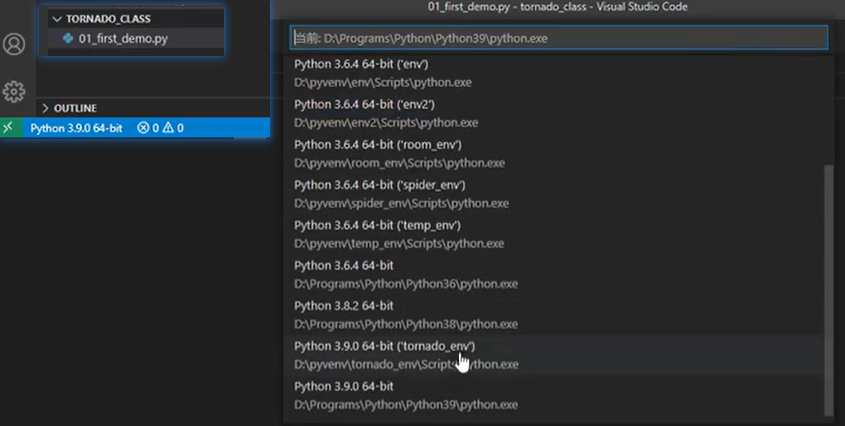
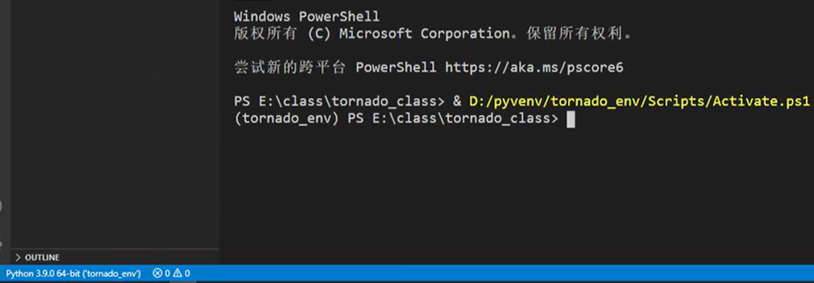
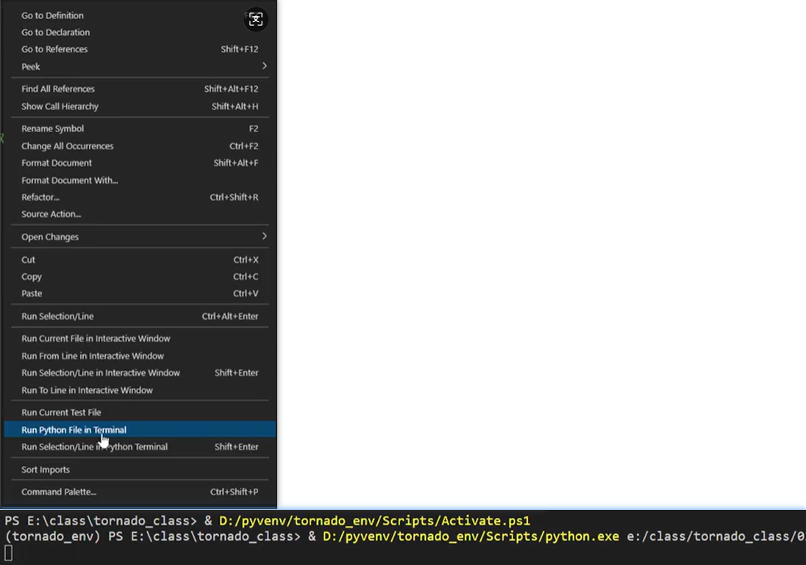
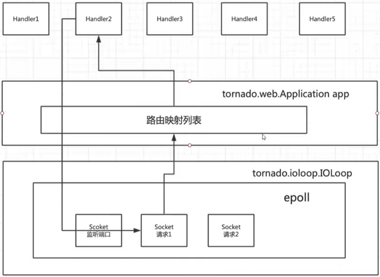
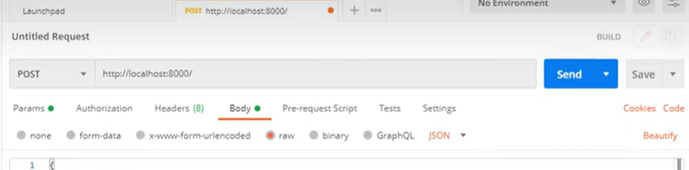
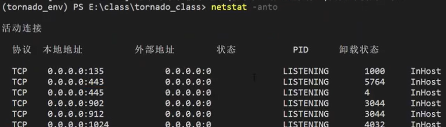

# 主流的Python网络框架

Django、Tornado和Flask是全栈网络框架的典型标杆；而Twisted更专注于网络底层的高性能封装，不提供HTML模板引擎等界面功能，所以不能称为全栈框架。

Tornado的性能比Django和Flask高很多。

Tornado自带异步特性，底层使用的是事件循环+协程。

Django和Flask是传统的模型，同步框架，阻塞io模型；api写同步代码，使用`celery`/`apscheduler`处理异步任务；传统的这种wsgi模型，主要是为了方便框架开发者只需要专注框架层面，而非http处理层面，但这样却增加了服务部署的复杂度，需要同时部署和配置`http server `和`wsgi server`，如果想支持异步还要部署`worker`。

在最基本的json的序列化性能方面，Django与Flask占优。

在处理远程http请求的能力方面，Tornado占绝对优势。

在数据库与模板处理性能方面，Tornado与Flask旗鼓相当，但Django的ORM很慢。Django的开发效率与维护非常好，但`Django ORM`深度绑定了该框架，如果要把`Django ORM`换成其它轮子，也意味着Django的诸多优秀特性将从此告别。

## Django

Django是企业级开发框架，于2003年诞生于美国堪萨斯（Kansas）州，最初用来制作在线新闻Web站点，于2005年加入了BSD许可证家族，成为开源网络框架。

Django是当前Python世界里最负盛名且最成熟的网络框架，目前已发展为应用最广泛的Python网络框架，也是遵循MVC架构的Web开发框架。Django的各模块之间结合得比较紧密，所以在功能强大的同时，又是一个相对封闭的系统，但是其健全的在线文档及开发社区，使开发者在遇到问题时能找到解决方法。

Django的主要特点是大而全，集成了很多组件，如`Model`、`Admin`、`Form` 等，属于全能型框架。

**优点：**

1、相对于Python的其他Web框架，Django的功能是最完整的。Django定义了服务发布、路由映射、模板编程、数据处理的一整套功能，也意味着Django模块之间紧密耦合。

2、是`Python web`框架的先驱，用户多，第三方库最丰富。

3、完善的文档。经过多年的发展和完善，Django有广泛的应用和完善的在线文档，开发者遇到问题时可以搜索在线文档寻求解决方案。

4、集成数据访问组件。Django的Model层自带数据库ORM组件，使开发者无须学习其它数据库访问技术（如dbi、SQLAlchemy等），且综合评价略高于`SQLAlchemy`。

5、强大的URL映射技术。Django使用正则表达式管理URL映射，因此给开发者带来了极高的灵活性。

6、后台管理系统自动生成。开发者只需通过简单的几行配置和代码，就可以实现完整的后台数据管理Web控制台。

7、错误信息非常完整。在开发调试过程中如果出现运行异常，则Django可以提供非常完整的错误信息帮助开发者定位问题，比如缺少xxx组件的配置引用等，这样可以使开发者马上改正错误。

8、自带的模板引擎简单好用，但其强大程度和综合评价略低于Jinja，但也支持`Jinja`等非官方模板引擎。

9、自带的数据库管理app评价高。

10、非常适合企业级网站的开发，快速、靠谱、稳定。

11、成熟、稳定、完善，但相比于`Flask`、`Django`，其整体生态相对封闭。

**缺点：**

1、`Django`太重了，灵活和自由度不够高。

2、`Django`能开发小应用，但会有“杀鸡焉用牛刀”的感觉。

3、`Django`自带`ORM`使其与关系型数据库的耦合度过高。如果想使用`MongoDB`等`NoSQL`数据，需要选取合适的第三方库。

**Django的组成结构：**

1、管理工具（Management）：一套内置的创建站点、迁移数据、维护静态文件的命令工具。

2、模型（Model）：提供数据访问接口和模块，包括数据字段、元数据、数据关系等的定义及操作。

3、视图（View）：Django的视图层封装了`HTTP Request`和`Response`的一系列操作和数据流，其主要功能包括URL映射机制、绑定模板等。

4、模板（Template）：是一套Django的页面渲染模板语言，用若干内置的tags和filters定义页面的生成方式。

5、表单（Form）：通过内置的数据类型和控件生成HTML表单。

6、管理站（Admin）：通过声明需要管理的Model，快速生成后台数据管理网站。

## Tornado

Tornado是高并发处理框架，全称是Torado Web Server，也被称为“microframework”。作为FriendFeed网站的基础框架，于2009年9月10日发布，目前已经获得了很多社区的支持，并且在一系列不同的场合中得到应用。

Tornado是使用Python编写的一个强大的可扩展的Web服务器，是非阻塞式服务器，而且速度相当快，也是一个`Python Web`的开发框架。Tornado在处理高网络流量时表现得足够强健，却在创建和编写时有着足够的轻量级，并能够被用在大量的应用和工具中。

Tornado常被用作大型站点的接口服务框架，而不像Django那样致力于建立完整的大型网站。

Tornado的主要特点是原生异步非阻塞，在IO密集型应用和多任务处理上占据绝对性的优势，属于专注型框架。

**特点：**

1、少而精（轻量级框架）、注重性能优越、速度快、解决高并发（请求处理是基于回调的非阻塞调用）、异步非阻塞。

2、完备的Web框架。Tornado提供了URL路由映射、Request上下文、基于模板的页面渲染技术等开发Web应用的必备工具（与Django、Flask等一样）。

3、有异步编码的一整套方案。Tornado不仅一个套完整web框架，还包含了一整套http协议、websocket协议的库、异步库。

4、Tornado是基于协程的解决方案。Tornado能高并发主要的原因是因为协程，而操作系统可以调度的最小单元就是线程，所以要调度协程就要自己的程序来调度，要自身的框架完成调度，没有办法通过操作系统来调度。在Python3.4才有原生的协程，后来出了asyncio后，Tornado底层协程调度转成了asyncio。

3、是一个高效的网络库，性能与Twisted、Gevent等底层Python框架相媲美。提供了异步I/O支持、超时事件处理，使Tornado除了可以作为Web应用服务器框架外，还可以用来做爬虫应用、物联网关、游戏服务器等后台应用。

4、提供高效HTTPClient。除了服务器端框架，Tornado还提供了基于异步框架的HTTP客户端。

5、提供高效的内部HTTP服务器（HTTPServer）。
不仅可以通过Tornado开发web应用，还可以通过Tornado部署其它的web应用。
虽然可以当服务器使用，但一般不会用Tornado替代掉nginx，毕竟nginx有的功能是Tornado没有的，如发送邮件、流量限速、负载均衡等。
另外，nginx服务器从一开始就是用来提供给同步的web应用框架使用的，而Tornado是一个套异步的web框架，算是一套新的框架，所以不多与nginx结合，Tornado不得不重新实现一个基于epoll协议的web服务器。
虽然其它Python网络框架也提供了内部HTTP服务器，但它们的HTTP服务器由于性能原因，只能用于测试环境，而Tornado的HTTP服务器与Tornado异步调用紧密结合，可以直接用于生产环境，且运行和部署与其它`Python web`框架不太一样。

6、提供完备的WebSocket（长连接）支持。WebSocket是HTML5的一种新标准，实现了浏览器与服务器之间的双向实时通信，可用于Web聊天、消息推送等场景。

7、单线程的异步网络程序。默认启动时根据CPU数量，运行多个实例，利用CPU多核的优势。

8、可以自定义模块。

9、模板和数据库部分有很多第三方的模块可选择，但不利于封装为一个功能模块。

## Flask

Flask是支持快速建站的框架，于2010年出现，这使得它吸收了其它框架的优点，并且把自己的主要领域定义在了微小项目上。

Flask是可扩展的，Flask让开发者自己选择用什么数据库插件来存储数据。Flask是一个面向简单需求和小型应用的微框架，很多功能简单但性能卓越的网站就是基于Flask框架而搭建的。

Flask的主要特点小而轻，原生组件几乎为零，三方提供的组件请参考`Django`，非常全面，属于短小精悍型框架（`Micro Framework`）。

**特点：**

1、内置开发服务器和调试器。Flask自带的开发服务器使开发者在调试程序时，无须再安装其它任何网络服务器。Flask默认处于调试状态，使得运行中的任何错误会同时向两个目标发送信息，一个是Python Console（启动Python程序的控制台），另一个是HTTP客户端（Flask开发服务器将调试信息传递给了客户端）。

2、与Python单元测试功能无缝衔接。Flask提供了一个与Python自带的单元测试框架（unitest）无缝衔接的测试接口，即Flask对象的test\_client()函数。通过test\_client()函数，测试程序可以模拟进行HTTP访问的客户端，来调用Flask路由处理函数，并且获取函数的输出来进行自定义的验证。

3、使用Jinja2模板。Jinja2是一个非常灵活的HTML模板技术。Jinja2模板使用配制的语义系统，提供灵活的模板继承技术，自动抗击XSS跨站攻击并且易于调试。

4、完全兼容WSGI 1.0标准。WSGI位于Web应用程序与Web服务器之间，与WSGI完全兼容使得Flask能够配置到各种大型网络服务器中。WSGI已经是Python界的一个主要标准，各种大型网路服务器对其都有良好的支持。WSGI（Web Server Gateway Interface）具有很强的伸缩性，且能运行于多线程或多进程环境下，因为Python线程全局锁的存在，使得WSGI的这个特性至关重要。

5、完全基于Unicode编码。对于制作非纯ASCII字符集的网站来说非常方便，在默认情况下，Flask会自动添加一个UTF-8编码格式的HTTP Head。

6、轻、自由、灵活、可扩展性强、第三方库的选择面广。开发时可以结合喜欢用的轮子，也能结合最流行最强大的`Python`库。

7、非常适用于小型网站，非常适用于开发web服务的API。

8、开发大型网站无压力，但代码架构需要自己设计，需要设计路由映射的规则，否则导致代码混乱，开发成本取决于开发者的能力和经验。

9、各方面性能均等于或优于Django。

10、与关系型数据库的配合使用不弱于`Django`，且与`NoSQL`数据库的配合远远优于Django。

11、比`Django`更加`Pythonic`，与`Python`的`philosophy`更加吻合。

## Twisted

Twisted是一个有着多年历史的开源事件驱动框架。Twisted支持很多种协议，包括传输层的UDP、TCP、TLS，以及应用层的HTTP、FTP等，对于所有这些协议，Twisted提供了客户端和服务器方面的开发工具。

Twisted是一个用Python语言编写的事件驱动的网络框架，也是一个高性能的编程框架，对于追求服务器程序性能的应用，Twisted框架是一个很好的选择。在不同的操作系统平台上，Twisted利用不同的底层技术实现了高效能通信。在Windows中，Twisted的实现基于I/O完成端口（IOCP，Input/Output Completion Port）技术，保证了底层高效地将I/O事件通知给框架及应用程序；在Linux中，Twisted的实现基于epoll技术，epoll是Linux下多路复用I/O接口select/poll的增强版本，它能显著提高程序在大量并发连接中的只有少量活跃情况下的系统的CPU利用率。

在开发方法上，Twisted引导程序员使用异步编程模型，提供了丰富的Defer、Threading等特性来支持异步编程。

## Scrapy

Scrapy是一个轻量级的使用Python编写的网络爬虫框架，这也是它与其它Python框架最大的区别。

因为专门用于爬取网站和获取结构数据，且使用起来非常的方便，所以Scrapy用途广泛，可以用于数据挖掘、监测和自动化测试等。

## Diesel

Diesel是基于Greenlet的事件I/O框架，提供一个整洁的API来编写网络客户端和服务器。它与其它Python框架最大的区别是支持TCP和UDP。

## Reflex

Reflex使开发人员能够使用Python这种单一语言构建全栈Web应用 ，旨在无缝集成后端和前端。
Reflex在FastAPI 之上构建，添加了一个前端层，并抽象出了连接后端和前端所需的样板，简化了全栈应用的开发；部署后，Reflex应用将被编译为具有React前端的FastAPI后端。

**优点：**

1、允许使用Python构建前端和后端，并处理前端和后端之间的连接。

2、带有 60 多个高度可定制的UI组件（支持 Tailwind、自定义 CSS 等），这些内置组件让开发人员可以轻松自定义和扩展这些组件，还可以选择引入自己的组件（底层是 React）。

3、与SQLAlchemy集成并为SQLite、Postgres和MySQL提供一流的支持。

4、提供多种身份验证选项，包括本地身份验证、Google身份验证、Captcha、Magic Link身份验证和Clerk身份验证，从而轻松实现用户管理。

5、Reflex应用程序可以使用单个命令部署到云端。

**缺点：**

1、Reflex是一个较新的框架，因此与Django等更传统的替代方案相比，其生态系统（插件）较小，

2、Reflex 仍在不断完善，其API可能会发生变化。

## Streamlit

Streamlit能够以最少的编码快速将数据脚本转换为交互式 Web 应用程序，因此在数据科学家中获得了相当大的关注。它是原型设计、构建仪表板和展示数据洞察的理想选择，但它不太适合需要复杂用户界面或持久交互性的应用程序。

**优点：**

1、快速原型设计。Streamlit擅长以最小的努力将Python脚本快速转换为Web应用程序。

2、数据可视化。Streamlit内置了用于常见数据可视化任务的组件，使其成为仪表板的理想选择。

3、易于使用。Streamlit的声明性语法允许开发人员专注于功能而不是样板代码。

4、社区驱动的示例。Streamlit拥有一个强大的应用程序库，包含Github等平台上的示例和模板，展示了如何构建各种Streamlit应用程序和仪表板。

**缺点：**

1、执行效率低下。Streamlit每次输入更改时都会重新运行整个应用程序代码，从而导致潜在的效率低下，这使得它不太适合具有复杂工作流或需要频繁更新的大规模数据的应用程序。

2、有限的 UI 组件。与Reflex等框架相比，Streamlit提供了一组有限的 UI 元素，不太适合构建复杂的自定义用户界面。

3、可扩展性弱。Streamlit不是为构建具有复杂工作流程的长期运行或高度交互的应用程序而设计的。

4、状态管理弱。对于需要动态用户交互的更复杂的应用程序来说，管理应用程序状态可能变得更具挑战性。

5、缓存复杂性。Streamlit提供缓存来提高性能，但缓存大型对象可能会带来挑战，如高内存消耗、性能缓慢或返回过时的数据；且如果缓存失效处理不当，可能会导致不可预测的行为，从而使实施有效的缓存策略变得棘手。

## Gradio

构建和分享令人愉悦的机器学习应用程序。Gradio是一个开源 Python 库，允许开发人员轻松为机器学习模型创建用户友好的基于Web的界面，特别适合以最少的设置来原型设计、演示和共享ML模型。

**优点：**

1、易于部署。Gradio应用程序可以快速部署，包括直接部署到Hugging Face Spaces，实现轻松共享。

2、ML集成。与TensorFlow、PyTorch和Hugging Face等流行的机器学习库无缝集成，简化了ML从业者的工作流程，成为ML从业者的首选。

**缺点：**

1、范围有限。Gradio最适合试验机器学习模型和创建演示，但它并不适用于生产级或高度复杂的Web应用程序。

2、定制限制。虽然对于标准ML应用程序来说已经足够，但创建高度定制或复杂的用户界面通常需要额外的JavaScript或外部库。

3、可扩展性弱。Gradio应用程序可能难以有效扩展以适应大规模生产用例。

## Dash

Dash是一个用于构建交互式分析Web应用程序的Python框架，建立在Flask、Plotly.js和React.js之上，为创建仪表板和数据应用程序提供了强大的环境。

Dash应用程序分为两个主要组件：layout（使用HTML和React组件定义视觉结构）和回调（通过动态响应用户输入来处理交互性）。

**优点：**

1、丰富的数据组件。Dash包含大量预构建的数据可视化和UI组件库，非常适合分析应用程序。

2、多语言支持。Dash支持Python、R和Julia，满足科学和数据社区的广大受众的需求。

3、学术支持。作为最早基于Python的数据可视化框架之一，Dash拥有强大的学术社区。

4、Plotly 集成。Dash利用Plotly.js创建高度可定制和交互式的可视化效果。

5、部署效率高：Dash针对部署效率进行了优化，适合在分布式环境中部署；因为应用程序的每个组件都是独立的，因此可以轻松进行水平扩展（应用程序），但这需要权衡无状态回调，每个组件必须是独立且自足的，这对于那些习惯于本地或有状态编程的人来说，开发更具挑战性。

**缺点：**

1、在大型或复杂的应用程序中，管理与回调的交互可能会变得很复杂；每个组件都必须独立运行，而不依赖于全局变量或存储的中间状态，这会增加开发的复杂性。

2、Plotly的托管服务主要针对企业用户，虽然可以进行容器部署，但会为个人开发人员或较小的团队增加额外的复杂性。

## FastAPI

FastAPI是一个现代后端Web框架，因构建REST API而广受欢迎。FastAPI建立在Starlette和Pydantic之上，性能卓越、符合人体工程学，在需要高性能和并发处理的场景中表现出色，高性能、易学、快速编码、可立即投入生产。

**优点：**

1、类型提示。FastAPI利用Python类型提示，提高代码质量并简化API交互。

2、自动文档。FastAPI根据类型提示自动为API生成OpenAPI（以前称为Swagger）文档（交互式文档）。

3、数据验证。FastAPI使用Pydantic进行数据验证，从而可以轻松验证请求和响应数据。

4、性能极高，在基准测试中通常匹敌或超越Node.js和Go的速度。

5、支持异步编程，适合高并发应用程序。

**缺点：**

1、FastAPI不提供内置前端框架，需要将其与单独的前端解决方案集成。

2、有限的内置功能。FastAPI专注于后端API，并且不提供诸如身份验证、管理面板或模板之类的许多内置功能。


# Tornado框架教程

相关链接：https://www.bilibili.com/video/BV1uqWHehEvW

## 介绍

Tornado（龙卷风）是由FriendFeed开发使用的，该公司于2009年被Facebook收购，而`Tornado`很快就开源了。

Tornado是一个用Python编写的可扩展的、无阻塞的**Web应用程序框架**和**Web服务器**。

Tornado以其高性能着称，它的设计允许处理大量并发连接，在设计之初就考虑到了性能因素，旨在解决`C10K`（同时处理一万个连接的缩写）问题，这样的设计使得其成为一个拥有非常高性能的框架。它还拥有处理安全性、用户验证、社交网络以及与外部服务（如数据库和网站API）进行异步交互的工具。

有一些基于线程的服务器（如Apache），为了传入的连接，维护了一个操作系统的线程池。Apache会为每个HTTP连接分配线程池中的一个线程，如果所有的线程都处于被占用的状态，并且尚有内存可用时，则生成一个新的线程。
尽管不同的操作系统会有不同的设置，但大多数Linux发布版中的线程堆大小默认都是8MB，所以Apache的架构在大负载下变得不可预测，为每个打开的连接而维护一个大的线程池来等待数据，是极易迅速耗光服务器的内存资源的。而之所以会有这么大的负载，是因为服务器同时要对许多客户端提供服务，而服务器端的处理流程，只要遇到了I/O操作，往往需要长时间的等待。
如“接受及处理输入数据（1ms）>访问远程网络或数据库（50ms）>整理数据及输出（1ms）”，中间的50ms是在等待耗时操作结束，这段时间的服务进程的CPU是空闲的，浪费掉了。

如果CPU能在各个流程间跳来跳去，专门处理一头一尾两段的内容，在这种模式下，服务进程就能有效利用等待时间，实际花费的只是一头一尾两段真正占用CPU的时间，服务进程每秒可以处理的请求就可成几十倍的增长。这样的模式，就是在一个进程之间，同时处理多个协程，充分利用CPU时间，这就是异步编程，而Tornado是可以支持异步非堵塞IO模式的。

## Tornado高并发原理

Tornado高并发的核心原理是epoll事件循环+协程。在使用协程之后，开销特别的小。

- 异步非阻塞IO。

- 基于epoll事件循环。底层是基于事件循环的，从线程到协程到高并发，功能上就是个事件循环。nginx实现并发也是使用的epoll（Linux）的事件循环，所以推荐使用linux系统，这样能充分体现性能。

- 协程。实现协程是一步步从无到有的、技术慢慢的迭代，之前写协程还要写回调，后来慢慢改善成写成类似同步的代码来实现异步。

注意：

1、使用了Tornado不一定就是高并发，如果在代码中使用了同步的IO后，效果也是比较低，甚至比Flask与Django还要低，所以尽量不要使用的同步IO。

2、事件循环的模式是单线程完成的，那就意外着，有一个地方使用了同步IO操作，那整个所有消息都会被堵塞住。

3、把耗时的操作放到线程池中能否提高效率，取决于是否是异步的，如果不是异步只能考虑换库，或自己写一个。

## 安装和使用

可以使用VSCode进行开发，并选择特定环境下的Python解释器。选中后，当再次打开控制台时，会切换到该环境下。





安装Tornado：`pip install tornado`。

使用示例：

```python
# ./01.py
from tornado import web
from tornado import ioloop
# 或直接写`from tornado import web, ioloop`
from time import sleep
class IndexHandler1(web.RequestHandler):
    def get(self):
        sleep(5) # 睡眠5秒
        self.write('Hello Tornado!!123')

class IndexHandler2(web.RequestHandler):
    def get(self):
        self.write('Hello Tornado!!123456')

if __name__ == '__main__': # 防止其它地方引入该文件时运行该脚本
    # 设置`debug = True`，则服务可以监听代码的改变，但控制台会出现可以可操作的情况，实际上，服务还没有结束，需要关闭控制台才会结束。
    # app = web.Application([('/', IndexHandler1)], debug = True) # 创建app对象，设置路由
    app = web.Application([ # url地址是按顺序进行匹配的
        ('/', IndexHandler1),
        ('/index/', IndexHandler2), # 先后访问'/'和'/index/'，如果没有`async`，则'/index/'会等待'/'返回后再返回
    ], debug=True)
    app.listen(8000)
    ioloop.IOLoop.current().start() # 开始事件循环
```



## 程序的原理



## tornado.options

options可以让服务运行前设置参数，常见的设置参数的方式为：命令行设置、文件设置。

### 命令行解析

```python
# ./main.py
from tornado import web, ioloop
from tornado.options import define, options, parse_command_line
# import time
# import tornado

# 定义key，用于接收传递进来的参数
define('port', default=8000, help='port to listen on', type=int)
define('debug', default=True, help='set debug mode', type=bool)
# 解析命令行传递进来的参数。如果不写，则会运行在默认的8000端口。
parse_command_line()

class IndexHandler(web.RequestHandler):
    async def get(self):
        self.write('Hello Tornado!!')
# options是一个类，全局只有一个options
if __name__ == '__main__':
    app = web.Application([
        ('/',IndexHandler)
    ], debug = options.debug)
    app.listen(options.port)
    ioloop.IOLoop.current().start()
```

执行命令：`python .\main.py --port=7000`。

### 文件设置

通过`tornado.options.parse_config_file`来解析

```python
# ./server.conf
# 创建文件，将必要的参数直接写入：
port=8000
debug=True
```

```python
# ./main.py
from tornado import web, ioloop
from tornado.options import define, options, parse_config_file

define('port', default=8000, help='port to listen on', type=int)
define('debug', default=True, help='set debug mode', type=bool)
# 解析文件传递进来的参数。
parse_config_file('server.conf')

class IndexHandler(web.RequestHandler):
    async def get(self):
        self.write('Hello Tornado!!')
if __name__ == '__main__':
    app = web.Application([
        ('/',IndexHandler)
    ], debug = options.debug)
    app.listen(options.port)
    ioloop.IOLoop.current().start()
```

右键运行Python文件。

## URL设置

```python
from tornado import web, ioloop

class IndexHandler1(web.RequestHandler):
    async def get(self):
        self.write('Hello Tornado')
class IndexHandler2(web.RequestHandler):
    async def get(self):
        self.write('Hello 2')

if __name__ == '__main__':
    app = web.Application([
        ('/', IndexHandler1),
        # ('/index/', IndexHandler2) # 必须完整访问`/index/`，否则报404
        ('/index/?', IndexHandler2) # 完整匹配URL。`?`表示可以不携带最后面的`/`，也能正常匹配
    ], debug = True)
    app.listen(8000)
    ioloop.IOLoop.current().start()
```

```python
from tornado import web, ioloop

class IndexHandler1(web.RequestHandler):
    async def get(self):
        self.write('Hello Tornado')
class UserHandler(web.RequestHandler):
    async def get(self, id):
        self.write(f'Hello 登录编号是：{id}')
class UserNameHandler(web.RequestHandler):
    async def get(self, name):
        self.write(f'Hello 登录用户名是：{name}')
class UserPwdHandler(web.RequestHandler):
    async def get(self, name, pwd):
        self.write(f'登录用户名是：{name} 密码是：{pwd}')  

if __name__ == '__main__':
    app = web.Application([
        ('/', IndexHandler1),
        # 通过正则匹配URL。通过URL传递参数
        ('/user/(\d+)/?', UserHandler), # 先匹配数字
        ('/user/(\w+)/?', UserNameHandler), # 再匹配字母数字字符
        # ('/user/(\w+)/(\w+)/?', UserPwdHandler), # 匹配多个变量
        ('/user/(?P<name>\w+)/(?P<pwd>\w+)/?', UserPwdHandler) # 精准匹配变量名
    ], debug = True)
    app.listen(8000)
    ioloop.IOLoop.current().start()
```

```python
from tornado import web, ioloop

class IndexHandler1(web.RequestHandler):
    async def get(self):
        self.write('Hello Tornado')
class IndexHandler2(web.RequestHandler):
    async def get(self):
        self.write('Hello 2')
class rediect2Handler(web.RequestHandler):
    async def get(self):
        self.redirect(self.reverse_url('index')) # 跳转和url反转，匹配name为index的url
class rediect3Handler(web.RequestHandler):
    def initialize(self, name, pwd): # 通过initialize接收
        self.name = name
        self.pwd = pwd
        print(name, '-', pwd)
    async def get(self):
        self.redirect(self.reverse_url('index'))

args = { 'name': '啊啊', 'pwd': '123' }
if __name__ == '__main__':
    app = web.Application([
        ('/', IndexHandler1),
        web.URLSpec('/index/?', IndexHandler2, name='index'),
        web.URLSpec('/redirect2/', rediect2Handler),
        # 通过第三个参数传递参数，并带有默认值。另外，也可以通过在url上携带参数的方式实现
        web.URLSpec('/redirect3/', rediect3Handler, args)
    ], debug = True)
    app.listen(8000)
    ioloop.IOLoop.current().start()
```

## RequestHandler

HTTP请求处理程序的基类：`tornado.web.RequestHandler`。

- 相关钩子：

initialize：初始化，用于初始化handler参数。

prepare：在get、post等请求的处理方法之前的调用，执行通用初始化，用于打印日志、打开文件等。

on_finish：请求结束后调用，用于执行清理、日志记录等。

get、post、delete、put、head、patch、Options。

- 相关API：

get_argument：返回具有给定名称的参数的值。适用于get和post请求。

get_arguments：返回具有给定名称的参数列表。适用于get和post请求。

get_query_argument：从请求查询字符串中返回具有给定名称的参数的值，默认获取请求信息里的最后一个参数。适用于get请求。

get_query_arguments：返回具有给定名称的查询参数的列表。适用于get请求。

get_body_argument：从请求主体返回具有给定名称的参数的值。适用于post请求。

get_body_arguments：返回具有给定名称的主体参数列表。适用于post请求。

request：包含附加请求参数的对象，如头文件、主体数据。

- 注意

对于一个post请求，如果Content-Type为`application/x-www-form-urlencoded`或`multipart/form-data`，则可以用get_argument、get_arguments、get_body_argument、get_body_arguments接受参数，如果数据传递类型为raw，即用原生的方式，则用这些API无法接收。

raw的类型有：
1、text：对应的Content-Type为text/plain，表示文本。
2、javascript：对应的Content-Type为application/javascript，表示javascript脚本。
3、json：对应的Content-Type：application/json，表示json数据格式。
4、html：对应的Content-Type：text/html，表示html或文本类型。
5、xml：对应的Content-Type：application/xml，表示xml类型。



```python
from tornado import web,ioloop
from json import loads
class IndexHandler(web.RequestHandler):

    # def initialize(self,db = None):
    #     self.db = db

    def prepare(self):
        print('1111')

    def on_finish(self):
        print('3333')

    async def get(self):
        print('2222')
        # 如果请求路径为localhost:8000/?q=1&q=2&q=3
        name = self.get_argument('q') # 3
        names = self.get_arguments('q') # ['1', '2', '3']
        # name = self.get_query_argument('q') # 3
        # names = self.get_query_arguments('q') # ['1', '2', '3']
        print(name)
        print(names)
        self.write('成功访问get请求')

    async def post(self):
        print('2222')
        # 情况一：如果请求路径为localhost:8000/?q=1&q=2&q=3，Content-Type为`application/x-www-form-urlencoded`，请求体为{ q: 'a', q: 'b' }
        # 获取url和请求体中的内容
        # name = self.get_argument('q') # b
        # names = self.get_arguments('q') # ['1', '2', '3', 'a', 'b']
        # 获取请求体中的内容
        # name = self.get_body_argument('q') # b
        # names = self.get_body_arguments('q') # ['a', 'b']
        # print(name)
        # print(names)

        # 情况二：如果请求路径为localhost:8000/，数据传递类型为raw，请求体为{ name: '你好' }
        # name = self.get_body_argument('name') # 报400
        # names = self.get_body_arguments('name') # 报400
        args = self.request.body.decode('utf-8')
        print(args)
        # `json.loads()`的作用是将JSON字符串转成Python对象，其参数必须是符合JSON语法的字符串
        print(loads(args)) # { name: '你好' }
        self.write('成功访问post请求')
        self.finish({'msg':'成功访问'}) # finish之后，则后面的代码不能再返回内容

if __name__ == '__main__':
    app= web.Application([
        ('/',IndexHandler),
    ], debug = True)
    app.listen(8000)
    ioloop.IOLoop.current().start()
```

## RedirectHandler

用于重定向。301是永久重定向，302是临时重定向。

```python
from tornado import web, ioloop
from tornado.web import RedirectHandler
class IndexHandler(web.RequestHandler):
    def get(self):
        self.finish('Hello Tornado!')
class LoginHandler(web.RequestHandler):
    def get(self):
        # print(self.reverse_url('index')) # /
        self.redirect('/') # 与`self.redirect(self.reverse_url('index'))`效果一样

if __name__ == "__main__":
    app = web.Application([
        web.URLSpec('/', IndexHandler, name='index'),
        # 方式一：通过redirect实现重定向
        web.URLSpec('/login/', LoginHandler), # 访问localhost:8000/login/，则重定向到localhost:8000/
        # 方式二：通过RedirectHandler实现重定向
        web.URLSpec('/index/', RedirectHandler, {'url':'/'})
    ], debug=True)
    app.listen(8000)
    ioloop.IOLoop.current().start()
```

## StaticFileHandler

可以返回目录中的静态内容（文件）。

```python
# ./main.py # 在相同父目录下，有static目录，里面有一张aa.jpg的图片。
from tornado import web, ioloop
from tornado.web import StaticFileHandler

class IndexHandler(web.RequestHandler):
    def get(self):
        self.finish("Hello Tornado")

settings = {
    "static_path": "./static/",
    "static_url_prefix": "/img/"
}

if __name__ == "__main__":
    # 方式一：通过static_path和static_url_prefix配置实现访问静态文件
    # 访问localhost:8000/img/aa.jpg，则显示aa.jpg图片
    # app = web.Application(
    #     [web.URLSpec("/", IndexHandler, name="index")],
    #     debug=True,
    #     static_path="./static/",
    #     static_url_prefix="/img/",
    # )
    # 方式二：通过对象传入配置
    # app = web.Application(
    #     [web.URLSpec("/", IndexHandler, name="index")],
    #     debug=True,
    #     **settings
    # )
    # 方式三：通过url配置
    # `os.path.abspath`用于获取当前文件的绝对路径，`os.path.dirname`用于获取当前文件的父级目录的路径，`os.path.join`用于拼接路径
    import os
    static_url = os.path.join(os.path.dirname(os.path.abspath(__file__)), 'static')
    app = web.Application(
        [
            web.URLSpec("/", IndexHandler, name="index"),
            # ('/img/(.*)', StaticFileHandler, {'path': './static'}) # 写法一
            ('/img/(.*)', StaticFileHandler, {'path': static_url}) # 写法二
        ],
        debug=True
    )
    app.listen(8000)
    ioloop.IOLoop.current().start()
```

## Template

### 基本使用

返回Template。

```python
# ./main1.py
from tornado import web, template
from tornado import ioloop
# 通过字符串返回：
class IndexHandler(web.RequestHandler):
    def get(self):
        arg = "Template"
        self.write(f"<h1>Hello {arg}!!</h1>")
# 通过模板Template返回：
class IndexHandler2(web.RequestHandler):
    def get(self):
        arg = "Template2"
        t = template.Template(f"<h1>Hello {arg}!!</h1>")
        self.finish(t.generate())
class IndexHandler3(web.RequestHandler):
    def get(self):
        arg1 = "Template3"
        t = template.Template("<h1>Hello {{arg}}!!</h1>")
        self.finish(t.generate(arg=arg1))
class IndexHandler4(web.RequestHandler): # 从外部引入文件
    def get(self):
        arg1 = "Template4_file"
        loader = template.Loader("./templates/")
        self.finish(loader.load("index.html").generate(arg=arg1))

if __name__ == "__main__":
    app = web.Application(
        [
            ("/", IndexHandler),
            ("/2/", IndexHandler2),
            ("/3/", IndexHandler3),
            ("/4/", IndexHandler4),
        ],
        debug=True
    )
    app.listen(8000)
    ioloop.IOLoop.current().start()
```

```python
# ./main2.py
from tornado import web
from tornado import ioloop
# 通过模板render返回：
class IndexHandler5(web.RequestHandler): # 从外部引入文件
    def get(self):
        arg1 = "render_Template5_file"
        self.render("index.html", arg=arg1)

if __name__ == "__main__":
    app = web.Application(
        [
            ("/5/", IndexHandler5),
        ],
        debug=True,
        template_path="./templates"
    )
    app.listen(8000)
    ioloop.IOLoop.current().start()
```

```html
<!-- ./templates/index.html -->
<h1>Hello {{arg}}!!</h1>
```

#### 案例

```python
# ./main.py
from tornado import web
from tornado import ioloop

class IndexHandler(web.RequestHandler):
    def count(self, price, num):
        return price * num
    def get(self):
        orders = [
            {
                "id": 1,
                "name": "啊啊",
                "type": "32G",
                "price": 9999,
                "num": 1,
                "img": "static1/img/goods001.jpg",
                "opts": '<a href="delete?id=1">删除</a>',
            },
            {
                "id": 2,
                "name": "哈哈",
                "type": "512G",
                "price": 6666,
                "num": 1,
                "img": "static1/img/goods002.jpg",
                "opts": '<a href="delete?id=2">删除</a>',
            },
        ]
        self.render("shop.html", orders=orders, count_price=self.count)

import os
base_path = os.path.dirname(os.path.abspath(__file__))
settings = {
    "static_path": os.path.join(base_path, "static"),
    "static_url_prefix": "/static1/",
    "template_path": os.path.join(base_path, "templates"),
}
if __name__ == "__main__":
    app = web.Application([("/", IndexHandler)], debug=True, **settings)
    app.listen(8000)
    ioloop.IOLoop.current().start()
```

```html
<!-- ./templates/shop.html -->
<!-- extends表示Template的继承 -->



<section class="wrap" style="margin-top:20px;overflow:hidden;">
  <table class="order_table">
    <tr>
      <th><input type="checkbox" /></th>
      <th>产品</th>
      <th>名称</th>
      <th>属性</th>
      <th>单价</th>
      <th>数量</th>
      <th>小计</th>
      <th>操作</th>
    </tr>
    
    
    <tr>
      <td class="center"><input type="checkbox" /></td>
      <td class="center"><a href="product.html"></a></td>
      <td><a href="product.html">{{order['name']}}</a></td>
      <td><p>{{order['type']}}</p></td>
      
      <td class="center"><span class="rmb_icon">优惠力度很大</span></td>
      
      <td class="center"><span class="rmb_icon">{{order['price']}}</span></td>
      
      <td class="center"><span>{{ order['num'] }}</span></td>
      <!-- <td class="center"><strong class="rmb_icon">{{ order['price']*order['num'] }}</strong></td> -->
      <td class="center"><strong class="rmb_icon">{{ count_price(order['price'],order['num']) }}</strong></td>
      <!-- raw表示按原生的方式进行html解析 -->
      <td class="center"></td>
      <div hidden>{{ total = total + count_price(order['price'],order['num']) }}</div>
    </tr>
    
  </table>
  <div class="order_btm_btn">
    <a href="index.html" class="buy_btn" />继续购买</a>
    <a href="order_confirm.html" class="add_btn" />共计金额<strong>{{ total }}</strong>立即结算</a>
  </div>
</section>

```

```html
<!-- ./templates/common/base.html -->
<!DOCTYPE html>
<html>
<head>
  <meta charset="utf-8" />
  <title>购物车</title>
  <link rel="stylesheet" type="text/css" href="{{ static_url('css/style.css') }}" />
  <script src="{{ static_url('js/html5.js') }}"></script>
</head>

<body>
  <header>
    <div class="topNavBg">
      <div class="wrap">
        <ul class="topRtNav">
          <li><a href="user.html">个人中心</a></li>
          <li><a href="cart.html" class="cartIcon">购物车<i>0</i></a></li>
          <li><a href="favorite.html" class="favorIcon">收藏夹</a></li>
          <li><a href="user.html">商家中心</a></li>
          <li><a href="article_read.html" class="srvIcon">客户服务</a></li>
        </ul>
      </div>
    </div>
  </header>
  <!-- 模板继承占位符 -->
  

  
  <footer>
    <!--help-->
    <ul class="wrap help">
      <li>
        <dl>
          <dt>服务保障</dt>
          <dd><a href="article_read.html">保障范围</a></dd>
          <dd><a href="article_read.html">退换货流程</a></dd>
          <dd><a href="article_read.html">服务中心</a></dd>
          <dd><a href="article_read.html">更多服务特色</a></dd>
        </dl>
      </li>
    </ul>
    <div class="wrap btmInfor">
      <p>© 2060 版权所有</p>
      <address>联系地址：有限公司</address>
    </div>
  </footer>
</body>
</html>
```

### UIModule的使用

```python
# ./main.py
from tornado import web
from tornado import ioloop

class IndexHanlder(web.RequestHandler):
    async def get(self):
        self.render("tmp.html")

class ProductModule(web.UIModule):
    def render(self):
        return self.render_string("ui_module/product.html")

import os
base_path = os.path.dirname(os.path.abspath(__file__))
settings = {
    "static_path": os.path.join(base_path, "static"),
    "static_url_prefix": "/static/",
    "template_path": os.path.join(base_path, "templates"),
    "ui_modules": {"product": ProductModule},
}
if __name__ == "__main__":
    app = web.Application([("/", IndexHanlder)], debug=True, **settings)
    app.listen(8000)
    ioloop.IOLoop.current().start()
```

```html
<!-- ./templates/tmp.html -->

```

```html
<!-- ./templates/ui_module/product.html -->
<head></head>
<script></script>

<section class="wrap" style="margin-top:20px;overflow:hidden;">
  <table class="order_table">
    <tr>
      <th><input type="checkbox" /></th>
      <th>产品</th>
      <th>名称</th>
      <th>属性</th>
      <th>单价</th>
      <th>数量</th>
      <th>小计</th>
      <th>操作</th>
    </tr>
  </table>
  <div class="order_btm_btn">
    <a href="index.html" class="buy_btn" />继续购买</a>
    <a href="order_confirm.html" class="add_btn" />共计金额<strong>{{ total }}</strong>立即结算</a>
  </div>
</section>
```

#### 案例

```python
# ./main.py
from tornado import web
from tornado import ioloop

class IndexHanlder(web.RequestHandler):
    async def get(self):
        orders = [
            {
                "id": 1,
                "name": "啊啊",
                "type": "32G",
                "price": 9999,
                "num": 1,
                "img": "static1/img/goods001.jpg",
                "opts": '<a href="delete?id=1">删除</a>',
            },
            {
                "id": 2,
                "name": "哈哈",
                "type": "512G",
                "price": 6666,
                "num": 1,
                "img": "static1/img/goods002.jpg",
                "opts": '<a href="delete?id=2">删除</a>',
            },
        ]
        self.render("tmp.html", orders=orders)

class ProductModule(web.UIModule):
    def count(self, price, num):
        return price * num
    def render(self, orders):
        return self.render_string("ui_module/product.html", orders=orders, count_price=self.count)
    # 将css样式写入模版的head标签里。需要模版里有head标签，否则报错
    # def embedded_css(self):
    #     return 'html {color:red}'
    # 将css文件引入写到模版里
    def css_files(self):
        return ['css/style.css']

import os
base_path = os.path.dirname(os.path.abspath(__file__))
settings = {
    "static_path": os.path.join(base_path, "static"),
    "static_url_prefix": "/static/",
    "template_path": os.path.join(base_path, "templates"),
    "ui_modules": {"product": ProductModule},
}
if __name__ == "__main__":
    app = web.Application([("/", IndexHanlder)], debug=True, **settings)
    app.listen(8000)
    ioloop.IOLoop.current().start()
```

```html
<!-- ./templates/tmp.html -->

```

```html
<!-- ./templates/ui_module/product.html -->
<head></head>
<script></script>

<section class="wrap" style="margin-top:20px;overflow:hidden;">
  <table class="order_table">
    <tr>
      <th><input type="checkbox" /></th>
      <th>产品</th>
      <th>名称</th>
      <th>属性</th>
      <th>单价</th>
      <th>数量</th>
      <th>小计</th>
      <th>操作</th>
    </tr>
    
    
    <tr>
      <td class="center"><input type="checkbox" /></td>
      <td class="center"><a href="product.html"></a></td>
      <td><a href="product.html">{{order['name']}}</a></td>
      <td><p>{{order['type']}}</p></td>
      
      <td class="center"><span class="rmb_icon">优惠力度很大</span></td>
      
      <td class="center"><span class="rmb_icon">{{order['price']}}</span></td>
      
      <td class="center"><span>{{ order['num'] }}</span></td>
      <td class="center"><strong class="rmb_icon">{{ count_price(order['price'],order['num']) }}</strong></td>
      <td class="center"></td>
      <div hidden>{{ total = total + count_price(order['price'],order['num']) }}</div>
    </tr>
    
  </table>
  <div class="order_btm_btn">
    <a href="index.html" class="buy_btn" />继续购买</a>
    <a href="order_confirm.html" class="add_btn" />共计金额<strong>{{ total }}</strong>立即结算</a>
  </div>
</section>
```

## aiomysql的使用

安装：`pip install aiomysql`。

如果使用`pymysql`操作数据库，则是同步的；而`aiomysql`是异步的框架，其底层大量的使用了`pymysql`，只是其通过`asyncio`实现的访问数据库。

```python
例子一：
import aiomysql
from tornado import ioloop
async def select_db():
    # 使用with语法则自动关闭连接池
    async with aiomysql.create_pool(host='127.0.0.1', port=3306, user='root', password='123', db='tornado_demo1') as pool:
        async with pool.acquire() as conn: # 打开连接
            async with conn.cursor() as cur: # 获取游标
                await cur.execute("select * from t_user;") # 执行SQL
                tmp = await cur.fetchone() # 等待返回的数据
                # 如果数据表没数据，则打印`None`；如果有数据，则打印类似`(1, 'nihao', '哈哈@123', '123', '111', 'python')`的结构
                print(tmp)

if __name__ == '__main__':
    ioloop.IOLoop.current().run_sync(select_db)

例子二：
import asyncio
import aiomysql
async def test_example(loop):
    pool = await aiomysql.create_pool(host="127.0.0.1", port=3306, user="root", password="", db="mysql", loop=loop)
    async with pool.acquire() as conn:
        async with conn.cursor() as cur:
            await cur.execute("SELECT 42;")
            print(cur.description)
            (r,) = await cur.fetchone()
            assert r == 42
    pool.close()  # 关闭连接池
    await pool.wait_closed()  # 异步等待

loop = asyncio.get_event_loop()
loop.run_until_complete(test_example(loop))
```

## ORM的使用

ORM（Object Relational Mapping），即对象关系映射，是一种软件设计模式或编程技术。

### peewee

Peewee（官网：http://docs.peewee-orm.com/en/latest/）是一个简单而小型的ORM，易于学习且使用直观。

特点：一个小的、表达力很强的ORM；python 2.7+和3.4+（使用3.6开发）；支持sqlite、mysql、postgresql和cockroachdb；有大量的扩展。

安装：`pip install peewee`。
注意，需要安装`pymysql`，否则会报错（`peewee.ImproperlyConfigured: MySQL driver not installed!`）。

The following types of comparisons are supported by peewee：`%`、`**`、`==`、`!=`、`<`、`>`、`<=`、`>=`、`<<`（x IN y, where y is a list or query）、`>>`（x IS y, where y is None/NULL）、`^`（x XOR y）、`~`（Unary negation (e.g., NOT x)）。如`User.select().where(User.username == '啊啊')`。

Because I ran out of operators to override, there are some additional query operations available as methods：
1、`.in_(value)`，IN lookup (identical to `<<`)。如`User.select().where(User.username.in_(['啊啊', '哈哈', '嘿嘿']))`
2、`.not_in(value)`，NOT IN lookup。
3、`.is_null(is_null)`，IS NULL or IS NOT NULL. Accepts boolean param。
4、`.contains(substr)`，Wild-card search for substring。如`Blog.select().where(Blog.title.contains(search_string))`。
5、`.startswith(prefix)`，Search for values beginning with `prefix`。如`Employee.select().where(Employee.name.startswith('啊'))`。
6、`.endswith(suffix)`，Search for values ending with `suffix`。
7、`.between(low, high)`，Search for values between `low` and `high`。如`Employee.select().where(Employee.salary.between(50000, 60000))`。
8、`.regexp(exp)`，Regular expression match (case-sensitive)。
9、`.iregexp(exp)`，Regular expression match (case-insensitive)。
10、`.bin_and(value)`，Binary AND。
11、`.bin_or(value)`，Binary OR。
12、`.concat(other)`，Concatenate two strings or objects using `||`。
13、`.distinct()`，Mark column for DISTINCT selection。
14、`.collate(collation)`，Specify column with the given collation。
15、`.cast(type)`，Cast the value of the column to the given type。

To combine clauses using logical operators, use：
1、`&`，AND。如`(User.is_active == True) & (User.is_admin == True)`。
2、`|`(pipe)，OR。如`(User.is_admin) | (User.is_superuser)`。
3、`~`，NOT (unary negation)。如`~(User.username.contains('admin'))`。

#### 创建表

```python
# ./main1.py
from operator import index
from peewee import *
from datetime import datetime
db = MySQLDatabase("tornado_demo1", host="127.0.0.1", port=3306, user="root", password="123")

class BaseModel(Model):
    create_time = DateTimeField(default=datetime.now)
    class Meta:
        database = db

class Commany(BaseModel):
    name = CharField(verbose_name="公司名称")
    full_name = CharField()
    year = IntegerField(default=2000)
    class Meta:
        # database = db
        table_name = "t_commany"

class Music(BaseModel):
    name = CharField(index=True, verbose_name="音乐名称")
    singer = CharField(max_length=32, verbose_name="演唱者")
    duration = CharField(max_length=32, verbose_name="时长")
    _type = CharField(max_length=32, verbose_name="类型")
    commany = ForeignKeyField(Commany, verbose_name="版权所属", backref="musics")
    class Meta:
        # database = db
        table_name = "t_music"

def init_table():
    db.create_tables([Commany, Music])

if __name__ == "__main__":
    init_table()
```

#### 增加数据

```python
# ./main2.py
from main1 import Commany, Music
def add_one():
    # 方式一：
    c = Commany()
    c.name = '啊啊'
    c.full_name = '你好你好'
    c.year = 8888
    c.save()
    print(c.id)
    # 方式二：
    m = Music(name='哈哈', singer='嘿嘿嘿嘿', duration='1:30', _type='hhhh', commany=c.id)
    m.save()
if __name__ == '__main__':
    add_one()
````

#### 查询数据

```python
# ./main3.py
from main1 import Music
def query_music1():
    # `Music.id == 6`表面是判断，但实际上ORM对其进行了特殊处理，它并不直接返回True或False，而是ORM框架（如Peewee）通过运算符重载生成的`查询条件描述`（`查询条件对象`，本质是一种语法树结构），这也是ORM能实现用Python语法写SQL查询的核心机制。
    print(Music.id==6) # <Expression: Music.id = 6>
    m = Music.get(Music.id==6) # 注意，如果数据表中不存在id为6的数据，则报错
    print(m) # 6 # 但m实际上是一个对象，只不过修改了输出的方法
    print(m.name) # 哈哈

def query_music2():
    m = Music.get_by_id(6)
    print(m.name) # 哈哈

def query_music3():
    m = Music[6]
    print(m.name) # 哈哈

def query_music4():
    # tmp_ms = Music.select() # 生成了一个sql语句，但还没执行 # 相当于`select * from t_music <where> <order by>`
    # for tmp_m in tmp_ms: # 执行sql语句，并遍历数据
    #     print(tmp_m.name) # 哈哈

    # tmp_ms = Music.select(Music.name, Music.singer) # 选择要的字段
    # for tmp_m in tmp_ms:
    #     print(f'{tmp_m.name}，{tmp_m.singer}') # 哈哈，嘿嘿嘿嘿

    # tmp_ms = Music.select().where(Music.id>5) # 增加过滤条件 # 相当于`select * from t_music where id > 5`
    # tmp_ms = Music.select().where((Music.id>5) & (Music.singer == '嘿嘿嘿嘿')) # 相当于`select * from t_music where id > 5 and singer = '嘿嘿嘿嘿'`
    # tmp_ms = Music.select().where((Music.id>5) | (Music.singer == '嘿嘿嘿嘿')) # 相当于`select * from t_music where id > 5 or singer = '嘿嘿嘿嘿'`
    # tmp_ms = Music.select().where(Music.name.contains('嘿')) # 相当于`select * from t_music where like "%嘿%"`
    # for tmp_m in tmp_ms:
    #     print(f'{tmp_m.id}，{tmp_m.name}，{tmp_m.singer}') # 6，哈哈，嘿嘿嘿嘿

    # tmp_ms = Music.select().order_by(Music.name) # 根据name进行排序 # 相当于`select * from t_music order by name`
    # tmp_ms = Music.select().order_by(Music.name.asc()) # 或`Music.select().order_by(+Music.name)` # 根据name进行升序排序
    # tmp_ms = Music.select().order_by(Music.name.desc()) # 或`Music.select().order_by(-Music.name)` # 根据name进行降序排序

    tmp_ms = Music.select().paginate(2,3) # 第2页、每页显示3条 # 相当于`select * from t_music limit 2,3`

if __name__ == "__main__":
    query_music1()
```

#### 更新数据和删除数据

```python
# ./main4.py
from main1 import Music
def update_music():
    # 方式一：获取数据，在对象上修改
    # m = Music.get_by_id(6)
    # m.singer = '呀呀呀呀'
    # m.save()
    # 方式二：利用类方法
    Music.update(singer='呀呀呀呀').where(Music.id == 6).execute() # 相当于`update table set ??? where ???`

def delete_music():
    # 方式一：删除对象
    # m = Music.get_by_id(8)
    # m.delete_instance()
    # 方式二：利用类方法
    Music.delete().where(Music.id > 5).execute()

if __name__ == '__main__':
    # update_music()
    delete_music()
```

### peewee_async

https://github.com/05bit/peewee-async

使用`peewee_async`，需要安装相关依赖支持：PostgreSQL（`pip install --pre peewee-async; pip install aiopg`）、MySQL（`pip install --pre peewee-async; pip install aiomysql`）。

#### 使用

```python
# ./main11.py
from operator import index
from peewee import *
from datetime import datetime
import peewee_async
db = peewee_async.MySQLDatabase('tornado_demo1', host='127.0.0.1', port=3306, user='root', password='123')
obj = peewee_async.Manager(db)

class BaseModel(Model):
    create_time = DateTimeField(default=datetime.now)
    class Meta:
        database = db

class Commany(BaseModel):
    name = CharField(verbose_name="公司名称")
    full_name = CharField()
    year = IntegerField(default=2000)
    class Meta:
        table_name = "t_commany"

class Music(BaseModel):
    name = CharField(index=True, verbose_name="音乐名称")
    singer = CharField(max_length=32, verbose_name="演唱者")
    duration = CharField(max_length=32, verbose_name="时长")
    _type = CharField(max_length=32, verbose_name="类型")
    commany = ForeignKeyField(Commany, verbose_name="版权所属", backref="musics")
    class Meta:
        table_name = "t_music"
```

```python
# ./main5.py
from main11 import obj, Music
import asyncio
async def create_data():
    await obj.create(Music, name='哈哈', singer='嘿嘿嘿嘿', duration='1:30', _type='hhhh', commany=1)

async def select_data():
    musics = await obj.execute(Music.select())
    for m in musics:
        print(f'{m.name}，{m.singer}') # 哈哈，嘿嘿嘿嘿

if __name__ == '__main__':
    loop = asyncio.get_event_loop()
    loop.run_until_complete(select_data())
```

## WTForms

WTForms是用于Python Web开发的灵活的表单验证和呈现库，可以与任何Web框架和模板引擎一起使用。但由于WTForms与tornado结合的不太友好，所有使用`wtforms-tornado`即可。

WTForms文档：https://wtforms.readthedocs.io/en/2.3.x/。WTForms_Tornado：https://github.com/puentesarrin/wtforms-tornado

安装：`pip install wtforms-tornado`。

### 表单验证

```python
例子一：
# ./main1.py
import tornado.ioloop
import tornado.web
from wtforms_tornado import Form
from wtforms.fields import IntegerField
from wtforms.validators import Required
class SumForm(Form):
    a = IntegerField(validators=[Required()])
    b = IntegerField(validators=[Required()])

class SumHandler(tornado.web.RequestHandler):
    def post(self):
        form = SumForm(self.request.arguments)
        if form.validate():
            self.write(str(form.data['a'] + form.data['b']))
        else:
            self.set_status(400)
            self.write("" % form.errors)

application = tornado.web.Application([
    (r"/", SumHandler),
])
if __name__ == "__main__":
    application.listen(8888)
    tornado.ioloop.IOLoop.instance().start()


例子二：
# ./wftform1.py
from wtforms_tornado import Form
from wtforms.fields import IntegerField, StringField
from wtforms.validators import DataRequired, Length
class UserForm(Form):
    id = IntegerField('ID')
    username  = StringField('用户名', validators=[DataRequired(message='请输入用户名'), Length(min=3, max=8, message='请输入3-8长度的用户名')])
    nick_name = StringField('昵称')
    email = StringField('Email')
    password = StringField('密码')
    phone = StringField('手机号')
    language = StringField('语言')

# ./handler1.py
from tornado import web, ioloop
from wftform1 import UserForm
class IndexHandler(web.RequestHandler):
    async def post(self):
        user_form = UserForm(self.request.arguments)
        if user_form.validate():
            print(user_form.data)
            return self.finish({'msg':'success'})
        else:
            return self.finish({'msg':'error'})
。。。
```

### HTML生成

```python
# ./wftform2.py
from wtforms_tornado import Form
from wtforms.fields import IntegerField, StringField, PasswordField
from wtforms.fields.simple import HiddenField
from wtforms.widgets.core import HiddenInput
from wtforms.validators import DataRequired, Length
class UserForm(Form):
    # id = IntegerField('ID', widget=HiddenInput()) # `widget=HiddenInput()`用于隐藏该字段对应的输入框
    id = HiddenField('ID') # `HiddenField('ID')`用于隐藏该字段对应的输入框
    username  = StringField('用户名',validators=[DataRequired(message='请输入用户名'), Length(min=3, max=8, message='请输入3-8长度的用户名')])
    nick_name = StringField('昵称')
    email = StringField('Email')
    password = PasswordField('密码')
    phone = StringField('手机号')
    language = StringField('语言')

# ./handler2.py
from tornado import web, ioloop
from wftform2 import UserForm
class IndexHandler(web.RequestHandler):
    async def get(self):
        uf = UserForm()
        self.render('personal.html', user_form = uf)
。。。
```

```html
<!-- ./templates/personal.html -->
。。。
    <!-- 设置`autoescape None`之后会自动解析html标签，否则`field.label`会直接显示类似`<label for="id">ID</label>`的纯文本 -->
    
    
        
            <div class="form-group">
                <!-- `field()`会生成类似`<input id="id" name="id" type="text" value>`的内容 -->
                {{ field(class_="au-input au-input--full",placeholder=field.label.text)}}
            </div>
        
            <div class="form-group">
                {{ field.label }}
                {{ field(class_="au-input au-input--full",placeholder=field.label.text)}}
                
                    {{field.errors}}
                
            </div>
        
    
。。。
```


# 扩展知识

Windows常用命令：

查看端口占用情况：`netstat -anto`。


