课程介绍（用Python3.8）：数据分析；spark；用户画像（给用户打标签）；flink；实时项目。


# Python基础编程

## 介绍

1989年，Guido von Rossum（吉多·范·罗苏姆，龟叔）开始写Python语言的编译器。1991年，第一个Python编译器诞生。
Python语法很多来自C语言，但又受到ABC语言的强烈影响，且来自ABC语言的一些规定直到今天还富有争议。
Python语言崇尚（设计初衷）：让开发人员把更多的精力放到解决问题的业务逻辑上，而不是在编程语言本身的语法精确度。

Python只是一个工具语言，是弱数据类型语言，定义变量时不需要声明数据类型。目前，Python由一个专门团队在维护与创新。

Python的作用：
①数据分析：numpy、pandas、sklearn、seaborn。
②爬虫。
③系统开发。

Python官网：https://www.python.org/

**Python的应用范围：**自动化运维、自动化测试、数据分析、Web应用开发（B/S）、桌面应用开发（C/S）、操作系统管理、服务器软件、人工智能。

**Python的优点：**

1、简单。Python是一种代表极简主义思想的语言。

2、易学。Python有着极其简单的语法，很容易上手。

3、免费和开源。Python是属于自由、开放源码软件。

4、高层语言。用Python编程不需要考虑内存垃圾回收的底层细节，大大减轻了开发者的工作压力。

5、可移植性。Python可被移植在不同的工作平台上（如Windows、Linux、MacOS等），因为Python代码是运行在操作系统安装的解释器上，只需安装对应版本的解释器。

6、解释性。用Python写的程序不需要编译（不需要生成其它文件），可以直接运行。这也导致执行效率较低（缺点），需要一边编译一边运行。

7、面向对象。Python既支持面向过程，也支持面向对象编程。

8、可扩展性。Python程序中，可以调用其它编程语言编写的优良程序代码。

9、丰富的库。Python有丰富的第三方库，可以帮助理各种开发工作。

10、规范的代码。Python采用强制缩进的方式，使代码具有良好的阅读性。

**Python的版本：**Python版本说的是Python解释器（IDLE）的版本号，即发布的底层Python源码对应版本。在一台电脑上可以同时安装多个不同版本的Python解释器。IDLE版本可以向下进行兼容。

Python目前有两个大版本，分别是Python2和Python3。直到2024年中，最新版的Python解释器分别为2.7.x和3.11.x。

Python版本查看：https://www.python.org/downloads/windows/

安装Python注意：不要把Python解释器安装在有中文的目录下；安装时，勾选'将Python解释器安装路径添加到Path环境变量'选项；可以不勾选两个’Download‘相关的选项，因为容易出错；验证时，在cmd窗口输入`python`或`python --version`命令查看。

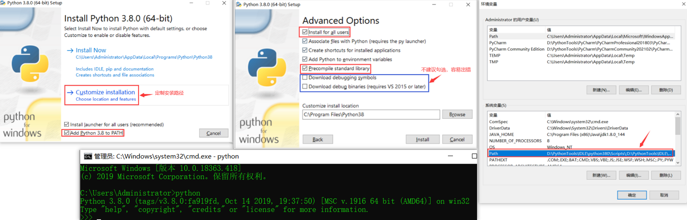


## pip

pip是Python的包管理工具，用于安装、升级和管理Python第三方库，默认集成在Python 3.4及以上版本中，是Python生态系统的核心组成部分。‌‌‌‌

安装PIP：`python get-pip.py`。

## windows下搭建python的虚拟环境

### virtualenv

安装virtualenv：`pip install virtualenv`（py2安装）、`pip3 install virtualenv`（py3安装）。

在当前目录下创建一个虚拟环境名（创建完之后显示是一个文件夹）：`virtualenv envname`。

激活virtualenv（进入到虚拟环境目录，然后执行命令）：`cd Scripts`、`activate`（激活成功）、`python`（查看python是否正常）。

退出虚拟环境：直接在环境中`deactivate`就可以退出。

删除虚拟环境：`rm -r venv`，或直接删除虚拟环境所在的文件夹。

### virtualenvwapper

Virtaulenvwrapper是virtualenv的扩展包（管理包），用于更方便管理虚拟环境，功能很强大。

（python2环境）安装：`py -2 -m pip install virtualenvwrapper-win`、`pip install virtualenvwrapper-win`。
（python3环境）安装：`py -3 -m pip install virtualenvwrapper-win`。

安装virtualenv：`mkvirtualenv envname`。

查看进入虚拟环境：`workon`。


## 使用PyCharm

PyCharm官网：https://www.jetbrains.com/pycharm/download/#section=windows

注意：不要把PyCharm软件安装在有中文的目录下。


PyCharm的常用快捷键：
`Ctrl + /`，单行注释；
`Ctrl + D`，快速复制一行；
`Ctrl + Y`，快速删除一行；
`Ctrl + Alt + L`，快速格式化代码。

PyCharm软件界面包含菜单栏、工作区、脚本文件、处理结果区等区域。

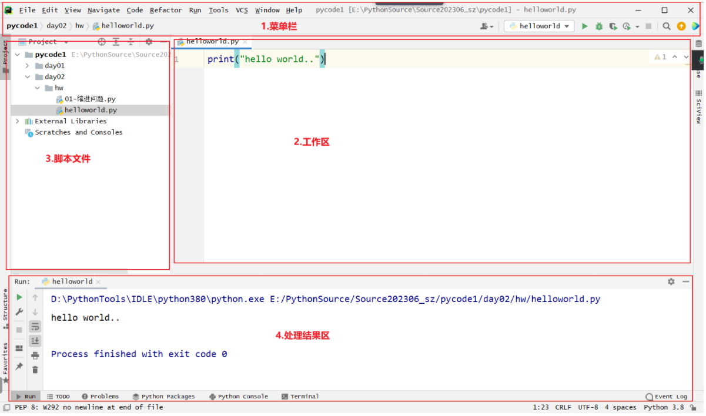

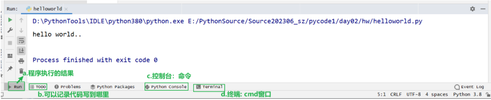

**安装一些实用插件：**


**新建项目：**

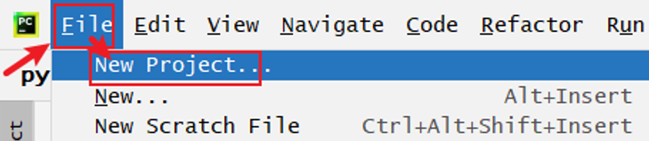

对于`Interpreter type`：
如果选择`project venv`，则表示创建项目的时候，也会创建和使用下面选择的Python版本；
如果选择Custom environment（自定义环境），且Environment选择`Select existing `，则`Base python`会选择系统安装的Python版本。

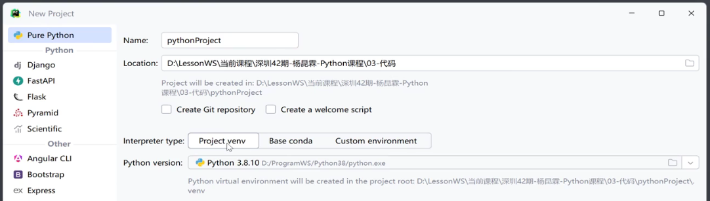

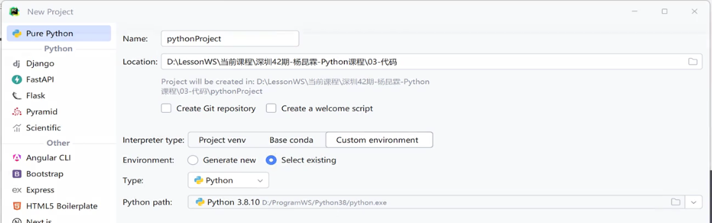

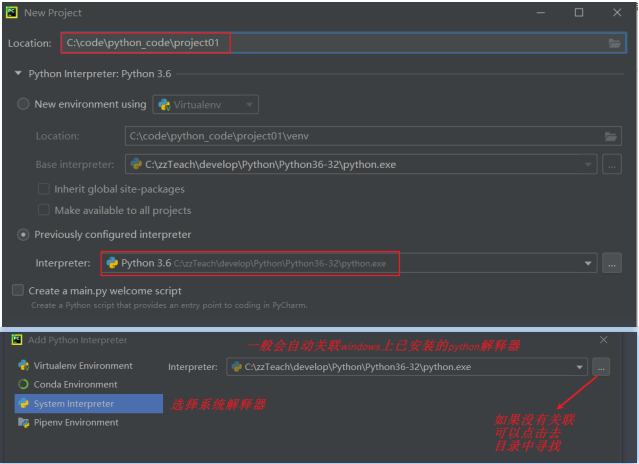

**新建目录和新建py文件：**

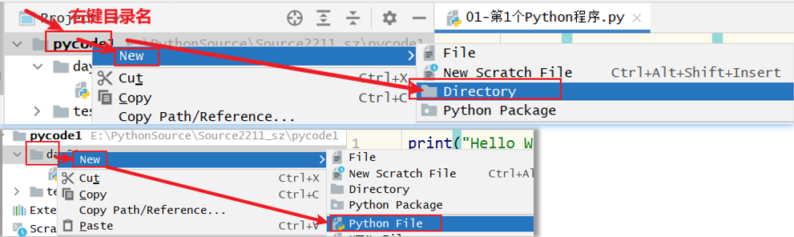

**运行程序：**

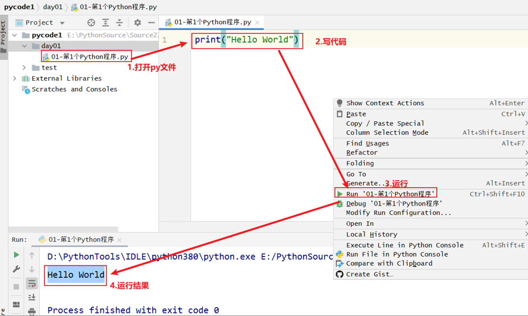

**重命名：**Refactor>Rename，用于对文件名或代码中的变量名进行重构。

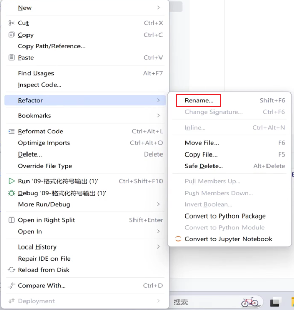

**刷新：**

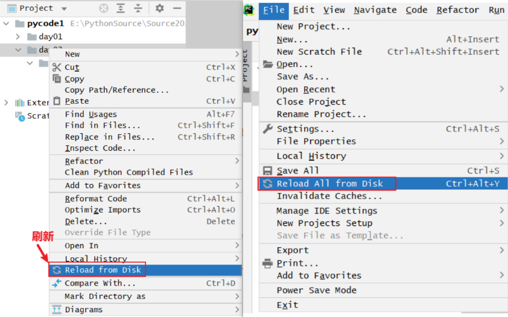

**连接DB：**

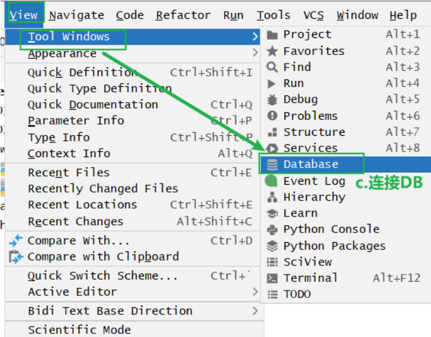

**断点调试：**右键点击Debug，进行断点调试。

调试图标的含义：
第1个，表示重新debug；
第2个，表示停止当前的debug；
第3个，表示执行下一个断点；
第4个，表示暂停当前运行；
第5个，顺着代码一行一行地运行，不会进入方法；
第6个，进入方法或进入类库；
第7个，进入方法，但只进入自己写的方法；
第8个，跳出当前方法；
第9个，显示当前所有的断点位置；
第10个，忽略当前断点。

右边的显示界面可以查看程序中的变量的情况。

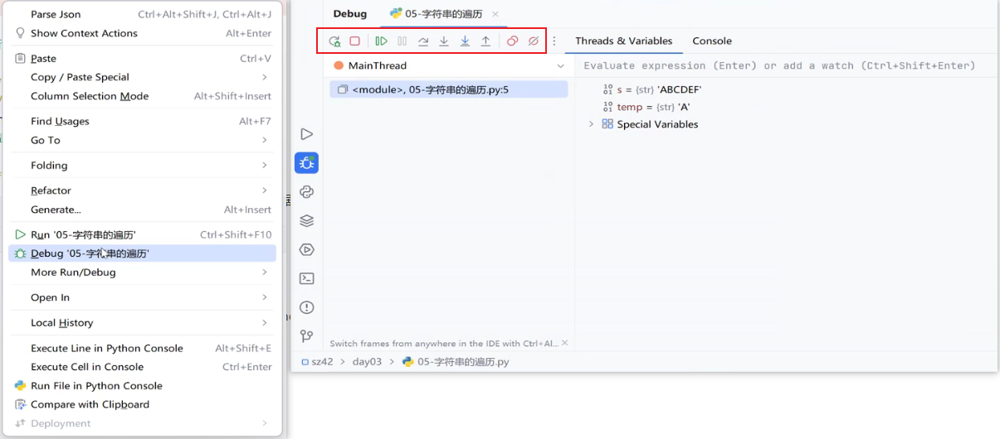


## Python基础语法

### 注释

注释：在程序中，对代码进行解释说明的文字。

一个合格的程序，注释内容应该占总代码量的30%左右。

在Python程序中，注释了某些文本内容，运行Python时，会绕开该注释信息，而不会被Python解释器识别。

- 在Python中，注释分为两类：

1、单行注释。以#开头，#右边的所有文字当作注释内容。

格式：`# 注释文字内容`。

2、多行注释。以三个引号（单引号或双引号）引起来的内容作为对代码的解释说明。

```python
格式：
"""
	多行注释内容1
	....
	多行注释内容2
"""
```

### 关键字

在Python语言中，关键字是指已经使用的一些词语，且具有特殊意义。Python不允许开发者定义与关键字同名的变量。

可以使用keyword库来查看所有关键字：

```python
import keyword
print(keyword.kwlist) # ['False', 'None', 'True', 'and', 'as', 'assert', 'async', 'await', 'break', 'class', 'continue', 'def', 'del', 'elif', 'else', 'except', 'finally', 'for', 'from', 'global', 'if', 'import', 'in', 'is', 'lambda', 'nonlocal', 'not', 'or', 'pass', 'raise', 'return', 'try', 'while', 'with', 'yield']
```

### 标识符

标识符是指用来标识某个实体的一个符号，在不同的应用环境下有不同的含义。通俗地说，标识符就是开发者在程序中定义的所有名字，如变量名。

标识符要遵循的命名规范：见名知意；由数字、字母、下划线组成，且不能以数字开头；区分大小写；不能和关键字同名；长度没有限制，但是最好不要超过15个字符。

### 命名方法

常见命名方法指的是在标识符的基础上，增加额外要求。

- 在Python中，常见命名方法有：

1、小驼峰式命名法（lower camel case）。 第一个单词以小写字母开始，第二个单词及之后单词的首字母大写。

2、大驼峰式命名法（upper camel case）。 所有单词首字母大写，其余字母均小写。

3、下划线命名法。用下划线_来连接所有的单词。

- 一般地，Python推荐使用下划线命名。

- 常见的为了给Python标识符新增的一些额外要求：

1、变量名、函数名、方法名，所有字母均小写，且单词与单词之间使用下划线连接。

2、模块名，所有字母均小写。

3、类名，遵循大驼峰命名法。

### 变量

变量指的是程序在运行过程中，数值会改变的量。通俗地说，变量就是用来存储数据的。

定义变量的语法：`变量名 = 值`。

定义变量后的结尾处不用添加分号；可以通过变量名来访问变量值。

### 数据类型

在Python中，不同类型的变量，存放的数据也不同。

可以使用`type(变量名)`来查看数据类型。

**常见的数据类型有：**

1、int，整型，属于基本数据类型。用于存放整数。

```python
a = 99
print(type(a)) # <class 'int'>
```

2、float，浮点型，属于基本数据类型。用于存放小数。

```python
b = 1.5
print(type(b)) # <class 'float'>
```

3、bool，布尔型，属于基本数据类型。用于表示真或假，值只有两种（True、False）。

```python
c = True
print(type(c)) # <class 'bool'>
```

4、str，字符串，属于对象类型，是可变长的字符列表。使用引号引起来的内容。

**数据类型转换：**

把某数据转换为指定数据类型的语法：`指定数据类型(变量名)`。指定数据类型指的是数据类型的具体名。

int(x)，将x转换为一个整数。
float(x)，将x转换为一个浮点数。
str(x)，将x转换为字符串。
eval(str)，用来将已转换后的数据结果，重新转换为原始数据类型。
tuple(s)，将序列s转换为一个元组。
list(s)，将序列s转换为一个列表。

```python
print(type(eval("12"))) # <class 'int'>
print(type(eval("12.25"))) # <class 'float'>
print(type(eval("True"))) # <class 'bool'>
```

**不可变数据类型：**
1、数字类型：int（整型）、float（浮点型）、complex（复数型）。
2、bool（布尔型）。
3、str（字符串类型）。
4、tuple（元组类型）。
5、frozenset（冻结集合类型）。

**可变数据类型：**
1、list（列表）。
2、dict（字典）。
3、set（集合）。

### 转义字符

转义字符，指的是无法直接表达本身含义，就需要转化含义来显示。若要给一个字符转义，通常要在字符前添加`\`。

转义字符有：
1、`\n`，换行符。给内容进行换一行显示。
2、`\t`，水平制表符。缩进一个tab键的空白位置，也可以当成是缩进4个空格。
3、`\\`，反斜杠。表示一个反斜杆。
4、`\"`，单个双引号。表示单个双引号。

### print输出函数

`print()`函数的语法：`print(args)`。参数args可以是一个变量名，或具体的数据值。

print()输出函数有自动换行的效果，原因是底层源码设置了默认值`\n`。如果要取消换行效果，只需把end值修改为其它内容。

打印多个值：`print(值1, 值2, 值3......)`。
自定义结束符：`print(值1, 值2, 值3......, end="\n")`。

```python
print('深"''"圳') # 分别处理'深"'和'圳"' # 深""圳
print('深"\'\'"圳') # 深"''"圳
print('1', end="哈哈") # 1哈哈
```

### 格式化符号输出

在Python中，完整的格式化符号要与%一同使用。

%d，表示整数。
%s，表示通过str()字符串转换后的格式化，即字符串。
%f，表示浮点数，即有小数点的数值。

注意：让一个符号具有格式化的效果，一般要在前面添加%；当使用格式化符号占据位置后，再使用变量去替换；字符串和变量之间要使用%连接。

使用格式：`"%d, %s, %f" % (变量1，变量2.....)`

```python
aaa = '你好'
bbb = 5
ccc = 1000000.3568
percent = bbb / ccc
print("测试一%s，哈哈%d好好，结果是%f的" % (aaa, bbb, ccc)) # 测试一你好，哈哈5好好，结果是1000000.3568的
print("测试一%s，哈哈%d好好，结果是%20.10f的" % (aaa, bbb, ccc)) # 测试一你好，哈哈5好好，结果是  1000000.3568000000的
print("占比：%.2f%%" % (percent * 100))
```

### format格式化输出

在Python中，用于格式化显示内容。

format()函数的语法：`xxx{}xxx.format(args)`，参数args可以替换前面的变量名。

在Python 3.6之后的版本，可以使用`print(f"xxx{变量名1}xxx{变量名2}xxx")`或`print(F"xxx{变量名1}xxx{变量名2}xxx")`。

```python
name = "你好"
num = "188"
print("测试一{name}，哈哈好好{num}，结果。") # 测试一{name}，哈哈好好{num}，结果。
print("测试一{}，哈哈好好{}，结果。".format(name, num)) # 测试一你好，哈哈好好188，结果。
# 可以自定义顺序：
print("测试一{1}，哈哈好好{0}，结果。".format(name, num)) # 测试一188，哈哈好好你好，结果。
print(F"测试一{name}，哈哈好好{num}，结果。") # 测试一你好，哈哈好好188，结果。
# 常用写法：
print(f"测试一{name}，哈哈好好{num}，结果。") # 测试一你好，哈哈好好188，结果。
```

### input()输入函数

输入表示从键盘上录入内容，并在程序中使用变量接收。

input()函数语法：`input(x)`，用于接收从键盘上录入的内容。参数x是字符串型数据，表示给用户的提示信息。input函数接收的数据内容为str数据类型。

```python
password = input("请输入密码：")
print(f"当前输入的密码为：{password}")
print(type(password))
"""
	请输入密码：abc
	当前输入的密码为：abc
	<class 'str'>
"""
```


## Python流程控制

### 运算符

- 运算符是用于执行程序代码的操作运算。

**算术运算符：**指的是用于基本的算术运算.

1、`+`，加法。两个数相加。
2、`-`，减法。两个数相减。
3、`*`，乘法。两个数相乘。注意，字符串乘以数值，相当于对字符串进行复制。
4、`/`，除法。两个数相除。
5、`//`，取整除。两个数相除取商的整数部分。
6、`%` ，求余（取模）。两个数相除取余数值。
7、`**`，次幂（次方）。x**y表示返回x的y次幂。

**赋值运算符：**指定数值的符号，最常用的就是`=`（赋值号）。

1、`=`，赋值。`c =a+b`，将a+b的值赋值给c。
2、`+=`，加等于。`m += n`，等同于`m = m + n`。
3、`-=`，减等于。`m -= n`，等同于`m = m - n`。
4、`*=`，乘等于。`m *= n`，等同于`m=m * n`。
5、`/=`，除等于。`m /= n`，`等同于m = m / n`。
6、`//=`，取整除等于。`m //= n`，等同于`m = m // n`。
7、`%=`，求余等于（取模等于）。`m %= n`，等同于`m = m % n`。
8、`**=`，幂等于。`m **= n`，等同于`m = m ** n`。

**比较运算符：**也称为关系运算符，用于比较两边的操作数，且结果总是布尔型的True或False。

在实际应用中，通常将比较运算的结果当做条件判断来处理。

1、`==`，等于。
2、`!=`，不等于。
3、`<`，小于。
4、`>`，大于。
5、`<=`，小于等于。
6、`>=`，大于等于。

**逻辑运算符：**用于进行逻辑处理，通常情况下，运行的两端都是布尔值（True或False）。

1、`and`，与。`a and b`。
2、`or`，或。`a or b`。
3、`not`，非。`not m`。

- 运算符的优先级从高到低的顺序：

小括号，`()`，优先级19，结合性无。
索引运算符，`x[i]`或`x[i1: i2 [:i3]]`，优先级18，结合性左。
属性访问，`x.attribute`，优先级17，结合性左。
乘方，`**`，优先级16，结合性右。
按位取反，`~`，优先级15，结合性右。
符号运算符，`+`（正号）、`-`（负号），优先级14，结合性右。
乘除，`*`、`/`、`//`、`%`，优先级13，结合性左。
加减，`+`、`-`，优先级12，结合性左。
位移，`>>`、`<<`，优先级11，结合性左。
按位与，`&`，优先级10，结合性右。
按位异或，`^`，优先级9，结合性左。
按位或，`|`，优先级8，结合性左。
比较运算符，`==`、`!=`、`<`、`>`、`<=`、`>=`，优先级7，结合性左。
is运算符，`is`、`is not`，优先级6，结合性左。
in运算符，`in`、`not in`，优先级5，结合性左。
逻辑非，`not`，优先级4，结合性右。
逻辑与，`and`，优先级3，结合性左。
逻辑或，`or`，优先级2，结合性左。
逗号运算符，`exp1`，`exp2`，优先级1，结合性左。

### 三大基本语句

Python中有三大基本语句，它们支撑起了程序的业务逻辑处理。在实际开发中，通常是将顺序语句、分支语句、循环语句混合使用。

三大基本语句有：

- 顺序语句：让代码按照顺序从上往下、一行一行的执行代码。

- 分支语句：程序在遇到不同条件时，要做判断处理。

- 循环语句：反复多次执行某操作，也可以设定终止循环的关键字。。

### if语句

if可以用于做条件判断处理。条件的结果总是布尔型的，且if语句后要使用Tab进行强制缩进。

如果if语句后暂时不写代码，或if后面没要执行代码时，则要加上pass关键字占据空位置。

```python
# if语句的语法：
if 条件: 
   条件成立时，要做的事情

# if-else语句的语法：
if 条件:
   满足条件时，要做的事情1
   ...(省略)...
else:
   不满足条件时，要做的事情2
   ...(省略)...

# if...elif...else...语句的语法：
if 条件1:
   满足条件1，执行代码1
   ...
elif 条件2:
   满足条件2，执行代码2
   ...
elif 条件3:
   满足条件3，执行代码3
   ...
else:
   所有条件都不满足执行的代码

# if嵌套语句语法：
if 条件1:
   满足条件1，做的事情1
   ...
   if 条件2:
      满足条件2，做的事情2
      ...
```

### while循环

当满足条件判断时，就反复多次地执行指定代码。

在使用while循环时，建议先写改变循环条件的语句，这样可以避免产生更多错误。

```python
# while循环语法：
初始化变量语句
while 循环条件:
    循环体语句
    改变循环条件的语句
```

- 死循环：也称为无限循环，指的是程序代码一直执行，不会停止。

产生死循环的情况有：缺少了改变循环条件的语句；误写了循环条件；标准的死循环格式。

```python
# 死循环格式：
while True:
   代码
   ...
```

- 嵌套循环：通俗地说，嵌套循环就是指外层有一个循环，里面再嵌套一个内层循环。在while循环内，再包含一个while循环，也可以使用两个for语句形成嵌套语句。

可以把内层循环当做一个循环的循环体语句来处理。当外层循环执行一次，内层循环执行所有。

```python
# 嵌套循环的语法：
初始化变量语句1
while 循环条件1: # 外层循环
    [循环体语句1]
    初始化变量语句2
    while 循环条件2: # 内层循环
        循环体语句2
        改变循环条件的语句2
    改变循环条件的语句1
```

- break语句：break语句主要是用于终止某个循环语句块的执行。break会终止循环的执行。

```python
# break的语法：
循环语句块
    ……
    break
其它语句
```

- continue语句：continue语句不常使用，表示用于跳过某个循环语句块的一次执行，然后继续执行下一轮的循环。

```python
# continue的语法：
循环语句块
    ……
    continue
其它语句
```

### for循环

for语句能完成反复多次的执行。

序列指的是能被循环处理的数据类型，如列表、字符串等。

for可以配合else关键字一起使用，for循环的else的外层中括号`[]`代表可选，即可选可不选。

```python
# for循环语法：
for 临时变量 in 序列:
    满足条件时，执行的代码
    ……
[else:
    当for循环正常执行结束后，执行代码]
```

- `range()`函数：`range(x, y)`，一个序列，专门用于给for循环使用。`range()`中的参数表示从x到y的取值（整数值），即`[x,y)`，表示能获取到x值，但获取不到y值。

如果只有一个参数，`range(stop)`，则取值在`[0,stop)`之间。
如果有两个参数，`range(start, stop)`，则取值在`[start, stop)`之间。
如果有三个参数，`range(start, stop, step)`，则取值在`[start, stop)`，且每次数字的步进为step。

```python
print(range(10)) # range(0, 10)

for i in range(10):
    print(i, end='\t')
# 0   1   2   3   4   5   6   7   8   9

for i in range(1, 10):
    print(i, end='\t')
# 1   2   3   4   5   6   7   8   9

for i in range(1, 10, 2):
    print(i, end='\t')
# 1   3   5   7   9

for i in "nihao":
    print(i, end='\t')
else:
    print("结束")
# n   i   h   a   o   结束

for i in "nihao": # 字符串本质上就是一个字符序列
    print(i, end='\t')
    if s == 'a':
        break
else:
    print("结束")
# n   i   h   a
```


## Python容器

容器是用来存放数据的。在Java中，叫集合，但只能放同种类型的数据。

对容器中的数据进行处理的方法：`变量名.函数(x)`。变量名即容器的名称。

常见容器有：
1、字符串，str。使用双引号引起来的内容，是有序列的容器。
2、列表，list。使用`[]`表示的内容，是有序列的容器。
3、元组，tuple。使用`()`表示的内容，是有序列的容器。里面有几个元素就叫几元组。
4、字典，dict。使用`{}`表示，内部元素是键值对。

```python
s = "nihao"
print(type(s)) # <class 'str'>
l = ['哈哈', 'hh', 'nihao', 99]
print(type(l)) # <class 'list'>
print(len(l)) # 4
t = ('哈哈', 'hh', 'nihao', 99)
print(type(t)) # <class 'tuple'>
d = {'aa': s, 'bb': t, 'cc': s}
print(type(d)) # <class 'dict'>
```

### 字符串

创建字符串的语法：`变量名 = "内容"`。

字符串可以使用双引号、单引号、三个双引号、三个单引号表示，较常见的是双引号表示。
如果字符串中有引号时，单引号中可以有双引号，双引号中可以有单引号；如果有重复的引号，则可以加转义字符。
字符串只能与字符串直接拼接；字符串与非字符串不能直接拼接，但可以通过格式化的方式拼接；字符串不能与数值直接拼接，否则会报错。

字符串的索引，也称为下标、编号，可以获取容器中指定位置的元素。索引值是从0开始计算的，最大的索引是`容器的长度-1`。
索引编号支持负索引，从-1开始编号，最大索引是`-len()`。
获取字符串元素的语法：`变量名[索引值]`。

字符串长度的表示方式：`len(s)`，返回变量s的长度或元素个数。长度值是从1开始计算的。
索引与长度的关系可表示为：`最大索引值 = 长度 - 1`。

切片：指截取字符串中的一部分内容。
切片的语法：`[起始:结束]`。
如果需要每隔几个字符来截取内容，则可以加入步长，即`[起始:结束:步长]`，且默认步长为1。
切片语法选取的范围是左闭右开型，即`[起始, 结束)`，表示在截取内容时，包含起始位，但不包含结束位。省略开始，表示从0开始；省略结束，表示到最后一个元素结束（包含最后一个元素）；开始结束都省略，即`容器[::]`，表示从开始到结束都包含；步长为负数，表示倒着截取内容，此时开始是-1，结束是`-len(容器)`。

如果想快速获取字符串的所有元素，可以直接使用for循环或while循环，但应该优先考虑使用for循环来遍历。
使用for语句遍历字符串时，无法直接显示索引值。

字符串的查找方法：指的是查找元素（或子串）在字符串内容的索引位置。
1、`find(sub)`。检测sub是否包含在字符串中，如果是，则返回sub所在开始的索引，否则返回-1。在实际应用中，优先使用该方法查找字符串元素，因为该方法更稳定。
2、`index(sub)`。检测sub是否包含在字符串中，如果是，则返回sub所在开始的索引，但当sub在字符串中不存在时，会报错。
3、`rfind(sub)`。从右往左找子串在字符串的某个索引（找的是从左往右最后一次出现的该字符串）。
4、`count(sub)`。计算sub在字符串中出现的总次数。

字符串的修改方法：指的是修改字符串中的数据。
1、`replace(old, new)`。用于将字符串中的old内容替换成new内容；如果传第三个参数（count），则表示要替换的次数，-1（默认值）表示替换所有的匹配项。
2、`split(sep)`。使用指定内容sep来对字符串进行切割；参数必传，否则报错（empty separator）。
3、`strip()`。用于去掉字符串前后的空白内容（默认会去除前后两端的空格），如果设置参数，会根据参数去除前后两端对应的参数内容。

```python
s = "HelloWorld"
print(s[0]) # H
print(len(s)) # 10
print(s[len(s) - 1]) # d
print(s[1:5]) # ello
print(s[0:5]) # Hello
print(s[:5]) # Hello
print(s[2:]) # lloWorld
print(s[2:-1]) # lloWorl
print(s[1:7:2]) # elW
# 如果要从后往前数，可以使用负数表示，对字符串进行反转
print(s[::-1]) # dlroWolleH
# 如果结束索引值大于实际边界，则虽然可以正常执行，但是只能取到最后的索引位置
print(s[0:100]) # HelloWorld
# 如果直接获取索引值大于实际边界，则会报错（超出索引边界）
print(s[100]) # 报错

# 使用for循环来遍历元素；
s = "ABCDEF"
for temp in s:
    print(temp, end='\t')
else:
    print("遍历结束")
# A   B   C   D   E   F   遍历结束

# 当需要获取元下标时，通过下标循环遍历字符串中的元素
for i in range(0, len(s)):
    print(f"{s[i]}是第{i + 1}个", end='\t')
# A是第1个   B是第2个   C是第3个   D是第4个   E是第5个   F是第6个

# 使用while循环遍历字符串
i = 0
while i < len(s):
    print(s[i], end='\t')
    i += 1
# A   B   C   D   E   F

str1 = "  hello world and 哈哈 and ni and hao"
str2 = "aaaaaaaaaaaaa"
print(str1.find("and")) # 14
print(str1.index("and")) # 14
print(str1.find("666")) # -1
# print(str1.index("666")) # 报错（ValueError: substring not found）
print(str1.rfind("and")) # 28
print(str1.count(" ")) # 9
print(str2.count("aaa")) # 4
print(str1.replace(" ", "666", 1)) # 666 hello world and 哈哈 and ni and hao
print(str1.split(sep=' ')) # ['', '', 'hello', 'world', 'and', '哈哈', 'and', 'ni', 'and', 'hao']
print(str1.split(sep='a')) # ['  hello world ', 'nd 哈哈 ', 'nd ni ', 'nd h', 'o']
print(str1.strip()) # hello world and 哈哈 and ni and hao
print(str1.strip("o")) #   hello world and 哈哈 and ni and ha
```

#### 字符串操作大全

##### capitalize

把字符串的第一个字符大写。`mystr.capitalize()`。

##### title

把字符串的每个单词首字母大写。

```python
a = "hello itcast"
a.title()
print(a) # 'Hello Itcast'
```

##### startswith

检查字符串是否是以xxx开头，是则返回True，否则返回False。`mystr.startswith(xxx)`。

##### endswith

检查字符串是否以xxx结束，是则返回True，否则返回False。`mystr.endswith(xxx)`。

##### lower

转换mystr中所有大写字符为小写。`mystr.lower()`。

##### upper

转换mystr中的小写字母为大写。`mystr.upper()`。

##### ljust

返回一个原字符串左对齐，并使用空格填充至长度width的新字符串。`mystr.ljust(width)`。

##### rjust

返回一个原字符串右对齐，并使用空格填充至长度width的新字符串。`mystr.rjust(width)`。

##### center

返回一个原字符串居中，并使用空格填充至长度width的新字符串。`mystr.center(width)`。

##### lstrip

删除mystr左边的空白字符。`mystr.lstrip()`。

##### rstrip

删除mystr字符串末尾的空白字符。`mystr.rstrip()`。

##### strip

删除mystr字符串两端的空白字符。

```python
a = "\n\t itcast \t\n"
a.strip()
print(a) # 'itcast'
```

##### rfind

从右边开始查找。`mystr.rfind(str, start=0, end=len(mystr))`

##### rindex

从右边开始。`mystr.rindex( str, start=0,end=len(mystr))`。

##### partition

把mystr以str分割成三部分，str前、str和str后。`mystr.partition(str)`。

##### rpartition

从右边开始。`mystr.rpartition(str)`。

##### splitlines

按照行分隔，返回一个包含各行作为元素的列表。`mystr.splitlines()`。

##### isalpha

如果mystr所有字符都是字母则返回True，否则返回False。`mystr.isalpha()`。

##### isdigit

如果mystr只包含数字则返回True，否则返回 False。`mystr.isdigit()`。

##### isalnum

如果mystr所有字符都是字母或数字则返回True，否则返回False。`mystr.isalnum()`。

##### isspace

如果mystr中只包含空格则返回True，否则返回False。`mystr.isspace()`。

##### islower

如果mystr只包含小写字母则返回True，否则返回 False。`mystr.islower()`。

##### isupper

如果mystr只包含大写字母则返回True，否则返回False。`mystr.isupper()`。

### 列表

列表可以用于存放任意类型的数据。

创建列表的语法：`变量名 = [元素1, 元素2, 元素3,...]`。列表的多个元素之间使用逗号（`,`）分隔。

获取列表元素的语法：`变量名[索引值]`。

列表长度的表示方式：`len(s)`，返回变量s的长度或元素个数。长度值是从1开始计算的。
索引与长度的关系可表示为：`最大索引值 = 长度 - 1`。
当给列表变量添加新内容后，列表的长度也会变化。

给列表添加元素的方法：
1、`append(x)`。用于在列表结尾处，添加数据内容x。
2、`insert(index, x)`。用于在列表索引index处，新增一个元素x。指定位置添加，原来位置及之后的元素全部自动后移。
3、`extend(x)`。用于给列表添加另一个列表的所有元素内容，并形成一个完整列表。

删除列表元素的方法：
1、`remove(x)`。删除列表元素值x。
2、`del 变量名[索引]`。根据索引值，删除列表的某个元素。
3、`pop(索引)`。弹出元素；如果不传索引参数，则默认弹出最后一个元素。

修改列表元素的方法：
1、`变量名[索引] = 值`。根据索引值，来修改列表中的某个元素值。

查找元素的方法：
1、`in`。判断指定数据是否在某个列表序列中，如果在就返回True，否则返回False。

排序通常指按从小到大、从大到小的顺序排列。
排序的方法：
1、`reverse()`。将列表进行倒序，即输入顺序与输出顺序相互倒过来。
2、`sort([reverse=False])`。对列表进行从小到大排序，当设置reverse=True时，可改为由大到小排序。

```python
print(list('ab3')) # ['a', 'b', '3']
print(list(('a', 'b', 3))) # ['a', 'b', 3]

list = ["你好", "哈哈", 38, 0, True]
print(list) # ['你好', '哈哈', 38, 0, True]
s = "Python"
print(list(s)) # ['P', 'y', 't', 'h', 'o', 'n']

list0 = ['你好', '哈哈', 'hh', '啊啊']
# 使用for循环来遍历列表
for element in list0:
    print(element, end='\t')
# 你好   哈哈   hh   啊啊

# 使用while循环来遍历列表
index = 0
while index < len(list0):
    print(list0[index], end='\t')
    index += 1
# 你好   哈哈   hh   啊啊

list1 = ['你好', '哈哈', 'hh', '啊啊']
list1.append('哦哦')
print(list1) # ['你好', '哈哈', 'hh', '啊啊', '哦哦']
list1.insert(2, 'aa')
print(list1) # ['你好', '哈哈', 'aa', 'hh', '啊啊', '哦哦']
list2 = [100, 200, 300]
# print(list1.extend(list2)) # None
list1.extend(list2)
print(list1) # ['你好', '哈哈', 'aa', 'hh', '啊啊', '哦哦', 100, 200, 300]

list3 = ['你好', '哈哈', 'hh', '啊啊']
print(list3) # ['你好', '哈哈', 'hh', '啊啊']
list3.remove('hh')
print(list3) # ['你好', '哈哈', '啊啊']
del list3[1]
print(list3) # ['你好', '啊啊']
print(list3.pop(0)) # 你好
print(list3) # ['啊啊']

list4 = [10, 200, 20, 100, 30, 0]
list4.reverse()
print(list4) # [0, 30, 100, 20, 200, 10]
list4.sort()
print(list4) # [0, 10, 20, 30, 100, 200]
list4.sort(reverse=True)
print(list4) # [200, 100, 30, 20, 10, 0]

list5 = [{"name": "你好", "age": 10}, {"name": "哈哈", "age": 20}, {"name": "hh", "age": 30}]
list5.sort(key=lambda item: item["age"], reverse=True)
print(list5) # [{'name': 'hh', 'age': 30}, {'name': '哈哈', 'age': 20}, {'name': '你好', 'age': 10}]
```

```python
# 使用ASCII码通过chr()转换为字母字符
print(chr(65)) # A

for i in range(65, 91):
    print(chr(i), end='') # ABCDEFGHIJKLMNOPQRSTUVWXYZ

print("ABCDEFGHIJKLMNOPQRSTUVWXYZ".lower()) # abcdefghijklmnopqrstuvwxyz

list1 = []
for i in range(65, 91):
    list1.append(chr(i))
print(list1) # ['A', 'B', 'C', 'D', 'E', 'F', 'G', 'H', 'I', 'J', 'K', 'L', 'M', 'N', 'O', 'P', 'Q', 'R', 'S', 'T', 'U', 'V', 'W', 'X', 'Y', 'Z']

list2 = [chr(i) for i in range(65, 91)]
print(list2) # ['A', 'B', 'C', 'D', 'E', 'F', 'G', 'H', 'I', 'J', 'K', 'L', 'M', 'N', 'O', 'P', 'Q', 'R', 'S', 'T', 'U', 'V', 'W', 'X', 'Y', 'Z']
```

### 元组

元组的元素可以是不同类型的数据。

元组的元素只能用来查询，且元素不可以修改、不可以删除、也不可以添加。

创建元组的语法：`变量名 = (元素1, 元素2, 元素3,...)`。
定义元组时，需要使用小括号（`()`），用逗号（`,`）隔开各个元素。
当元组中仅有一个元素时，应该定义为`(元素, )`。

元组的常见操作：
1、`元组变量名[索引]`。按索引值查找数据。
2、`index(x)`。查找某个数据，当数据不存在时会报错。
3、`len(x)`。表示元组中元素的总个数。
4、`in`。用于判断元素是否出现在元组中。

元组可以使用循环来处理。若要遍历元组的数据内容，优先考虑使用for循环。

元组的常见的应用场景：
1、当要存放一些固定值和内容时，优先考虑使用元组。
2、让数据不可以修改、删除、添加，保护数据安全。
3、格式化符号后，使用%百分号连接的`()`内容，本质上就是一个元组。
4、Python函数后面的任意多个参数，是元组形式。

```python
t = (4)
print(t1) # 4
t0 = (4,)
print(t1) # (4,)
t1 = (4, 5, 6, 'a', '你好')
print(t1) # (4, 5, 6, 'a', '你好')

t2 = ('你好', '哈哈', 'hh', '啊啊')
# t2[0] = 'python' # 报错（TypeError: 'tuple' object does not support item assignment）
# del t2[0] # 报错（TypeError: 'tuple' object doesn't support item deletion）
print(t2[2]) # hh
print(t2.index('hh')) # 2
print(len(t2)) # 4
print("Hello" in t2) # False
print(t2[1:3]) # ('哈哈', 'hh')

t3 = ('你好', '哈哈', 'hh', '啊啊')
for element in t3:
    print(element, end='\t')
# 你好   哈哈   hh   啊啊

index = len(t3) - 1
while 0 <= index < len(t3):
    print(t3[index], end='\t')
    index -= 1
# 啊啊   hh   哈哈   你好
```

### 字典

python中的一个双列容器，用来存储键值对数据。可以使用字典存储大量数据。字典中的元素不分先后顺序，可任意存储字典的数据。
键、值组合在一起，形成了字典的元素；字典元素的键必须要用引号表示，否则报错；字典元素的键是唯一的，如果写了多个相同的key，则只会保留最后的一个；字典元素的值可以重复。

创建字典的语法：`变量名 = {键1: 值1, 键2: 值2, ...}`。

通常情况下，使用字典的是获取元素键值对的值。

通过键来访问值的方式：
1、`变量名[键]`。当查找不存在的key时，会报错。
2、`get(key[, default])`。返回指定键key对应的值，若值不在字典中，则返回默认值。当访问不存在的键时，可以提升稳定性。

添加元素和修改元素的语法：`变量名[键] = 值`。

删除元素的方法：
1、`del 变量名[键]`。删除指定元素。
2、`clear()`。清空字典的所有元素内容。当要添加新的纯净数据前，要先把原有数据做清空处理。

遍历字典的元素内容，即获取字典的键、值。常用的方法：
1、`keys()`。以列表的形式，返回一个字典所有的键。
2、`values()`。以列表的形式，返回一个字典所有的值。
3、`items()`。返回由键值组成的序列，主要应用于遍历字典。

```python
dict1 = {"name": "你好", "sex": "哈哈", "address": "hh", "age": 16}
print(dict1) # {'name': '你好', 'sex': '哈哈', 'address': 'hh', 'age': 16}
dict2 = {"name": "你好", "sex": "哈哈", "address": "hh", "age": 16, "sex": "啊啊"}
print(dict2)  # {'name': '你好', 'sex': '啊啊', 'address': 'hh', 'age': 16}

print(dict1["name"]) # 你好
print(dict1.get("name")) # 你好
# print(dict1['skill']) # 报错
print(dict1.get("test")) # None
print(dict1.get("test", "不存在")) # 不存在

key_list = dict1.keys()
print(key_list) # dict_keys(['name', 'sex', 'address', 'age'])
print(list(key_list)) # ['name', 'sex', 'address', 'age']
for key in key_list:
    print(f"{key}，{dict1[key]}", end='\t')
# name，你好   sex，哈哈   address，hh   age，16

value_list = dict1.values()
print(value_list) # dict_values(['你好', '哈哈', 'hh', 16])
for value in value_list:
    print(value, end='\t')
# 你好   哈哈   hh   16

items = dict1.items()
print(items) # dict_items([('name', '你好'), ('sex', '哈哈'), ('address', 'hh'), ('age', 16)])
for kv in items:
    print(f"{kv[0]}，{kv[1]}", end='\t')
# name，你好   sex，哈哈   address，hh   age，16
```

### 公共运算符

公共运算符：指的是可以运用于Python容器的一些运算符。
1、`+`，合并。支持的容器类型有字符串、列表、元组。
2、`-`，复制。支持的容器类型有字符串、列表、元组。
3、`in`，素是否存在。支持的容器类型有字符串、列表、元组、字典。
3、`not in`，元素是否不存在。支持的容器类型有字符串、列表、元组、字典。

```python
# 对字符串的+的运算操作
str1 = "你"
str2 = str1 + "好"
print(str2) # 你好
# 对字符串的*的运算操作
print("你" * 4) # 你你你你

# 对列表的+的运算操作
list1 = [1, 2, 3]
list2 = list1 + list1
print(list2) # [1, 2, 3, 1, 2, 3]
# list2 = list1 + 3 # 报错（TypeError: can only concatenate list (not "int") to list）。列表不能与数字相加
# 对列表的*的运算操作
list3 = list1 * 2
print(list3) # [1, 2, 3, 1, 2, 3]
# list3 = list1 * list1 # 报错（TypeError: can't multiply sequence by non-int of type 'list'）。列表不能与非数值进行相乘操作

# 对元组的+的运算操作
tuple1 = (1, 2, 3)
tuple2 = tuple1 + tuple1
print(tuple2) # (1, 2, 3, 1, 2, 3)
# 对元组的*的运算操作
tuple3 = tuple1 * 2
print(tuple3) # (1, 2, 3, 1, 2, 3)

list4 = [1, 2, 3, 4, [5, 6, 7]]
print(5 in list4) # false
print(5 not in list4) # True
print([5, 6, 7] in list4) # True
```

### 公共方法

公共方法：指的是能适用于Python容器的一些通用方法。
1、`len(s)`，计算容器中的元素总个数。
2、`del 容器[index]`，删除容器中的元素。
3、`max()`，返回容器中元素最大值。
4、`min()`，返回容器中元素最小值。

```python
list1 = [-8, 99, 66, 33]
print(len(list1)) # 4
print(max(list1)) # 99
print(min(list1)) # -8

list2 = ['你好', '哈哈', 'hh', '啊啊']
print(max(list2)) # 啊啊
print(min(list2)) # hh

list3 = ['你好', 99999999, 'hh', '啊啊']
# print(max(list3)) # 报错（TypeError: '>' not supported between instances of 'int' and 'str'）
```

当要查看Python内置[函数]有哪些时，可以使用`print(dir(__builtins__))`来查看。


## 函数

### 函数基础

当要减少代码的重复和代码冗余时，就可以使用Python函数。

当将一些代码进行封装在一块，并给这块代码取了个名字，就叫函数。
Python函数需要使用def关键字来定义。
特点：
1、先定义、后调用。
2、不调用，不执行。
3、调用一次，执行一次。

给函数名进行命名，一般都是使用动词，或动词+名词。

在定义函数时，如果设定了参数，则可称该函数为有参函数；反之，没有参数的函数，称为无参函数。
当有参函数调用时，必须按形参的要求传入实参（传递参数值），否则报错。
当给有参函数传递参数时，要关注参数的三要素是个数、类型、顺序。

形参是指形式参数，表示在定义函数时的参数；
实参是指实际参数，表示在调用函数时传递的参数值，具有实际意义。

定义函数的语法：

```python
def 函数名([参数, ..]):
    代码1
    代码2
    ...
    [return 具体的值]
```

调用函数的语法：`函数名(参数值1,参数值2,...)`。

函数的返回值：指的是当函数完成一件事情后，最后要返回给函数的结果。
若要给函数返回结果，需要使用return关键字；return关键字的作用是把结果返回给函数，并结束函数；当函数没有返回值时，默认返回None。

说明文档：指的是在定义函数的第一行，加上多行注释。这样可以让函数更加规范化。
通俗地说，说明文档就是更规范地给函数添加多行注释。
当添加了说明文档后，在调用函数时，就能查看到函数的作用提示。

当需要看函数的说明文档的具体内容时，可以使用`help(函数名)`。

添加说明文档的语法：

```python
def 函数名():
    """ 说明文档的位置 """
    代码
    ...
```


```python
def get_amass(a, b):
    amass = a * b
    return amass
amass = get_amass(1, 2)
print(amass) # 2

def get_res(a, b):
    res1 = a - b
    res2 = a + b
    return res1, res2
result = get_res(1, 2)
print(result) # (-1, 3)
print(result[0]) # -1
print(type(result)) # <class 'tuple'>

def show():
    print("你好")
print(show()) # None

def func_with_doc(a, b):
    """
    这是一个有说明文档的函数
    :param a: 这是第一个参数
    :param b: 这是第二个参数
    :return: 返回两数之和
    """
    return a + b
print(print) # <built-in function print>
# 直接输出函数名时，输出的是函数对应的内存地址值
print(func_with_doc) # <function func_with_doc at 0x00000239867344C0>
help(func_with_doc)
# func_with_doc(a, b)
#     这是一个有说明文档的函数
#     :param a: 这是第一个参数
#     :param b: 这是第二个参数
#     :return: 返回两数之和
```

### 函数分类

对于函数的使用，可以根据有无参数、有无返回值来进行分类。

- 无参无返回值的函数的语法：

```python
def 函数名():
	代码
	...

函数名()
```

- 有参无返回值的函数的语法：

```python
def 函数名(参数1, 参数2, ...):
	代码
	...

函数名(值1, 值2, ...)
```

- 无参有返回值的函数的语法：

```python
def 函数名():
	代码
	...
	return 值

变量名 = 函数名()
```

- 有参有返回值的函数的语法：

```python
def 函数名(参数1, 参数2, ...):
	代码
	...
	return 值

变量名 = 函数名(值1, 值2, ...)
```

### 函数的嵌套调用

函数的嵌套调用：指的是在一个函数中，调用了另一个函数。

使用函数的嵌套调用，可以把复杂问题分解成多个简单问题，便于解决问题。

嵌套调用的语法：

```python
def 函数1():
	代码
	...

def 函数2():
	代码
	# 调用函数1
	函数1()
	...
```

### 函数的多种参数

**位置参数**：指的是调用函数时，根据函数定义的参数位置来传递数值。
当调用函数时，要按照定义函数时的参数位置，进行传递值。

位置参数的语法：

```python
def 函数名(参数1, 参数2, ...):
	代码
	...

函数名(值1,值2,...)
```

**关键字参数**：指的是调用函数时，可以通过`键 = 值`的形式指定参数。
使用关键字参数后，可以让函数更加清晰、容易使用，也简化了传递参数的要求，如不需要关注参数的顺序。
调用函数时，参数名必须要与定义函数时的名称保持一致。

关键字参数的语法：

```python
def 函数名(参数1, 参数2, ...):
	代码
	...

函数名(参数1=值, 参数2=值,...)
```

**缺省参数**：也叫默认参数，指在定义函数时，就为参数提供默认值；在调用函数时，就可以不用传递默认参数的值。
如果给缺省参数传递了数值，则以传递的值为准。
缺省参数需要定义在最末尾。

缺省参数的语法：

```python
def 函数名(参数1, 参数2, ..., 参数n=值):
	代码
	...

函数名(值1,值2,...[值n])
```

**不定长参数**：也叫可变参数。
通常情况下，不定长参数用于在不确定调用函数时，要传递多少个参数的场景，当然也可以不传递参数。
而当要调用函数时，可以给`*args`传递位置参数，给`**kwargs`传递关键字参数，这样更加方便。
当给不定长参数传递数值时，可以理解成就是综合运用位置参数和关键字参数来传值。

不定长参数语法：

```python
def 函数名(参数1,.., *args, **kwargs):
	代码
	...

函数名(值1, 值2, 值3, ... 参数1=值, 参数2=值,...)
```

```python
案例：
def show_info1(str1, num1):
    print("字符串，%s" % (str1))
    print("字符串，%s" % (num1))
show_info1('你好', '10') # 字符串，你好 字符串，10
show_info1('你好', 10) # 字符串，你好 字符串，10

def show_info2(str2, num2):
    print("字符串，%s" % (str2))
    print("整数，%d" % (num2))
show_info2('你好', 10) # 字符串，你好 整数，10
# 因为使用了`%d`，所有num2不能传字符串
# show_info2('你好', '10') # 字符串，你好 报错（TypeError: %d format: a number is required, not str）
# show_info2('你好') # 报错（TypeError: show_info2() missing 1 required positional argument: 'num2'）

def show_info3(name, age=99, sex='男'):
    print(f"姓名，{name}")
    print(f"年龄，{age}")
    print(f"性别，{sex}")
show_info3('啊啊') # 姓名，啊啊 年龄，99 性别，男
show_info3(name='啊啊', age=28) # 姓名，啊啊 年龄，28 性别，男
show_info3('啊啊', age=28) # 姓名，啊啊 年龄，28 性别，男
show_info3('啊啊', 28) # 姓名，啊啊 年龄，28 性别，男
show_info3('啊啊', 28, sex='女') # 姓名，啊啊 年龄，28 性别，女
show_info3(sex='女', name='啊啊', age=28) # 姓名，啊啊 年龄，28 性别，女
# show_info3('啊啊', sex='女', name='哈哈', age=28) # 报错（TypeError: show_info3() got multiple values for argument 'name'）
# show_info3() # 报错（TypeError: show_info3() missing 1 required positional argument: 'name'）
# 位置参数不能出现在关键字参数之后。关键字参数后面也要是关键字参数，否则报错。
# show_info3(name='啊啊', 28) # 报错（SyntaxError: positional argument follows keyword argument）
# show_info3('啊啊', age=28, '女') # 报错（SyntaxError: positional argument follows keyword argument）

# 不能把缺省参数放在前面。默认参数后不能有非默认参数
# def show_info4(name='张三', age=99, sex): # 报错（SyntaxError: non-default argument follows default argument）
#     print(f"姓名，{name}")
#     print(f"年龄，{age}")
#     print(f"性别，{sex}")

def get_sum1(*args):
    print(args)
    sum1 = 0
    for i in args:
        sum1 += i
    print(sum1)
get_sum1(1, 2, 3, 4) # (1, 2, 3, 4) 10
# 不定长参数可以传入不同数据类型的实参，但处理时需要有对应的数据类型
# get_sum1(1, 2, 3, '4') # (1, 2, 3, '4') 报错（TypeError: unsupported operand type(s) for +=: 'int' and 'str'）

def get_sum2(**kwargs):
    print(kwargs)
    sum1 = 0
    for v in kwargs.values():
        sum1 += v
    print(sum1)
get_sum2(a=1, b=2, c=3, d=4) # {'a': 1, 'b': 2, 'c': 3, 'd': 4} 10

def get_sum3(*args, **kwargs):
    sum1 = 0
    sum2 = 0
    for num in args:
        sum1 += num
    for num in kwargs.values():
        sum2 += num
    return sum1 + sum2
print(get_sum3(1, 2, 3, 4, a=1, b=2, c=3)) # 16
```

### 函数名当参数传递

函数名记录的是函数的引用，即内存地址值。
当把函数名直接作为参数进行传递时，从本质上说，传递的是对应函数的内存地址值。
当把函数名直接传递时，若要查看调用函数的效果，需要在函数内，给参数添加`()`（括号）进行调用；
把函数名当作参数进行传递，可以应用于闭包和装饰器中。

```python
def 函数名A():
	代码
	...

def function(num):
	代码
	num()
	...

function(函数名A)
```

```python
def test():
    print("Hello")

def func(arg1):
    arg1() # 加上括号，则这个参数只能是函数

# func("hello") # 报错（TypeError: 'str' object is not callable）
func(test) # Hello
```


## 闭包

闭包：指的是在函数嵌套的前提下，内部函数使用了外部函数的变量，并且外部函数返回了内部函数，这个使用外部函数变量的内部函数就称为闭包。

闭包的作用：闭包可以保存函数内的变量，而不会随着调用完函数而被销毁；闭包可以用于处理装饰器的使用。

当调用完函数后，函数内定义的变量就销毁了，如果要保存函数内的变量，就可以使用闭包。

要构成闭包，需要满足三个条件：
1、有嵌套：外部函数中嵌套了一个内部函数。
2、有引用：内部函数中使用了外部函数的变量或参数。
3、有返回：需要把内部函数名返回给外部函数。

定义闭包的语法：

```python
# 外部函数
def 外部函数名(外部参数):
    # 内部函数
    def 内部函数名(内部参数):
        ...[使用外部参数]
        代码
    return 内部函数名 # 闭包
```

调用闭包的语法：

```python
变量名 = 外部函数名([外部参数列表])
变量名([内部参数列表])
```

```python
案例一：
def func():
    a = 10
    print("你好")
    return a
num = func() # 使用变量来接收函数的返回值。函数虽然调用结束了，但是变量被保存起来，即产生了闭包
print(num + 1) # 11


案例二：
def outer(x):
    def inner(a, b):
        result = x + a + b
        print(f"和为{result}")
    return inner

# 调用闭包
print(outer) # <function outer at 0x000001A0138400D0>
print(outer(10)) # <function outer.<locals>.inner at 0x000001A013E03040>
print(outer(30)) # <function outer.<locals>.inner at 0x000001A013E03040>
get_sum = outer(30)
get_sum(120, 150) # 和为300
get_sum(130, 140) # 和为300
```

### nonlocal关键字

在闭包的使用过程中，当要在内部函数中修改外部函数的变量，要使用nonlocal关键字提前声明。

nonlocal关键字语法：`nonlocal 变量名`。

```python
案例一：
def outer():
    a = 100
    def inner():
        nonlocal a
        # 修改外部函数中的变量
        a += 1 # 如果不提前声明，则报错（UnboundLocalError: local variable 'a' referenced before assignment）。程序会认为这个局部会有两个a的引用，是不行的
        print(f"修改后是{a}")
    return inner
# 调用闭包
outer()() # 修改后是101


案例二：
def outer():
    a = 100
    def inner():
        a = 1 # 相当于定义一个局部变量a
        print(f"定义一个{a}")
    return inner
outer()() # 定义一个1
```


## 装饰器

### 装饰器基础

装饰器本质上是闭包（的语法糖），但装饰器有特殊作用，即在不改变原有函数的基础上，给原有函数增加额外功能。
要构成装饰器，要满足的条件是有嵌套、有引用、有返回、有额外功能。
使用装饰器时，应该优先考虑使用语法糖。

```python
# 定义装饰器的语法：
def outer([外面参数列表]):
	def inner([内部参数列表]):
		新增额外功能代码
		....
		...[外面参数的引用]
	return inner

# 使用装饰器的标准语法：
@outer
def 函数名():
	代码
	...

# 使用装饰器的传统方式语法（传统方式）：
变量名 = outer([外面参数列表])
变量名([内部参数列表])
```

```python
def outer(func):
    def inner():
        print(f"你好", end='\t')
        func()
    return inner

# 相当于执行`publish = outer(publish)`
@outer
def publish1():
    print("啊啊")

def publish2():
    print("哈哈")

# 调用函数（调用闭包）
publish1() # 你好   啊啊
outer(publish2)() # 你好   哈哈
```

### 装饰器分类

函数的分类有四种，则对于装饰器也有四种。

对于关于装饰器的内部函数的使用，可以根据有无参数、有无返回值来进行分类。

- 装饰无参无返回值的函数的语法：

一般来说，当被装饰的函数没有参数时，对应定义的装饰器的内部函数也没有参数，特殊情况除外。
一般来说，当被装饰的函数没有返回值时，对应定义的装饰器的内部函数也没有返回值，特殊情况除外。

```python
def outer(func):
	def inner():
		新增额外功能代码
		....
		...[引用]
	return inner
```

```python
def outer(func):
    def inner():
        print("你好", end='\t')
        func()
    return inner
@outer
def get_sum():
    a = 10
    b = 20
    print(a + b)
get_sum() # 你好   30
```

- 装饰有参无返回值的函数的语法：

一般来说，当被装饰的原有函数有参数时，装饰器的内部函数也有对应个数的参数，特殊情况除外。

```python
def outer(func):
	def inner(参数1, 参数2, ...):
		新增额外功能代码
		....
		...[引用]
	return inner
```

```python
def outer(func):
    def inner(*args):
        print("你好", end='\t')
        func(*args)
    return inner
@outer
def get_sum(*args):
    sum = 0
    for num in args:
        sum += num
    print(f"结果为{sum}")
get_sum(1, 2, 3) # 你好   结果为6
```

- 装饰无参有返回值的函数的语法：

一般来说，当原有函数有返回值时，装饰器的内部函数也需要返回结果，否则没有输出效果，特殊情况除外。

```python
def outer(func):
	def inner():
		新增额外功能代码
		....
		...[引用]
		return 值
	return inner
```

```python
def outer(func):
    def inner():
        print("你好")
        result = func()
        return result
    return inner
@outer
def get_sum():
    a = 10
    b = 20
    sum = a + b
    return sum
result = get_sum() # 你好
print(result) # 30
```

- 装饰有参有返回值的函数的语法：

一般来说，当被装饰的原有函数有参有返回值时，定义的装饰器类型应该在内部函数中要有参数和返回值，特殊情况除外。

```python
def outer(func):
	def inner(参数1, 参数2, ...):
		新增额外功能代码
		....
		...[引用]
		return 值
	return inner
```

```python
def outer(func):
    def inner(*args):
        print("你好")
        result = func(*args)
        return result
    return inner
@outer
def get_sum(*args):
    sum = 0
    for i in args:
        sum += i
    return sum
result = get_sum(1, 2, 3) # 你好
print(result) # 6
```


## 变量的作用域

### 局部变量和全局变量

作用域：指的是内容生效的具体范围。
根据作用域的不同，可以给变量分为两类：局部变量、全局变量。
局部变量：指的是定义在函数内部的变量或参数，且只在函数中生效，函数运行结束就消失了。局部变量只作用在函数中。
全局变量：指的是在函数体内、外都能生效的变量。与模块中定义的函数，处于同一级别的变量，就是全局变量。

当函数中的局部变量与全局变量同名时，在函数中使用的是局部变量的值。
当要修改全局变量的值时，要提前使用global进行声明。

局部变量的语法：

```python
def 函数名(参数1,参数2,...):
	代码
	变量名 = 值
	...
```

全局变量的语法：

```python
变量名 = 值
def 函数名():
	代码
	...
```

global关键字的语法：

```python
global 变量名
变量名 = 修改后的值 # 修改值
```

```python
案例一：
a = 100
def func1():
    a = 10
    print(a)
func1()
print(a)
# 10 100

案例二：
b = 100
def func2(c):
    global b # 不能写c，否则重复声明，报错（SyntaxError: name 'c' is parameter and global）
    b += 2
    print(c)
func2(10)
print(b)
# 10 102

案例三：
d = 100
def func3(d):
    d += 2
    print(d)
func3(10)
print(d)
# 12 100
```


## 拆包

拆包：把组合形成的元组形式的数据，拆分出单个元素内容。`变量名1,变量名2,... = 结果`。
当要把一个组合的结果快速获取元素数据时，可以使用拆包来完成。
对列表、元组的数据结果，都可以使用拆包方式。

```python
def get_sum_sub(num1, num2):
    sum = num1 + num2
    sub = num1 - num2
    return sum, sub
print(get_sum_sub(1, 2)) # (3, -1)
a, b = get_sum_sub(1, 2)
print(a) # 3
print(b) # -1

stu_dict = {"name": "啊啊", "age": 66, "gender": '男'}
for item in stu_dict.items():
    print(item[0], item[1], end='\t')
# name 啊啊   age 66   gender 男
for key, value in stu_dict.items():
    print(f'{key}，{value}', end='\t')
# name，啊啊   age，66   gender，男
```

交换变量值：使用拆包方式可以用于交换变量的值。

```python
# 对两个变量a和b进行互换顺序：
a = 38
b = 6
# 1、使用元组交换数值
(a, b) = (b, a) # 6 38 # 也可以写成`a, b = (b, a)`
print(a, b)
# 2、使用中间变量交换数值
# temp = 0
# temp = a
# a = b
# b = temp
# print(a, b)
# 3、按位异或
# a = a ^ b
# b = a ^ b
# a = a ^ b
# print(a, b)

# 求最大值，最小值
data_list = [1212, 2, 4444, 4, 52000, 1314, 66, 88, 99, 10]
def get_max_min(list_data):
    max_value = list_data[0]
    min_value = list_data[0]
    for item in list_data:
        if item > max_value:
            max_value = item
        if item < min_value:
            min_value = item
    return max_value, min_value
print(get_max_min(data_list)) # (52000, 2)
```


## 引用

引用：可以通俗的称为内存地址值。变量值是通过引用来传递的。

在Python中，引用有两种表现形式：十进制数（如5040624）、十六进制数（如0x45AC6）。

查看引用的语法：`id(变量名)`。可以把`id()`的值理解为变量所在内存的地址值。

当定义函数时设定了参数，则在调用函数时，也需要传递参数值。
当给函数传递参数时，其本质是把引用当做参数进行传递。当把变量传递给函数时，本质是传递变量的引用值。

```python
a = 100
print(id(a)) # 2305825920464

def get_sum(a, b):
    return a + b
# 函数不带括号，表示函数本身，即函数的引用
print(get_sum) # <function get_sum at 0x00000218DDF700D0>
# 函数带括号，表示调用的是函数返回值
print(get_sum(1, 2)) # 3
print(id(get_sum)) # 2305826422992
print(id(get_sum(1, 2))) # 2305825728880

list1 = [1, 2, 3, 4, 5]
list2 = [1, 2, 3, 4, 5]
print(id(list1)) # 2940829846784
print(id(list2)) # 2940829881920
# `==`用于比较两个容器中的值是否相等
print(list1 == list2) # True
# `is`用于比较两个容器的地址值是否相同
print(list1 is list2) # False

# 字符串中的内容相同时，地址引用一样
print('1' is '1') # True
str1 = 'abc'
str2 = 'abc'
print(str1 == str2) # True
print(str1 is str2) # True
print(id(str1)) # 1664368434480
print(id(str2)) # 1664368434480

print(1 is 1) # True
a = 1
b = 1
print(a == b) # True
print(a is b) # True
print(id(128)) # 2940799768912
print(id(128)) # 2940799768912

def func1(c):
    print(c)
    print(f"c的引用值为{id(c)}")
d = '99998888aaa'
print(id(d)) # 2521009769904
func1(d) # 99998888aaa c的引用值为2521009769904
e = ['111', 22, 88]
print(id(e)) # 2586831703296
func1(e) # ['111', 22, 88] c的引用值为2586831703296
```


## 匿名函数

匿名函数表示没有名字的函数，这种函数得名于省略了用def关键字声明函数的标准步骤。一般用于当做参数传递给函数使用，一般使用一次就不再使用了。

定义匿名函数需要使用lambda关键字，可以创建小型匿名函数。

定义匿名函数语法：`lambda 参数列表 : 表达式`。

调用匿名函数的语法：

```python
函数名 = lambda 参数列表 : 表达式
函数名([参数列表])
```

在实际应用中，为便于简化函数传递处理，可以使用lambda表达式作为参数进行传递。注意，传递的是一个引用。
当一个函数比较简单且仅使用一次时，建议使用lambda。

当完成一个功能简单的需求时（函数比较简单且仅使用一次），可以使用匿名函数，而当需求较复杂时，不建议使用匿名函数。

```python
abc = lambda a, b: a + b
print(abc(1, 2)) # 3

def get_sum(func):
    a = 100
    b = 200
    print(func(a, b))
get_sum(lambda a, b: a * b - 10000 + 20) # 10020
def func1(a, b):
    return a * b - 10000 + 20
get_sum(func1) # 10020
```


## 文件操作

文件（file对象）是用于记录数据内容的，通常是有后缀名的。文件可以用来存储数据。
文件的后缀名没有意义，只是为了给操作系统和业务程序来识别是什么程序，是个什么文件、用什么打开。但通常情况下，文件是有后缀名的。

若根据文件内容的不同来给文件分类，可分为：
1、文本类型。存放文字类数据，读写时使用r、w。
2、二进制原始数据类型。存放二进制bytes数据，如图片、音频、视频等，读写时使用rb、wb。

在Python中操作文件记录信息的步骤：
1、打开或新建一个文件，`open()`。
2、读取或写入数据内容，`read()`、`write()`。
3、关闭文件，`close()`。

不管一个文件有多么复杂，操作步骤都是：打开文件、读或写数据、关闭文件。

- 打开文件。

在操作一个文件前，需要先打开文件。

函数：
1、`open(name, mode)`。创建一个新文件或打开一个已经存在的文件，name指的是文件名，mode指的是访问模式。

常见的mode访问模式有：
1、`r`，表示read，即读。以读数据的方式打开文件，这是默认模式，可以省略。
2、`rb`。以读二进制原始数据的方式打开文件。
3、`w`，表示write，即写。以写数据的方式打开文件；如果文件已存在，则打开文件写入数据会覆盖原有内容；如果文件不存在，则创建新文件。
4、`wb`。以写二进制原始数据的方式打开文件。
5、`a`。使用追加内容形式，打开一个文件；通常用于写数据，会把新内容写入到已有内容后。

- 读数据。

在读取文件数据前，该文件必须已存在。
当访问模式有`r`时，可以读数据。

函数：
1、`read()`。从某文件中，一次性读完整的数据。
2、`readlines()`。按行的方式把文件中的完整内容进行一次性读取，并返回一个列表。
3、`readline()`。一行一行读文件中的数据内容；如果想使用readline读取全部，需要使用循环；使用readline（或readlines）读取一行数据时，会创建一个指针（偏移量），每调用一次，readline()指针就自动向下移动。

为了简化读写数据的操作，可以使用语法：

```python
with open(xxx, xx) as 变量名:
	变量名.read()
	# 变量名.write(xxx)
```

with不是函数也不是循环，是一个固定语法，后面跟的缩进不是层级也不是所属关系，只是用该语法能省略`file.close()`，且里面定义的变量属于全局变量。

- 写数据。

在写文件数据前，文件若不存在，则创建一个新文件。
当访问模式有`w`时，可以写数据；当使用访问模式`a`时，用于追加数据内容，也可以写入数据。

写文件时，如果文件不存在，则会自动创建；如果目录不存在，则会报错。

如果要给一个文件写入中文内容，要设定文件的编码格式为utf-8。

函数：
1、`write(seq)`。给某文件写数据。

- 关闭文件。

当每次打开文件及使用完毕后，都需要进行关闭文件，用于释放系统内存资源。

函数：
1、`close()`。关闭文件。

### 向文件写数据

```python
# 向test.txt文件分别写入数据
# 如果data目录不存在，则会报错（FileNotFoundError: [Errno 2] No such file or directory: './data/test.txt'）
file = open("./data/test.txt", "w")
file.write('Hello world\n')
file.write('123456')
file.write('你好') # 写入中文后，查看时需要使用GBK字符集
file.close()

# 在文件原有内容基础上，再追加内容
file = open('./data/test.txt', 'a')
file.write("\nhhhhhh")
file.write("\n啊啊")
file.close()

# ./data/test.txt的内容（注意，要使用GBK编码打开，否则中文会显示乱码）：
Hello world
123456你好
hhhhhh
啊啊
```

### 从文件读数据

```python
# 方式一：
file = open("./data/test.txt", "r", encoding="GBK")
print(file.read())
file.close()

# 方式二：
with open("./data/test.txt", "r", encoding="GBK") as file:
    texts = file.read()
    print(texts)
print(texts)

# 方式三：
file = open('./data/test.txt', 'r')
lines = file.readlines() # ['Hello world\n', '123456你好\n', 'hhhhhh']
for line in lines:
    print(line, end="")
file.close()

# 方式四：
file = open('./data/test.txt', 'r')
print(file.readline(), end="")
print(file.readline(), end="")
while True:
    line = file.readline()
    # if not line:
    #     break
    if len(line) == 0:
        break
    print(line, end="")
file.close()

# 以上五个print都打印：
Hello world
123456你好
hhhhhh
啊啊
```

### 备份文件

备份文件：指的是将原文件的数据内容，进行重新写入到另一个新文件中。
当要备份文件时，要注意读写文件的编码要保持一致。

```python
reader = open('./data/test.txt', 'r')
writer = open('./data/test[备份].txt', 'a')
texts = reader.read()
writer.write(texts)
# 注意，当文件被打开之后，不会再去读取文件新增的数据，所以下面的while循环不能实现实时读取并写入
while True:
    line = reader.readline()
    writer.write(line)
reader.close()
writer.close()
```


## os模块

目录（os模块）是可以用于存放多个文件、目录的集合。
Python中的os模块包含操作系统所具备的功能，如查看路径、创建目录、显示文件列表等。
操作目录时，需要使用到os模块。

os模块是Python标准库，可直接导入使用：`import os`，导入os模块。

### 查看目录

os模块的常用函数分为两类：
1、通过`os.path`调用的函数。
2、通过`o`s直接调用的函数。

通过`os.path`进行调用的常用函数：
1、`exists(pathname)`。用来检验给出的路径是否存在。
2、`isfile(pathname)`。用来检验给出的路径是否是一个文件。
3、`isdir(pathname)`。用来检验给出的路径是否是一个目录。
4、`abspath(pathname)`。获得绝对路径。
5、`join(pathname,name)`。连接目录与文件名或目录。
6、`basename(pathname)`。返回单独的文件名；如果是目录，则返回最后一级的目录名。
7、`dirname(pathname)`。返回文件路径。

```python
path1 = "D:/daima/test/data/test"
path2 = "D:\daima\test\data\test.txt"
path3 = "D:/daima/test/data/test.txt" # 推荐使用该方式（类似Linux中的文件路径）
path4 = "D:\\daima\\test\\data\\test.txt"
path5 = r"D:\daima\test\data\test.txt"
path6 = "./data/test.txt" # 相对路径，要相对于执行python代码文件的相对路径
path7 = "./data/"
path8 = "./data"
path9 = "./"
path10 = "."
import os
print(os.path.exists(path1)) # False
print(os.path.exists(path2)) # False
print(os.path.exists(path3)) # True
print(os.path.exists(path4)) # True
print(os.path.exists(path5)) # True
print(os.path.exists(path6)) # True

print(os.path.isfile(path1)) # False
print(os.path.isfile(path2)) # False
print(os.path.isfile(path3)) # True
print(os.path.isfile(path4)) # True
print(os.path.isfile(path5)) # True
print(os.path.isfile(path6)) # True

print(os.path.isdir(path5)) # False
print(os.path.isdir(path6)) # False
print(os.path.isdir(path7)) # True
print(os.path.isdir(path8)) # True

print(os.path.abspath(path5)) # D:\daima\test\data\test.txt
print(os.path.abspath(path6)) # D:\daima\test\data\test.txt
print(os.path.abspath(path7)) # D:\daima\test\data
print(os.path.abspath(path8)) # D:\daima\test\data

print(os.path.basename(path5)) # test.txt
print(os.path.basename(path6)) # test.txt
print(os.path.basename(path7)) # 打印为空
print(os.path.basename(path8)) # data
print(os.path.basename(path9)) # 打印为空
print(os.path.basename(path10)) # .

print(os.path.dirname(path5)) # D:\daima\test\data
print(os.path.dirname(path6)) # ./data
```

### 操作目录

直接通过os调用的常用函数：
1、`getcwd()`。获得当前工作目录，即当前Python脚本工作的目录路径。
2、`system(name)`。运行shell命令。
3、`listdir(path)`。返回指定目录下的所有文件和目录名，即获取文件或目录列表。
4、`mkdir(path)`。创建单个目录。
5、`makedirs(path)`。创建多级目录。
6、`remove(path)`。删除一个文件。
7、`rmdir(path)`。删除一个目录。
8、`rename(old, new)`。重命名文件。

可以使用os模块配置环境变量，如`os.environ["HADOOP_HOME"] = "/export/server/hadoop/"`，相当于修改`/etc/profile`文件，但是只在当前代码中生效。

```python
import os
work_path = os.getcwd()
print(work_path) # D:\daima\test
dir_list = os.listdir(work_path)
print(dir_list) # ['data', 'test.py']
new_path_name = './data/hello/world/python'
if not os.path.exists(new_path_name):
    os.makedirs(new_path_name)
else:
    os.makedirs(new_path_name) # 如果目录已存在，则报错（FileExistsError: [WinError 183] 当文件已存在时，无法创建该文件。: './data/hello/world/python'）
```


## 异常介绍

异常：有时候可称为错误，指的是Python程序发生的不正常事件。
当检测到一个错误时，Python解释器就无法继续执行，反而出现了一些错误的提示，这就是异常，即常说的BUG。
通常情况下，Python异常的名称是以Error结尾。

实际上，当开发者能制造出对应的异常信息，往往他是能够解决的，反之则无法解决。

常见的异常有NameError、IndexError、KeyError、TypeError等

异常具有传递性：当一段可能发生异常的代码，发生了异常时，若不处理，则会传递给调用处。

### 处理异常

当程序中遇到了异常时，通常程序会出现崩溃情况。为了不让程序崩溃，可以使用异常来快速处理。`try`、`except`都是关键字，用于处理异常。

异常处理语法：

```python
try:
    可能发生异常的代码
except:
    如果出现异常时, 执行的代码
```

### 捕获多个异常

捕获异常是处理异常的标准形式。

通常情况下，捕获异常分为三类：捕获一个指定异常；捕获多个异常；捕获所有异常。

在捕获异常的三种方式中，捕获所有异常的方式最简洁高效。
在实际应用开发中，推荐使用捕获所有异常的方式来处理可能发生异常的代码。

- 捕获一个指定异常的语法：

```python
try:
    可能发生异常的代码
except 异常类型名:
    当捕获到该异常类型时，执行的代码
```

- 捕获多个异常：指的是可以对一段可能发生异常的代码做多个异常类型的判断处理。

捕获多个异常的语法：

```python
try:
    可能发生异常的代码
except (异常类型1, 类型2,...):
    如果捕获到该异常类型时,执行的代码
```

```python
try:
    dicts = {}
    print(dicts['name'])
    data = [1, 2, 3, 4, 5, 6, 7, 8, 9]
    print(data[100])
except (IndexError, KeyError): # 多个异常使用元组形式存放
    print(f"发生了异常，{IndexError}") # 发生了异常，<class 'IndexError'>
    print(f"发生了异常，{KeyError}") # 发生了异常，<class 'KeyError'>
```

- 捕获所有异常：Exception是表示所有程序异常类的父类，即使用Exception可以表示一切异常。

捕获所有异常的语法：

```python
try:
    可能发生异常的代码
except Exception[ as 变量]:
    当捕获到该异常类型时，执行的代码
```

```python
try:
    dicts = {}
    print(dicts['name'])
    data = [1, 2, 3, 4, 5, 6, 7, 8, 9]
    print(data[100])
except Exception as error:
    print(f"发生了异常信息为，{error}") # 发生了异常信息为，'name'

dicts1 = {}
print(dicts1['name']) # 报错（KeyError: 'name'）
```

### 异常的其它关键字

`else`：表示如果没有异常时，要执行的代码。

`finally`：表示无论是否有异常，都要执行的代码。

语法：

```python
try:
    可能发生异常的代码
except 异常类型:
    当捕获到该异常类型时，执行的代码
else:
	没有异常信息时，执行的代码
finally:
	无论如何，都会执行的代码
```

```python
# 案例一：
try:
    data = [1, 2, 3]
    print(data[10])
except IndexError:
    print(f"发生了异常，{IndexError}")
else:
    print("程序正常运行")
finally:
    print("有没有异常都会执行")
# 以上打印：
发生了异常，<class 'IndexError'>
有没有异常都会执行

# 案例二：
# 对于except和finally里的内容（包括return语句），分别按顺序执行。无论是否有报错，都返回finally的return；如果没有finally，则返回except的return。
def test():
    try:
        strs = "abc"
        print(strs[60])
    except:
        print("Hello")
        return 1
    finally:
        print("nihao")
        return 2
print(test())
# 以上打印：
Hello
nihao
2

# 案例三：
def test():
    try:
        strs = "abc"
        print(strs[60])
    except:
        print("Hello")
        return print("111")
    finally:
        print("nihao")
        return print("222")
print(test())
# 以上打印：
Hello
111
nihao
222
None
```


## 常用模块

### random模块

在Python中，要获取随机数值，可以使用生成随机数的random模块。

random模块生成随机数的函数：`randint(a, b)`，返回`[a, b]`之间的整数，并能取值a和b。

```python
import random # 导入模块。
r1 = random.randint(0, 5)
print(r1)
```

### math模块

math模块的函数：
1、`pow(x, y)`。返回x^y^（x的y次方）的值。
2、`sqrt(x)`。返回数值x的平方根。
3、`ceil(x)`。返回数值x的上入整数。
4、`floor(x)`。返回数值x的下舍整数。

```python
print(pow(2, 10)) # 1024
import math
from math import ceil, floor
print(math.pow(2, 10)) # 1024.0
print(math.sqrt(9)) # 3.0
print(ceil(3.14)) # 4
print(floor(3.14)) # 3
```

```python
from math import *
print(sqrt(6.25)) # 2.5
print(pow(2, 10)) # 1024.0
print(pi) # 3.141592653589793
print(e) # 2.718281828459045
```

### time模块

time模块表示时间日期，常用的函数：
1、`sleep(t)`。休眠，即延迟运行，注意参数t的单位为秒(s)。
2、`time()`。返回时间戳，即当前时间毫秒数（与1970年1月1日午夜之间的时间差）。

```python
import time
i = 60
while i > 0:
    print(i)
    time.sleep(1)
    i -= 1
```


## 导入模块

模块：指的是以`.py`结尾的Python文件。
模块名属于标识符。
在模块中，能定义函数、变量和类等，也能包含其它一些可执行的代码。
使用模块前，要先导入模块。

- 导入模块有三种方式：

1、`import 模块名1`，或`import 模块名1[, 模块名2...]`（不推荐）。

使用import直接导入模块时，建议放在py文件的顶部，且建议一行导入一个模块。

调用模块中的函数的语法：`模块名.函数名([值1, 值2, ...])`。

2、`from 模块名 import 功能1`（不推荐），或`from 模块名 import 功能1[, 功能2, 功能3...]`。

调用模块中的功能的语法：`功能1()`。

3、`from 模块名 import *`，表示导入所有功能。

不推荐使用该方式导入模块，因为导入模块中的所有功能时，加载缓慢。

- 导入模块的别名。

导入模块时，也可以给模块或功能取别名。
当取了别名后，则只能使用别名来调用功能或函数。

语法：`import 模块名 as 别名`、`from 模块名 import 功能 as 别名`。

```python
import math as m
from math import sqrt as sq
print(m.pow(2, 10))
print(sq(9))
```


## 制作模块

模块，有时候也称为库；当一个模块具有强大功能时，也可称为框架。

在Python中，模块分为三类：
1、自定义模块。定义后，直接使用；每个Python文件都可以作为一个自定义模块而存在。
2、标准库。直接导入使用。
3、扩展库（第三方库）。要先安装库，再使用。

给模块名取名时，建议所有字母均小写。

当一些功能比较通用且频繁使用时，可以采用自定义的形式把功能封装在自定义模块中，但自定义模块名不要与Python已有库名相同，否则会出错。

### `__name__`变量

当编写完一个自定义模块的功能后，为了提升程序的稳定性，需要在模块中添加一些测试代码；而当在另一个模块中，调用该自定义模块时，会发现刚刚添加的测试代码也会一并执行。

每个模块中都有`__name__`变量，`__name__`在当前模块下测试输出结果是`__main__`，而在另外的模块里，调用输出的结果是当前模块名。

通常地，在测试代码时，需要添加判断`__name__`变量的语法：

```python
if __name__  "__main__":
    代码
    ...
```

```python
# ./mytool1.py
def add(a, b):
    return a + b
def sub(a, b):
    return a - b
print(add(100, 200))
print(f"这是mytool1中的，{__name__}")

# ./test1.py
import mytool1
if __name__ == '__main__':
    print(mytool.add(2, 3))
    print(mytool.sub(5, 3))
    print(f"这是主代码中的，{__name__}")
# 直接运行该test1.py文件，打印：
300
这是mytool1中的，mytool1
5
2
这是主代码中的，__main__
```

```python
# ./mytool.py
def add(a, b):
    return a + b
def sub(a, b):
    return a - b
if __name__ == "__main__":
    print(add(100, 200))
    print(f"这是mytool中的，{__name__}")
# 直接运行该mytool.py文件，打印：
300
这是mytool中的，__main__

# ./test.py
import mytool
if __name__ == '__main__':
    print(mytool.add(2, 3))
    print(mytool.sub(5, 3))
    print(f"这是主代码中的，{__name__}")
# 直接运行该test.py文件，打印：
6
2
这是主代码中的，__main__
```

### `__all__`变量

可以使用`__all__`变量来限定`*`的导入范围，但使用较少。当一个模块文件中有`__all__`变量，且使用`from xxx import *`导入该模块时，则只能导入这个列表中的元素。

语法：`__all__ = ["函数名1", "函数名2", xxx]`。

```python
# ./myutil.py
__all__ = ['add', 'mul']
def add(a, b):
    return a + b
def sub(a, b):
    return a - b
def mul(a, b):
    return a * b

# ./test.py
from myutil import *
print(add(2, 3)) # 5
# print(sub(2, 3)) # 报错（NameError: name 'sub' is not defined）
print(mul(2, 3)) # 6
```

### 制作Python包

当在一个文件夹下，创建了一个名字为`__init__.py`的模块文件，这个文件夹就叫做Python包。
一般地，会在`__init__.py`模块做一些初始化操作，如初始化MySQL、初始化数据等。
Python包可以将一些有联系的模块放在一起，即放到同一个文件夹下，这样更加便于管理。

当制作完Python包后，使用包下的模块的语法：`from 包名 import 模块名, xxx`、`from 包名.模块名 import 功能名`。

```python
# ./data/hello/world/__init__.py
print("可以执行一些初始加载的代码")

# ./data/hello/world/mytool.py
def add(a, b):
    return a + b
if __name__ == "__main__":
    print(add(100, 200))
    print(f"这是mytool中的，{__name__}")
```

```python
# ./test.py
# import data.hello.world.mytool as mytool
from data.hello.world import mytool
print(mytool.add(2, 3))
# 以上打印：
可以执行一些初始加载的代码
5
```


## 面向对象

对象属性（公有属性、私有属性）、对象方法（公有方法、私有方法）、类属性（公有类属性、私有类属性）、类方法（公有类方法、私有类方法）。

### 常见的编程思想

编程思想：就是利用计算机来解决实际编程问题的一种思维方式。
编程思想是通用的，与计算机语言本身没有太大关系。

常见的编程思想有：面向过程、面向对象。

Python是同时支持面向过程和面向对象的编程语言。

面向过程是一种以过程为中心的编程思想。在解决编程问题时，把需要的操作步骤都列出来，然后按照操作步骤写代码，这种思维就是面向过程思想。

面向对象是软件开发方法，一种编程范式。面向对象是相对于面向过程来讲的，面向对象方法，把相关的数据和方法组织为一个整体来看待，从更高的层次来进行系统建模，更贴近事物的自然运行模式。
面向对象思想是，解决问题的视角不再是详细的操作步骤，而是另一个视角，即操作对象。
可以简单理解操作对象的过程，就是将面向过程的操作步骤再次封装处理。

面向对象的三大特性：
1、封装。封装就是把对象的属性和方法放在一个整体中，并限制对属性和方法的访问操作；这里的整体就是类（Python类）。
2、继承。当子类继承了父类后，子类就具有父类的属性和方法；继承都满足`is-a关系`。
3、多态。同一个类的对象在不同环境下的运行效果不同；不同类的对象对同一消息做出不同的响应，这里的发送消息，通常是指调用方法。

### 类和对象

- 类是抽象的概念，表示对某些事物的描述；简单地说，类就是一个模板。

类是面向对象编程中的基础概念，它是对具有相同属性和行为的一组对象的抽象描述。

可以使用class关键字定义类，定义Python类的语法：

```python
class 类名:
    def 方法名(self):
    	代码1
    	代码2
    	...
    # 其它方法...
```

- 对象是具体的概念，表示实实在在存在的个体；简单的说，对象就是通过类创建出来的实体。

创建对象的语法：`对象名 = 类名()`。本质上就是调用这个类的`__init__()`方法。

调用方法语法：`对象名.方法名()`。注意，不用给self参数传递参数值。

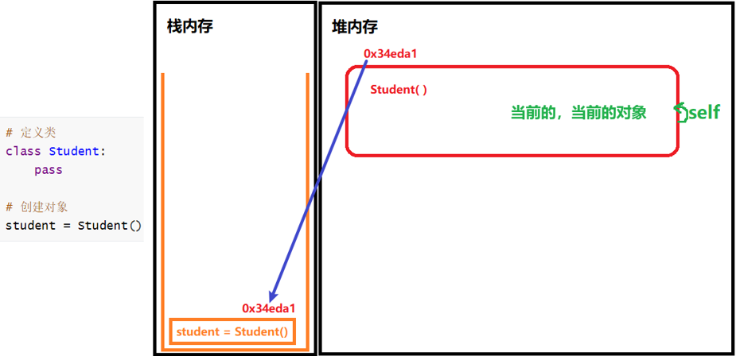

### self关键字

self是一个Python关键字，在面向对象中，self指向了对象本身，可以简单理解为对象本身。self表示当前的、当前的对象。

self出现在类中的函数的形参上，位置必须是第一个参数。
self参数在函数被调用时，不需要调用者传值，哪个对象调用self，就代替哪个对象。

```python
class Student:
    def study(self):
        print("你好")
    def sleep(self):
        print(self)
        self.study()
        Student.study(self)

if __name__ == "__main__":
    stu1 = Student()
    print(stu1) # <__main__.Student object at 0x000001E4FAF6FFD0>
    stu1.sleep() # <__main__.Student object at 0x000001E4FAF6FFD0> 你好 你好
    stu2 = Student()
    print(stu2) # <__main__.Student object at 0x000001E4FAF6FFA0>
    stu2.sleep() # <__main__.Student object at 0x000001E4FAF6FFA0> 你好 你好
    # 类能间接接调用属性方法，但如下写法等价于`stu2.sleep()`
    Student.sleep(stu2) # <__main__.Student object at 0x000001E4FAF6FFA0> 你好 你好
    # 类不能直接调用属性方法，因为没有self参数，否则报错（TypeError: study() missing 1 required positional argument: 'self'）
    # Student.study()
```

### 公开权限

平时写的就是公开权限。

### 对象属性

一个对象通常包含两部分，即方法和属性。

对象属性，有时也称为实例属性、普通属性、公有属性，或者直接叫属性。
属性可以简单理解为与生俱来的特征。
属性在面向对象中，直接使用变量来表示。
属性在类内部、类外部都可以进行获取与使用。
在类的内部定义对象的属性，更符合面向对象编程的思想。

#### 类外面访问属性

在类的外面访问属性，分为添加属性、获取属性。
要访问对象中的属性，需要使用`.`（点）来操作。

在类的外部添加属性的语法：`对象名.属性名 = 值`。

在类的外部获取属性的语法：`对象名.属性名`。当没有添加属性时，无法直接获取属性结果，否则报错。

类名不能直接访问对象属性。

#### 类内部获取属性

在类内部，获取属性的语法：`self.属性`。

在类的内部添加属性，可以使用`__init__`方法。
当没有在`__init__()`中初始化属性时，直接在方法中调用，则会报警告信息。

```python
class Car:
    def run(self):
        print("你好")
    def show(self):
        print(f"{self.color}，{self.brand}", end="\t")
        print(f"{car1.color}，{car1.brand}")  # 在类的内部获取对象属性

if __name__ == "__main__":
    car1 = Car()
    car1.color = "红色"
    car1.brand = "hh"
    # 在类的外面访问属性
    print(f"{car1.color}，{car1.brand}")  # 红色，hh
    car1.show()  # 红色，hh   红色，hh
    car2 = Car()
    # car2.show() # 报错（AttributeError: 'Car' object has no attribute 'color'）
```

### 对象方法

如果一个方法需要访问到对象的实例属性，则可以把这个方法封装成一个对象方法（实例方法）。

### 私有属性

为了更好的限制属性的访问和包含隐私，可以给属性设置私有权限。
当把属性设置为私有属性后，则该属性只能被本类直接访问。
当要定义私有属性时，要在属性名前添加双下划线。
如果要从外部访问私有属性值，建议要在类中定义`set`和`get`方法。

定义私有属性的语法：`self.__属性名`。

设置和获取私有属性值的语法：

```python
class 类名(xxx):
	# 设置私有属性值[set]
    def set_私有属性名(self,参数):
        self.私有属性 = 参数
    # 获取私有属性值[get]
    def get_私有属性名(self):
        return self.私有属性
```

```python
class Father(object):
    def __init__(self):
        self.__money = 100
    def make_something(self):
        print("你好")
    def set_money(self, money):
        if money > self.__money:
            self.__money = money
        else:
            print("啊啊")
    def get_money(self):
        return "￥" + str(self.__money)

class Son(Father):
    pass

if __name__ == "__main__":
    person1 = Son()
    person1.make_something()
    person1.set_money(200)
    print(person1.get_money())
    # print(person1.money) # 报错（AttributeError: 'Son' object has no attribute 'money'）
    # print(person1.__money) # 报错（AttributeError: 'Son' object has no attribute '__money'）
# 以上打印：
你好
￥200
```

### 私有方法

当把方法设置为私有方法后，则该方法只能被本类直接访问。
当把方法设定为私有权限后，则该方法不会被继承给子类。

定义私有方法的语法：

```python
def __方法名(self):
     ...
```

```python
class Father(object):
    def __make_something(self):
        print("你好")
    def do_something(self):
        self.__make_something()
        print("啊啊")

class Son(Father):
    pass

if __name__ == "__main__":
    person1 = Son()
    person1.do_something()
    # person1.make_something() # 报错（AttributeError: 'Son' object has no attribute 'make_something'）
# 以上打印：
你好
啊啊
```

### 类属性

类属性：指的是类所拥有的属性，在整个类中都可以直接使用。

定义类属性的语法：

```python
class 类名(object):
	类属性名 = 值
```

调用类属性的语法：`类名.类属性名`。

实际上，可以通过对象名和类名来调用类属性，但优先考虑使用`类名.类属性名`的形式。所有对象（包括类名）都可以获取到类属性。

访问类属性的方式：
1、通过实例对象访问类属性时，Python会首先检查实例是否有同名属性，若无则自动回退到类属性。当对象（实例）拿到类属性时，类属性就转化为了对象属性。这种方式更符合常规逻辑，因为实例通常代表类的具体对象，直接通过对象名访问更直观。
2、直接通过类名访问类属性时，不依赖具体实例，适用于需要操作类级别的共享属性场景。

```python
class Student(object):
    aaa = "啊啊"

print(Student.aaa)  # 啊啊
Student.aaa = "哈哈"
stu1 = Student()
stu2 = Student()
print(stu1.aaa)  # 哈哈
stu1.aaa = "啊啊"
print(stu1.aaa)  # 啊啊
print(stu2.aaa)  # 哈哈
print(Student.aaa)  # 哈哈
```

### 类方法

类方法：指的是类所拥有的方法。
如果一个方法不需要访问对象的实例属性，但是需要访问到类的类属性，可以把方法封装成一个类方法。

要形成类方法，需满足：
1、使用装饰器`@classmethod`来修饰方法。
2、把方法的第一个参数设置为`cls`。

定义类方法的语法：

```python
class 类名(object):
    @classmethod
    def 类方法名(cls):
        ...
```

调用类方法的语法：`类名.类方法名()`。

类方法一般会和类属性配合使用，尤其是私有类属性。

```python
案例一：
class Dog(object):
    __count = 11
    class Cat(object):
        __count = 22
        money = 200
        def __init__(self):
            self.money = 100
        @classmethod
        def make(self):
            print(self.__count, end='\t')
            print(self.money)
        @classmethod
        def do_something(cls):
            print(cls.__count)

dog1 = Dog()
# dog1.make() # 报错（AttributeError: 'Dog' object has no attribute 'make'）
# Dog.make() # 报错（AttributeError: type object 'Dog' has no attribute 'make'）
# dog1.do_something() # 报错（AttributeError: 'Dog' object has no attribute 'do_something'）
dog1.Cat.make() # 22   200
dog1.Cat().make() # 22   200
Dog.Cat.make() # 22   200
Dog.Cat().make() # 22   200
dog1.Cat.do_something() # 22
dog1.Cat().do_something() # 22
Dog.Cat.do_something() # 22
Dog.Cat().do_something() # 22


案例二：
class Dog(object):
    __count = 11
    class Cat(object):
        __count = 22
        money = 200
        def __init__(self):
            self.money = 100
        def make(self):
            print(self.__count, end='\t')
            print(self.money)

dog1 = Dog()
# dog1.Cat.make() # 报错（TypeError: make() missing 1 required positional argument: 'self'）
dog1.Cat().make() # 22   100
# Dog.Cat.make() # 报错（TypeError: make() missing 1 required positional argument: 'self'）
Dog.Cat().make() # 22   100


案例三：
class Dog(object):
    __count = 11
    class Cat(object):
        __count = 22
        money = 200
        def __init__(self):
            self.money = 100
        def make(self):
            print(self.money, end='\t')
            print(self.__class__.money)
        def do_something(self):
            self.__class__.money = 300 # 在对象方法中，可以通过`self.__class__.属性名`获取当前的类属性并修改值

dog1 = Dog()
dog1.Cat().make() # 100   200
Dog.Cat().make() # 100   200
dog1.Cat().do_something()
dog1.Cat().make() # 100   300
```

### 静态方法

静态方法需要通过装饰器`@staticmethod`来修饰方法，且静态方法不需要定义任何参数。
静态方法会先于类的加载而加载。
可以使用静态方法显示一些文本信息。
如果一个方法不需要访问对象的实例属性，也不需要访问类的类属性时，可以把方法封装成一个静态方法。

定义静态方法的语法：

```python
class 类名(object):
    @staticmethod
    def 静态方法名():
        ...
```

调用静态方法的语法：`类名.静态方法名()`。

```python
class Dog(object):
    @staticmethod
    def do_something():
        print("你好")

Dog.do_something() # 你好
```


## 魔法方法

魔法方法：指的是可以给Python类增加魔力的特殊方法，是系统内置的特殊方法。

特点：
1、总是被双下划线所包围。
2、在特殊时刻会被自动调用，不需要开发者手动去调用。

魔法方法的语法：`__魔法方法名__()`。

常用的魔法方法有：
1、`__init__(self [, ...])`。构造器，当一个对象被初始化创建时，会被自动调用。
2、`__str__(self)`。输出对象名时，若不想直接输出内存地址值，可重写`str()`方法。
3、`__del__(self)`。当一个对象被删除或销毁时，会被自动调用。

当新创建一个对象时，则会自动触发`__init__()`魔法方法。
建议自定义的类中，都有一个`__init__()`魔法方法。
根据根据是否给`__init__()`魔法方法传递参数值，可分为：无参`__init__()`方法、有参`__init__()`方法。

### 无参`__init__()`方法

当仅需在类内部使用与初始化属性时，可以使用该方法。

语法：

```python
class 类名:
	def __init__(self):
        代码
        ...
```

### 有参`__init__()`方法

当想要在创建对象时，直接设定属性值时，可以使用有参`__init__()`方法传递参数值来处理。

`__init__()`方法可以用来设置属性的默认值；不需要给self传递参数值；传递参数个数的计算公式为`传递参数个数 = 定义方法后的参数总个数 - 1`。

语法：

```python
class 类名:
	def __init__(self, 参数1, 参数2,...):
        代码
        ...
```

```python
class Car:
    def __init__(self, color, number): # 有参构造函数
        if color not in ["red", "green", "blue"]:
            self.color = "black"
        else:
            self.color = color
        self.number = number

car1 = Car("你好", 2)
car2 = Car("blue", 4)
car2.color = "green"
print(car1.color)  # black
print(car1.number) # 2
print(car2.color) # green
```

### `__str__()`方法

返回（对象的）内存地址值，也称为引用，默认是继承自object类中打印地址值。

表现形式有：
1、十进制数，如5040624，`id()`函数。
2、十六进制数，如0x45AC6。

当直接输出对象名时，默认输出的是对象的内存地址值。
当在类中定义了`__str__`方法，则获取的是该方法返回的数据结果，但必须返回字符串型的结果。

语法：

```python
class 类名:
	def __str__(self):
        代码
        ...
        return 字符串型的结果
```

```python
class Car1:
    def __init__(self, color, number):
        self.color = color
        self.number = number

class Car2:
    def __init__(self, color, number):
        self.color = color
        self.number = number
    def __str__(self):
        return f"{self.color}，{self.number}"

if __name__ == '__main__':
    car1 = Car1('red', 2)
    car2 = Car2('blue', 4)
    print(car1) # <__main__.Car1 object at 0x00000147B9451FD0>
    print(car2) # blue，4
```

### `__del__()`方法

当删除对象（销毁对象、使用`del 对象名`）时，会自动调用`__del__()`方法；但通过对象来调用`__del__`方法并不会销毁对象。

当程序执行结束时，Python垃圾回收器也会自动销毁内存垃圾，此时会自动调用`__del__()`方法。

语法：

```python
class 类名:
	def __del__(self):
        代码
        ...
```

```python
案例一：
class Car:
    def __init__(self, color):
        self.color = color
    def __del__(self):
        print(f"{self.color}销毁了")

if __name__ == "__main__":
    car1 = Car("red")
    car1.__del__()
    print(car1.color)
# 以上打印：
red销毁了
red
red销毁了

案例二：
class Car:
    def __init__(self, color):
        self.color = color
    def __del__(self):
        print(f"{self.color}销毁了")

if __name__ == "__main__":
    car1 = Car("red")
    car1.__del__()
    print(car1.color)
    car2 = Car("blue")
    car2.__del__()
    print(car2.color)
# 以上打印：
red销毁了
red
blue销毁了
blue
red销毁了
blue销毁了

案例三：
class Car:
    def __init__(self, color):
        self.color = color
    def __del__(self):
        print(f"{self.color}销毁了")

if __name__ == "__main__":
    car1 = Car("red")
    car1.__del__()
    del car1
    # print(car1.color) # 报错（NameError: name 'car1' is not defined）
# 以上打印：
red销毁了
red销毁了
```


## 继承

类的定义方式有三种：
1、`类名`。
2、`类名()`。
3、`类名(object)`，最常见、更规范标准、推荐。

```python
方式一：
class 类名:
    代码
    ...

方式三：
class 类名():
    代码
    ...

方式三：
class 类名(object):
    代码
    ...
```

object类可以称为基类、顶级类或超类。子类，也叫派生类。

在Python面向对象中，继承包含单继承、多继承、多层继承。

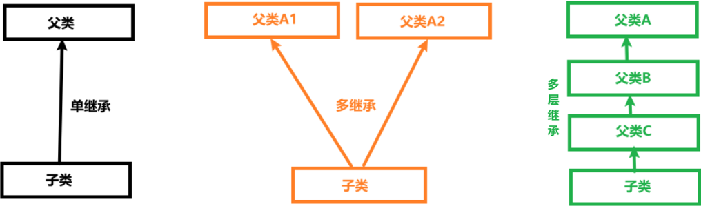

在面向对象中，当子类继承父类后，子类就拥有了父类的非私有属性和非私有方法。
当子类拥有了父类的属性和方法后，能提升代码的复用性。
当子类继承父类后，可以给子类添加新的扩展方法。

当子类同时继承多个父类，且多个父类有同名方法时，可以通过以下方法来查看当前子类对于同名方法的调用顺序：
1、`类名.__mro__`。
2、`类名.mro()`。

### 单继承

单继承：指的是一个子类继承一个父类。

单继承的语法：

```python
class 父类名(object):
    代码
    ...

class 子类名(父类名):
    代码
    ...
```

```python
class Father(object):
    def __init__(self):
        self.aaa = "hhh"
    def make_something(self):
        print("你好")

class Son(Father):
    pass

if __name__ == "__main__":
    person1 = Son()
    print(person1.aaa)
    person1.make_something()
# 以上打印：
hhh
你好
```

**方法重写：**

当子类中出现与父类中同名方法且参数内容保持一致时，称为方法重写。
只有在继承关系中，才有所谓的重写方法。
当父类的同名方法达不到子类的要求，则可以在子类中对方法进行重写。
当子类重写了父类方法后，子类对象优先调用执行子类方法（调用的就是子类自己的方法）。

方法重写的语法：

```python
class 父类名(object):
    def 方法A(self):
    	代码
    	...

class 子类名(父类名):
    def 方法A(self):
    	代码
    	...
```

```python
class Father(object):
    def __init__(self):
        self.aaa = "hhh"
    def make_something(self):
        print("你好")

class Son(Father):
    def make_cake(self): # 重写make_something方法
        print("哈哈")

if __name__ == "__main__":
    print(Son.mro())
    person1 = Son()
    print(person1.aaa)
    person1.make_something()
# 以上打印：
[<class '__main__.Son'>, <class '__main__.Father'>, <class 'object'>]
hhh
你好
```

**调用父类方法：**

当子类要在父类同名方法的基础上，再新增功能且要求在子类中调用同名方法时，就可以使用`super()`。`super()`表示父类。

`super()`语法：`super().方法名([参数1, 参数2, ...])`。

```python
class Father(object):
    def __init__(self):
        self.aaa = "hhh"
    def make_something(self):
        print(self.aaa)
        print(self.bbb)
        print("你好")

class Son(Father):
    def __init__(self, aaa, bbb):
        self.aaa = aaa
        self.bbb = bbb
    def make_something(self):
        print("好的")
        super().make_something()
        # super().super().make_something() # 报错（AttributeError: 'super' object has no attribute 'super'）

if __name__ == "__main__":
    person1 = Son("xxx", "yyy")
    person1.make_something()
    # super().super().make_something() # 报错（RuntimeError: super(): no arguments）
# 以上打印：
好的
xxx
yyy
你好
```

### 多继承

多继承：指的是一个类同时继承了多个父类。

多继承的语法：

```python
class 子类名(父类名1, 父类名2, ...):
    代码
    ...
```

```python
class Father(object):
    def __init__(self):
        self.aaa = "hhh"
    def make_something(self):
        print("你好")
    def do_something(self): # Father类特有的方法
        print("啊啊")

class Bapu(object):
    def __init__(self):
        self.aaa = "xxx"
    def make_something(self):
        print("好的")

class Son(Father, Bapu):
    pass

if __name__ == "__main__":
    print(Son.mro())
    person1 = Son()
    print(person1.aaa)
    person1.make_something()
    person1.do_something()
# 以上打印：
[<class '__main__.Son'>, <class '__main__.Father'>, <class '__main__.Bapu'>, <class 'object'>]
hhh
你好
啊啊
```

### 多层继承

多层继承：指的是多级继承的关系，如子类继承父类C、继续继承父类B、继续继承父类A等。
多层继承表示有多级父类。


## 浅拷贝和深拷贝

浅拷贝需要使用copy模块下的`copy()`函数。`copy(t)`，使用浅拷贝来拷贝信息。

浅拷贝只对可变类型的第一层对象进行拷贝，对拷贝的对象开辟新的内存空间进行存储，但不会拷贝对象内部的子对象。
对于浅拷贝的理解，尽量分为拷贝不可变类型和可变类型的数据来查看。
特点：拷贝父对象，不会拷贝对象的内部的子对象；只会拷贝可变数据类型的第一层对象中的数据；对于多层中嵌套的对象，只复制其地址引用。

深拷贝：指的是拷贝一个对象时，只要发现对象有可变类型就会对该对象到最后一个可变类型的每一层对象进行拷贝，对每一层拷贝的对象都会开辟新的内存空间进行存储。通俗地说，深拷贝就是对一个对象中所有层次的拷贝，即既拷贝了引用，也拷贝了内容。
特点：完全拷贝了父对象及其子对象；会对可变数据类型中的所有对象的数据进行拷贝，生成新内存地址空间。

无论浅拷贝还是深拷贝，对于不可变数据类型，都复制地址引用，不会复制对象中的数据。

当拷贝多层数据时，才能发现深拷贝、浅拷贝的区别在于是否能完全拷贝子对象。

```python
案例一：
import copy
# 使用浅拷贝对不可变数据类型进行操作，只能复制对象的地址值
num = 111
num_cp = copy.copy(num)
print(num) # 111
print(id(num)) # 1660099974960
print(num_cp) # 111
print(id(num_cp)) # 1660099974960

str = 'hello'
str_cp = copy.copy(str)
print(str) # hello
print(id(str)) # 1911306896176
print(str_cp) # hello
print(id(str_cp)) # 1911306896176

tup = (12, 13, 14)
tup_cp = copy.copy(tup)
print(tup) # (12, 13, 14)
print(id(tup)) # 1773553680272
print(tup_cp) # (12, 13, 14)
print(id(tup_cp)) # 1773553680272

# 使用浅拷贝对可变数据类型进行操作，可以复制对象中实际的数据，生成新的地址空间
list1 = [10, 20, 30]
list1_cp = copy.copy(list1)
print(list1) # [10, 20, 30]
print(id(list1)) # 1962778545728
print(list1_cp) # [10, 20, 30]
print(id(list1_cp)) # 1962778642112

dict1 = {"a": "a", "b": "b", "c": "c"}
dict1_cp = copy.copy(dict1)
print(dict1) # {'a': 'a', 'b': 'b', 'c': 'c'}
print(id(dict1)) # 1962777270592
print(dict1_cp) # {'a': 'a', 'b': 'b', 'c': 'c'}
print(id(dict1_cp)) # 1962777336512


案例二：
import copy
# 使用深拷贝对不可变数据类型进行操作时，只能复制对象的内存地址
num1 = 111
num2 = copy.deepcopy(num1)
str1 = "hello"
str2 = copy.deepcopy(str1)
tup1 = (1, 2, 3)
tup2 = copy.deepcopy(tup1)
print(id(num1), id(num2), id(str1), id(str2), id(tup1), id(tup2)) # 1909349504816 1909349504816 1909353401008 1909353401008 1909345538112 1909345538112
# 使用深拷贝对可变数据类型进行操作时，可以复制对象中的数据生成新的内存空间
list1 = [10, 20, 30]
list2 = copy.deepcopy(list1)
dict1 = {"a": 'a', "b": 'b', "c": 'c'}
dict2 = copy.deepcopy(dict1)
print(id(list1), id(list2), id(dict1), id(dict2)) # 1909353425664 1909353402112 1909345441920 1909345508096


案例三：
import copy
m = [1, 2, 3]
n = ["a", "b", "c"]
list1 = [m, n] # 定义多层可变数据类型
list1_copy = copy.copy(list1)
list1_deepcopy = copy.deepcopy(list1)
print(list1)  # [[1, 2, 3], ['a', 'b', 'c']]
print(list1_copy)  # [[1, 2, 3], ['a', 'b', 'c']]
print(list1_deepcopy)  # [[1, 2, 3], ['a', 'b', 'c']]
m.append(4)
print(list1)  # [[1, 2, 3, 4], ['a', 'b', 'c']]
print(list1_copy)  # [[1, 2, 3, 4], ['a', 'b', 'c']]
print(list1_deepcopy)  # [[1, 2, 3], ['a', 'b', 'c']]
print(id(list1), id(list1_deepcopy), id(list1_copy)) # 2747554805376 2747554804480 2747554805120
print(id(list1[0]), id(list1_copy[0]), id(list1_deepcopy[0])) # 2747554736576 2747554736576 2747554804800
print(id(list1[1]), id(list1_copy[1]), id(list1_deepcopy[1])) # 2747554729408 2747554729408 2747554805568
```


## 正则表达式

正则表达式，也叫规则表达式，通常会叫正则。
正则表达式是一种用于模式匹配和搜索文本的工具。
实际上，正则表达式是指符合一定规则的字符串（一段具有特殊含义的字符串），同时它能用于检查一段文本数据是否与某种模式匹配。
正则表达式提供了一种灵活且强大的方式来查找、替换、验证和提取文本数据。
正则表达式可以应用于各种编程语言和文本处理工具中，应用场景有查找数据、校验数据、替换数据。
在正则表达式中，可以使用单个字符或一段字符串来匹配满足正则规则的文本数据。

有一个专门用于处理正则表达式的模块，即`re`。
导入该模块的语法：`import re`。

### 使用re模块

`re`模块的常用方法：
1、`match(pattern, string)`。从左向右匹配，发现不符合的就停止，返回一个已匹配成功的对象（，没有匹配的则报错？）；参数pattern表示正则字符串，参数string表示要匹配的内容。
2、`search(pattern, string)`。从左向右搜索，找到第一个符合的就停止；对整个字符串一个一个地一直匹配，直到最后一个字符。
3、`findall(正则, 匹配的串)`。从左向右，直到最后，匹配所有的符合条件的数据。
4、`sub(正则, 替换的新内容, 匹配的串)`。把匹配的全部数据，替换为新内容。

当成功匹配数据后，结果存放在对象的`group`函数：`group(num=0)`，匹配成功的内容，num默认是0，表示匹配的所有数据结果。
当使用`re`模块未匹配到对应的数据时，会返回`None`。

```python
import re
print(f"结果：{re.match('','').group()}。") # 结果：。
print(re.match("[^0-9]", "123nihao").group()) # 报错（AttributeError: 'NoneType' object has no attribute 'group'）
print(re.search("[^0-9]", "123nihao").group()) # n

regex = "[1][0-9]{10}$"
# 正则表达式匹配的必须字符串
# matcher = re.match(regex, 1886666888844444) # 报错（TypeError: expected string or bytes-like object）
matcher = re.match(regex, "18866668888")
print(matcher)
if matcher is not None:
    print(matcher.group()) # 18866668888
else:
    print(matcher) # None
    # print(matcher.group()) # 报错（AttributeError: 'NoneType' object has no attribute 'group'）

strs = """
啊啊啊
# result = re.match("E:\\\\", "E:\\aaa\\bbb\\哈哈哈\\hhhh").group()
    # 在这里字符串在这里
哈哈哈
"""
print(re.search("字符串", strs).group()) # 字符串
```

### 正则的常见规则

#### 匹配单个字符

使用匹配单个字符的方式，只能匹配一个字符内容

常用的匹配单个字符的语法：
1、`.`。匹配除`\n`之外的任何单个字符，且是字符串中的第一个字符。
2、`[]`。匹配`[]`中列举的字符。
3、`\d`。匹配一个数字字符（纯数字字符），如`[0-9]`。
4、`\D`。匹配一个非数字字符，如`[^0-9]`。
5、`\s`。匹配任何空白字符。
6、`\S`。匹配任何非空白字符。
7、`\w`。匹配非特殊字符，如a-z、A-Z、0-9、_、汉字。
8、`\W`。匹配特殊字符，如非字母、非数字、非汉字等。
9、`X`。`X`代表任意字符；一个普通字符串就能看成是一个正则。

```python
import re
print(f"结果：{re.match('.', 'h').group()}。") # 结果：h。
print(f"结果：{re.match('.', 'python').group()}。") # 结果：p。
print(f"结果：{re.match('.', '你好').group()}。") # 结果：你。
print(f"结果：{re.match('.', ' 哈哈').group()}。") # 结果： 。
# print(f"结果：{re.match('.', '\n').group()}。") # 报错（SyntaxError: f-string expression part cannot include a backslash）
# print(re.match('.', '\n').group()) # 报错（AttributeError: 'NoneType' object has no attribute 'group'）
print(re.match('.', '\\n').group()) # \
print(f"是{re.match('[a-z]', 'z').group()}") # 是z
print(f"是{re.match('[a-z]', 'za').group()}") # 是z
# print(f"是{re.match('[A-Z]', '1').group()}") # 报错（AttributeError: 'NoneType' object has no attribute 'group'）
print(f"是{re.match('[^0-9]', 'a').group()}") # 是a
print(f"是{re.match('[^0-9]', 'ab').group()}") # 是a
# print(f"结果：{re.match('[^0-9]', '1').group()}") # 报错（AttributeError: 'NoneType' object has no attribute 'group'）
# print(f"结果：{re.match('[^0-9]', '1a').group()}") # 报错（AttributeError: 'NoneType' object has no attribute 'group'）
print(re.match('\d', '123').group()) # 1
print(re.match('\D', 'a1').group()) # a
# print(re.match('\D', '1a').group()) # 报错（AttributeError: 'NoneType' object has no attribute 'group'）
print(re.search('\D', '1a').group()) # a
print(re.match('\w', '_1a$').group()) # _
# print(re.match('\w', '$_1a').group()) # 报错（AttributeError: 'NoneType' object has no attribute 'group'）
print(re.match('\W', '$_1a').group()) # $
```

#### 匹配多个字符

常用的匹配多个字符的语法：
1、`X*`。匹配`X`出现0次或无限次（0到多个字符），即可有可无。
2、`X+`。匹配`X`出现1次或无限次（1到多个字符），即至少有1次。
3、`X?`。匹配`X`出现1次或0次，即有一次或一次也没有。
4、`X{m}`。匹配`X`恰好出现m次。
5、`X{m,n}`。匹配X至少m次，但是不超过n次。
6、`X{m,}`。至少m次，且上不封顶。

使用匹配多个字符的方式，（字符串？）可以是一个字符或批量数据内容

```python
import re
# print(f"结果：{re.match('\w*', '').group()}。") # 报错（SyntaxError: f-string expression part cannot include a backslash）
print("结果：{}。".format(re.match('\w*', '').group())) # 结果：。
print("结果：{}。".format(re.match('\w*', 'zz').group())) # 结果：zz。
print("结果：{}。".format(re.match('\w*', '\nzz').group())) # 结果：。
print("结果：{}。".format(re.match('\w*', 'zz\n').group())) # 结果：zz。
print("结果：{}。".format(re.match('\w*', '$zz').group())) # 结果：。
print("结果：{}。".format(re.match('\w*', 'zz$').group())) # 结果：zz。
print("结果：{}。".format(re.match(r'\w*', 'zz$').group())) # 结果：zz。
# print(re.match('\w+', '').group()) # 报错（AttributeError: 'NoneType' object has no attribute 'group'）
print(re.match('\w+', 'abcABC123').group()) # abcABC123
print(re.match('\w+', 'abcABC$123').group()) # abcABC
print(re.match(".+", "www.hhh.com").group()) # www.hhh.com
print(re.match("[0-9][0-9]?", "1").group()) # 1
print(re.match("[0-9][0-9]?", "99").group()) # 99
print(re.match("[0-9][0-9]?", "100").group()) # 10
print(re.match("[1-9]?[0-9]", "88").group()) # 88
print(re.match("[1-9]?[0-9]", "0").group()) # 0
print(re.match("[1-9]?[0-9]", "09").group()) # 0
# print(re.match("[a-zA-Z0-9_]{4, 16}", "ab123ab12AB$").group()) # 报错（AttributeError: 'NoneType' object has no attribute 'group'）
print(re.match("[a-zA-Z0-9_]{4,16}", "ab123ab12AB$").group()) # ab123ab12AB
print(re.match("[a-zA-Z0-9_]{4,16}", "ab123$ab12AB").group()) # ab123
# print(re.match("[a-zA-Z0-9_]{4,16}", "ab1").group()) # 报错（AttributeError: 'NoneType' object has no attribute 'group'）
```

#### 原始字符串

原始字符串：指的是在所有的正则表达式前，最好加上r，即`r"正则表达式"`，这样可以不用给一段文本数据内容进行转义，且能表达原始意义。

```python
import re
# print(re.match("E:\\", "E:\aaa\bbb\哈哈哈\hhhh").group()) # 报错（re.error: bad escape (end of pattern) at position 2）
# print(re.match("E:\\\\", "E:\aaa\bbb\哈哈哈\hhhh").group()) # 报错（AttributeError: 'NoneType' object has no attribute 'group'）
# print(re.match(r"E:\\", "E:\aaa\bbb\哈哈哈\hhhh").group()) # 报错（AttributeError: 'NoneType' object has no attribute 'group'）
print(re.match("E:\\\\", "E:\\aaa\\bbb\\哈哈哈\\hhhh").group()) # E:\
# print(re.match(r"E:\", "E:\\aaa\\bbb\\哈哈哈\\hhhh").group()) # 报错（SyntaxError: invalid syntax）
print(re.match(r"E:\\", "E:\\aaa\\bbb\\哈哈哈\\hhhh").group()) # E:\
```

#### 匹配开头和结尾

匹配开头和结尾语法：
1、`^`。匹配字符串开头；单独使用则表示开始，在`[]`里出现则表示取反。
2、`$`。匹配字符串结尾。

```python
import re
print(re.match("[^0-9]", "g").group()) # g
print(re.match("[^0-9]", "nihao").group()) # n
print(re.match("[^0-9]+", "nihao").group()) # nihao
print(re.match("[^0-9]{2}", "nihao").group()) # ni
print(re.match("[^0-9]{1}", "nihao").group()) # n
print(re.match("[^0-9]{0}", "nihao").group()) # 打印为空
# print(re.match("[^0-9]+", "").group()) # 报错（AttributeError: 'NoneType' object has no attribute 'group'）
print(re.match("www.hhh.com$", "www.hhh.com").group()) # www.hhh.com
# 要同时满足开头（因为正则）和结尾（因为使用了`$`），否则报错
# print(re.match("www.hhh.com$", "www.hhh.com.cn.gov.edu").group()) # 报错（AttributeError: 'NoneType' object has no attribute 'group'）
```

#### 匹配分组

获取分组数据信息的语法：
1、`X|Y`。表示或者，匹配X或Y的任意一个表达式。
2、`(X)`。将括号中字符X作为一个分组用于获取，且从1开始统计分组；正则中的`(X)`是从1开始计算分组，如果要获取分组数据的第1组，则`group()`括号里应该填写1。

```python
import re
print(re.match("[1-9]?[0-9]|100", "100").group()) # 10
print(re.match("100|[1-9]?[0-9]", "100").group()) # 100
print(re.match("100|[1-9]?[0-9]", "88").group()) # 88
print(re.match("100|[1-9]?[0-9]", "08").group()) # 0
print(re.match("100|[1-9]?[0-9]", "008").group()) # 0
print(re.match("100|[1-9]?[0-9]", "188").group()) # 18
print(re.match("(\w{4,12})@(163|126|qq).(com|cn|net)", "hello123A@126.com").group()) # hello123A@126.com
print(re.match("(\w{4,12})@(163|126|qq).(com|cn|net)", "hello123A@126.com").group(0)) # hello123A@126.com
print(re.match("(\w{4,12})@(163|126|qq).(com|cn|net)", "hello123A@126.com").group(1)) # hello123A
print(re.match("(\w{4,12})@(163|126|qq).(com|cn|net)", "hello123A@126.com").group(2)) # 126
print(re.match("(\w{4,12})@(163|126|qq).(com|cn|net)", "hello123A@126.com").group(3)) # com
```


## Python连接MySQL

### pymysql模块安装

如果要使用Python和MySQL数据库进行交互，则要借助一个第三方模块，即`pymysql`。

安装pymysql模块：`pip install pymysql`。也可以使用pycharm可视化界面安装。
有时使用`pip install xxx`命令安装时较慢，如果要提升pip下载的速度，可采用`pip install 模块名 [-i 镜像源地址]`命令。
如果是全局安装（无虚拟环境），则模块会安装到系统Python的`site-packages`目录。

在国内的镜像源（镜像来源）中，有很多可供使用的镜像源地址：
1、豆瓣，http://pypi.douban.com/simple/。
2、阿里云，http://mirrors.aliyun.com/pypi/simple/。
3、清华大学，https://pypi.tuna.tsinghua.edu.cn/simple。
4、中国科技大学，https://pypi.mirrors.ustc.edu.cn/simple/。
5、华中理工大学，http://pypi.hustunique.com/。
6、山东理工大学，http://pypi.sdutlinux.org/。

当成功安装pymysql模块后，可直接导入模块：`import pymysql`。

### pymysql操作步骤

在实际开发环境中，数据库和数据表都是提前建好的。一般情况下，很少使用编程语言来建库或建表。

在Python中，使用pymysql模块来操作MySQL数据的基本步骤：创建connection》获取cursor（游标）》执行查询、执行命令、获取数据、处理数据》关闭cursor》关闭connection。

操作步骤说明：

```python
import pymysql
# 1、创建连接对象
db_conn = pymysql.connect()
# host，IP地址。127.0.0.1
# port，端口号。3306
# user，用户名。root
# passwd，密码。123456
# db，数据库名。test
# charset，编码格式。utf8
# 2、创建（获取）游标对象
db_cursor = db_conn.cursor()
# 3、定义sql（可以是DDL DML DQL），使用游标对象执行SQL并进行增删改查
db_cursor.execute(sql) # 或execute(sql[, 占位符需要的参数])
# 增 insert into 表名[(字段1, 字段2.....)] values(值1, 值2.......)[(值1, 值2.......)(值1, 值2.......)]
# 删 delete from 表名 [where 条件]
# 改 update 表名 set 字段1=值1[,字段2=值2.......]
# 查 select * from 表名
# 4、关闭游标对象
db_cursor.close()
# 5、关闭连接对象
db_conn.close()
```

### connection对象

在使用MySQL数据库前，要先登录并进行连接（如通过命令行、DataGrip的方式）。
在使用pymysql模块时，也要登录并进行连接，且要使用connection对象。

connection用于建立与数据库的连接，需要使用pymysql模块来调用。
函数`connect(host=None, port=0, user=None, password="", database=None, charset='',...)`，用于创建Connection连接对象。
1、host：表示连接MySQL的IP地址；若为本机，则可表示成`localhost`或`127.0.0.1`；若为其它计算机，则表示为具体IP地址。
2、port：表示连接的MySQL的端口号，默认是3306。
3、user：表示连接的用户名，默认是root。
4、password：表示连接的密码。
5、database：表示数据库的名称。
6、charset：表示采用的编码方式，设定为utf8即可。

连接对象的常用函数：
1、`cursor()`。用于返回cursor对象，可使用该对象来执行SQL语句并获取结果。
2、`commit()`。用于事务提交，在进行数据操作时，要进行事务提交后才会生效。
3、`close()`。用于关闭连接，释放资源。

使用pymysql模块时，默认开启了事务，因此要让数据操作（插入数据、修改数据、删除数据）生效，则要进行事务提交；如果是查询操作，则可以提交，也可以不提交。
为了节约系统内存资源，通常在使用完Connection连接对象后，要进行`close()`关闭连接。

### cursor对象

执行SQL语句时，要使用cursor对象，可通过connection对象的`cursor()`方法进行创建。

cursor对象的常用函数：
1、`execute(operate [, param])`。用于执行SQL语句，返回受影响的行数；参数operate为字符串类型，表示SQL语句；param参数是可选项，参数parameters为列表类型，表示SQL语句中的参数。
2、`fetchone()`。在执行查询语句时，获取查询结果集的第一行数据，返回一个元组，即`(v1, v2,...)`。
3、`fetchall()`。在执行查询时，获取结果集的所有行，返回一个元组，即`((v11, v12,...), (v21, v22,...),...)`。
4、`fetchmany(n)`。查询n条。
5、`close()`。关闭cursor对象，释放资源。

使用`execute()`执行SQL语句时，SQL语句应写成字符串型。
当关闭connection和cursor对象时，要先关闭cursor游标、后关闭connection连接。

### 数据记录操作

#### 准备数据表

通常情况下，在使用pymysql模块前，会先创建好数据库和数据表字段信息。

```python
# 使用MySQL命令：
# 1、创建名为db_students的数据库，并设定为utf8编码
create database if not exists db_students charset utf8;
# 2、使用库
use db_students;
# 3、查看表信息
show tables;
# 4、创建表，包含编号id、姓名name、性别gender、年龄age字段。
create table if not exists student(
    id int primary key auto_increment,
    name varchar(20),
    gender varchar(10),
    age int
) engine = InnoDB default charset utf8;
# 5、查看表字段
desc student;
# 6、查看表数据
select * from student;
```

#### 插入数据

使用pymysql来给表内添加数据。

```python
import pymysql
conn = pymysql.connect(
    host='127.0.0.1',
    port=3306,
    user='root',
    passwd='123456',
    db='db_students',
    charset='utf8'
)
cur = conn.cursor()
sql = "insert into student(name, gender, age) values ('哈哈', '男', 28),('啊啊', '女', 38)"
cur.execute(sql)
conn.commit() # 提交事务
cur.close()
conn.close()
```

#### 修改数据

当数据显示有误时，就要修改数据内容。

```python
import pymysql
conn = pymysql.connect(
    。。。
)
cur = conn.cursor()
# sql = "update student set age=19, name = '你好' where id=2"
sql = "update student set gender='Male' where gender='男';"
# 若要修改数据表的数据内容，必须先已存在该数据。
res = cur.execute(sql)
print(res) # 1
conn.commit()
cur.close()
conn.close()
```

#### 删除数据

当数据内容已失效时，就需要来删除数据内容。

```python
import pymysql
conn = pymysql.connect(
    。。。
)
cur = conn.cursor()
sql = "delete from student where id=2"
res = cur.execute(sql)
print(res)
conn.commit()
cur.close()
conn.close()
```

#### SQL注入

在使用`execute()`操作数据时，如果采用硬编码的方式，则会存在不够灵活、SQL注入的问题。

SQL注入：指的是恶意篡改或注入SQL条件。
使用sql语句拼接字符串参数会导致sql注入，如在sql语句中加` or 1=1`。
当开发者的数据条件被恶意篡改，就达不到预期的查询效果。

```mysql
# SQL注入的案例：
use db_students;
insert into student(name, gender, age) values ('哈哈','男',28);
insert into student(name, gender, age) values ('啊啊','女',38);
select * from student where age=22;
# SQL注入方式一：
# select * from student where age=22 or age>0;
# SQL注入方式二：
select * from student where age=22 or 1=1;
```

#### 语句参数化

如果要解决SQL注入的问题，在pymysql模块中，可采用语句参数化来解决。
语句参数化是指以`%s`表示值，再传入具体的参数值进行替换。

在进行语句参数化时，使用的`execute()`方法要传递两个参数。

```python
import pymysql
conn = pymysql.connect(
    。。。
)
cur = conn.cursor()
name = input("请输入姓名：")
gender = input("请输入性别：")
age = int(input("请输入年龄："))
params = [name, gender, age]
sql = "insert into student(name,gender,age) values(%s,%s,%s)"
res = cur.execute(sql, params)
print(res)
conn.commit()
cur.close()
conn.close()
```

#### 查询数据

查询数据，要使用cursor对象的函数。

```python
import pymysql
conn = pymysql.connect(
    。。。
)
cur = conn.cursor()
name = input("请输入您要查询的姓名：") # 输入`你好`
params = [name]
sql = "select * from student where name = %s"
cur.execute(sql, params)

# result = cur.fetchone()
# print(result) # (1, '你好', '男', 28)

result_all = cur.fetchall()
print(result_all) # ((1, '你好', '男', 28), (2, '你好', '女', 38))
for row in result_all:
    print(row)
for id, name, gender, age in result_all:
    print(id, name, gender, age)
# conn.commit() # 查询数据操作不需要提交事务。但还是建议提交，这样可以避免与CRUD的差异化。
cur.close()
conn.close()
```


# 扩展知识

## lambda架构

lambda架构：`batch layer`，离线层；`speed layer`，速度层，主要用于做实时计算；`service layer`，主要用于做合并计算。
kappa架构：流批一体（实时流、批处理，一条链路解决实时和离线计算）。

## 事务

事务：一系列数据库操作放在一起成为一个整体。
事务是数据库管理系统（DBMS）执行过程中的一个逻辑单位，该逻辑单位由一组不可再分的数据操作指令构成。

事务具备ACID特性，即原子性、一致性、隔离性、持久性，没这些特性就没事务。

1、原子性（Atomicity）：
事务就像是一个不可分割的整体，包含在其中的所有操作，要么全部成功执行，要么全部不执行。一旦在事务执行过程中出现错误，系统会回滚（Rollback）到事务开始之前的状态，就好像这些操作从未执行过一样。

2、一致性（Consistency）：
事务在执行前后，数据库都必须保持一致性状态，即事务的执行不能破坏数据库原本的数据完整性约束，像主键约束、外键约束、业务规则等都不能被打破。

3、隔离性（Isolation）：
当多个事务并发执行时，它们之间要相互隔离，一个事务的执行不能受到其它事务的干扰。不同的隔离级别会对事务之间的可见性和并发问题产生不同的影响。
常见的隔离级别有：
①读未提交（Read Uncommitted）：一个事务可以读取另一个未提交事务的数据，这种隔离级别可能会导致脏读问题。
②读已提交（Read Committed）：一个事务只能读取其它已经提交事务的数据，避免了脏读，但可能会出现不可重复读的情况。
③可重复读（Repeatable Read）：在同一个事务中，多次读取同一数据的结果是相同的，不过可能会出现幻读问题。
④串行化（Serializable）：这是最高的隔离级别，它通过强制事务串行执行来避免所有的并发问题，但是会牺牲系统的性能。

4、持久性（Durability）：
一旦事务成功提交，它对数据库所做的修改就会永久保存下来，即使数据库系统出现故障也不会丢失。通常，这一特性是通过数据库的日志（如redo log）来实现的。


